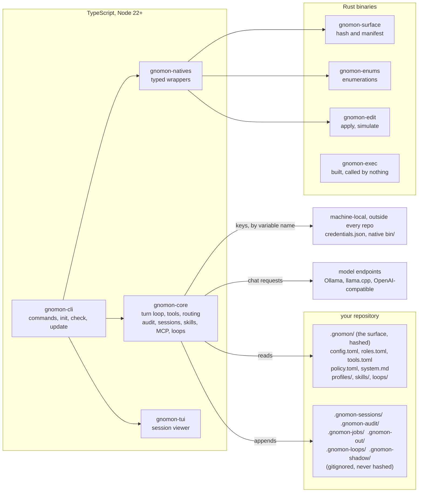
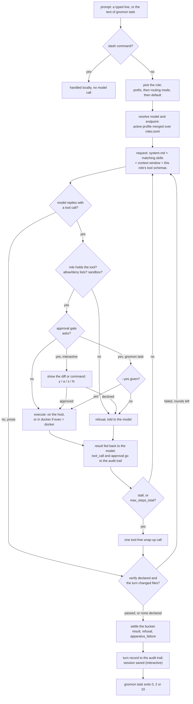
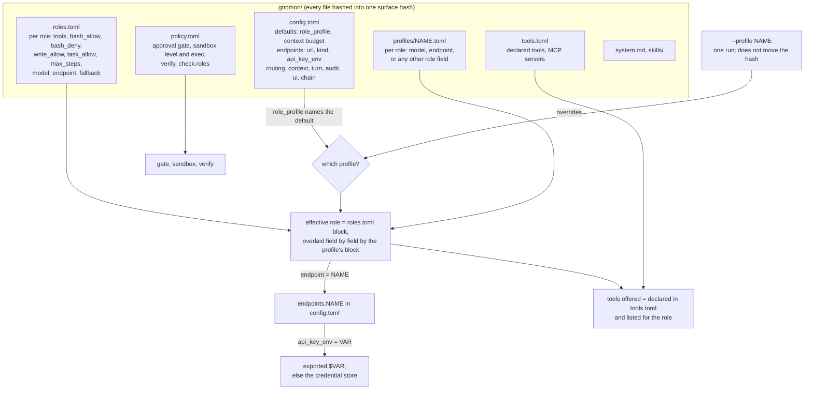
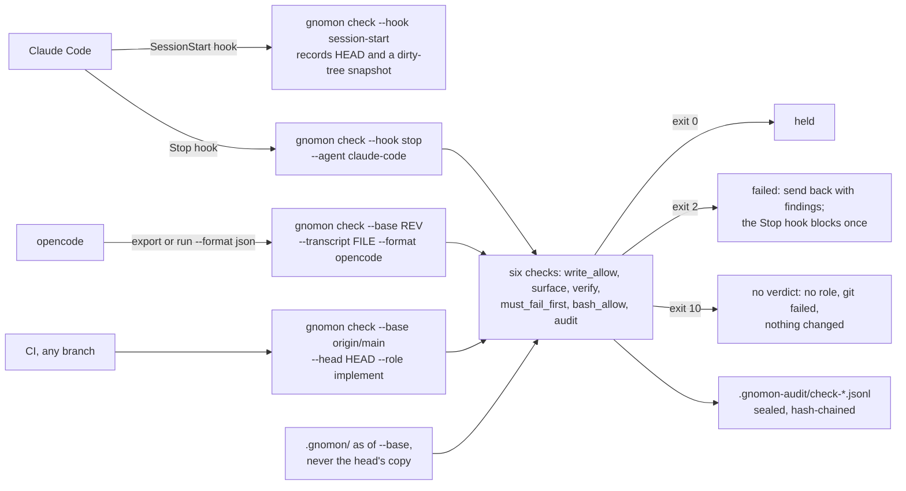
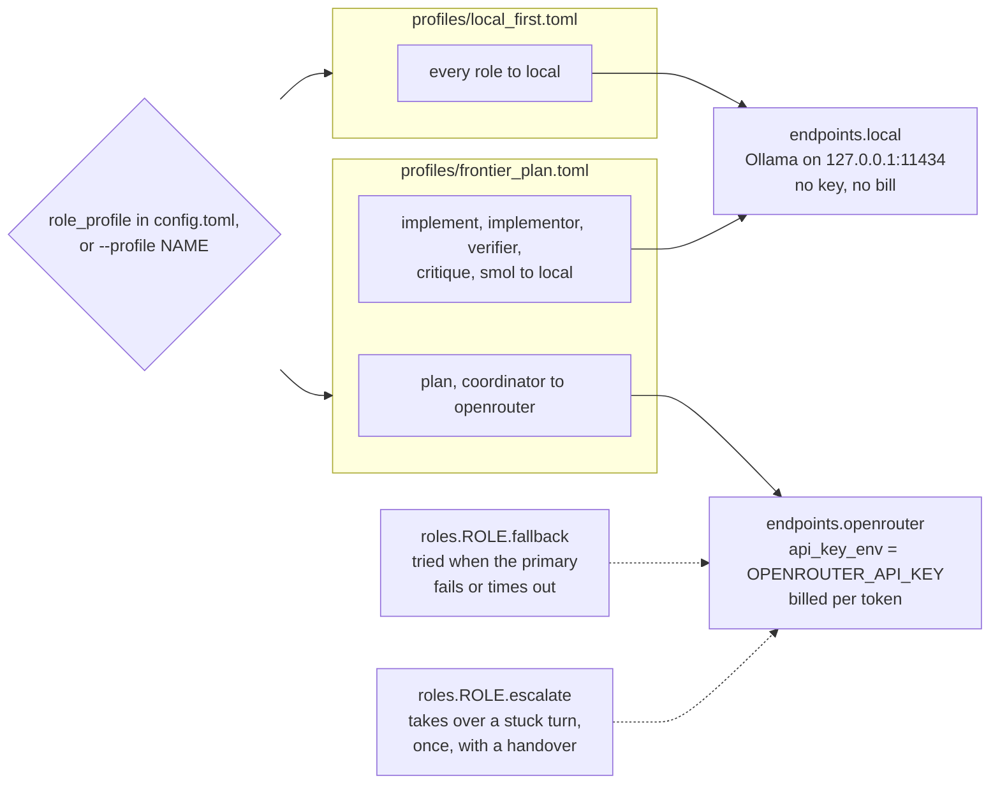

# The gnomon guide

A white paper and a how-to, for two readers:

- **People** deciding whether to adopt gnomon, and then adopting it.
- **AI agents** asked to install, configure or troubleshoot gnomon for someone.
  [Section 11](#11-for-agents-configuring-gnomon) is your procedure. Read
  [The Six Rules](../README.md#the-six-rules) first, because the procedure
  preserves them.

[README.md](../README.md) is the reference; this guide is the path through it.
Its commands were run against gnomon 0.3.1 (`master` at `bc8f27a`) and every
TOML snippet was loaded by that build (install pins below name the latest
release, v0.6.7. v0.6.0 added `gnomon security test`, `gnomon compliance`
(with `dataflow` and `pack`), `gnomon eval` and `gnomon audit metrics`; v0.6.1
extends them to the other harnesses `gnomon guard` governs, v0.6.2 lets
`gnomon eval` measure those harnesses too, and v0.6.3 fixes what a
multi-machine shadow test found (a `cd` out of the project no longer turns
the guard off, secrets read through `grep -r` and globs, eval cells that held
the trial specs) and adds the opt-in `[approval] readonly_bash`. v0.6.4
adds a live trace you can follow (reasoning, steps, delegated turns,
skills), reads reasoning in every shape the 2026 model families send it, and
sends a provider's own reasoning objects back in its shape; v0.6.5 fixes a
guard error on words that only look like a glob; v0.6.6 adds governed
self-improvement (`gnomon proposals`, `gnomon memory`, `gnomon improve`), the
dashboard v2, guard adapters for Cursor hooks v2, Codex CLI, Qwen Code and
Copilot, `gnomon skill export`, nine distinct terminal themes, and context
windows read from the endpoint in the background; v0.6.7 adds `hashline` edits, a harness
signature on eval reports, failure attribution, `gnomon eval --ablate`, a policy
linter, `gnomon audit scan`, sandbox probes and regression trials from incidents. v0.4.4
and v0.4.5 were drafted and never published, so v0.5.0 was the first release
with `gnomon task --deadline`, the completion
gate, the sweep knobs, replay on by default for hosted endpoints, the docker
isolation fixes, and the opt-in finish gate, deliverable-first notes,
first-token watchdog, soft-timeout shell and governance levels;
sections added since say which version they describe);
[Appendix A](#appendix-a-how-this-guide-was-verified) says how, and what was
not exercised.

**Contents**

1. [What gnomon is, in one page](#1-what-gnomon-is-in-one-page)
2. [Architecture](#2-architecture)
3. [Install](#3-install)
4. [Quick start: five minutes to a first useful result](#4-quick-start-five-minutes-to-a-first-useful-result)
5. [Model setup recipes](#5-model-setup-recipes)
6. [The commands that matter](#6-the-commands-that-matter)
7. [Use-case patterns](#7-use-case-patterns)
8. [Configuration essentials](#8-configuration-essentials)
9. [Troubleshooting](#9-troubleshooting)
10. [FAQ](#10-faq)
11. [For agents configuring gnomon](#11-for-agents-configuring-gnomon)

---

## 1. What gnomon is, in one page

**The problem.** Ask most coding agents *why did you do that?* and there is
nothing to point at. What they may do is spread across global dotfiles,
environment variables and per-machine state. Two people get different behaviour
from the same repository, and nobody can say which difference mattered.

**The idea.** In gnomon, behaviour is a property of the repository. One
directory, `.gnomon/`, declares the models, the roles, which tools each role may
call, when it must ask permission, and how context is kept. That directory is
content-hashed, and the hash is stamped on every session and audit record. If
the behaviour changed, the hash changed, and `git diff .gnomon/` shows which
file moved. Clone the repository on another machine and you get the same agent.

**What you get, and the mechanism behind each:**

| Property | Mechanism |
|---|---|
| Same agent on every machine | Everything lives in `.gnomon/` and is hashed. There is no global config file. |
| Roles separated by capability, not by asking nicely | A role is offered only the tools it holds. The `verifier` has no `write` tool to call. |
| Nothing changes your repo unseen (default gate) | Writes, edits and shell commands show a diff or the command, then wait for you. |
| The agent cannot rewrite its own rules | `write` and `edit` refuse paths in `.gnomon/`. `bash` can't be blocked honestly, so the hash is re-read after each command and any change is reported. |
| A record you can check | A hash-chained JSONL audit trail, switched on in every surface `gnomon init` writes. It holds decisions and outcomes, not prompt text. |
| Outcomes a script can branch on | Every step lands in one of three buckets (`result`, `refusal`, `apparatus_failure`), and the exit codes are a published contract. |
| Governance for other harnesses | `gnomon check` judges a change that Claude Code, opencode or a CI branch made, using this repository's rules. |
| Local, cloud, or both | Each role picks its own endpoint and model: Ollama, llama.cpp or any OpenAI-compatible API. |

**What it is not.** gnomon does not make a model complete more tasks. It was
measured against opencode on 34 paired Terminal-Bench tasks with the same model
on 2026-09-02 (v0.2 line): 50.0% against 47.1%, p = 1.0
([POSITIONING.md](POSITIONING.md)). That is no
measurable difference. What gnomon adds is determinism, capability separation
and a record of what happened.

**A good fit if** you want an agent whose configuration you commit and review
like code; you run local or self-hosted models, or mix them with cloud ones; you
must be able to say afterwards what an agent was allowed to do; or you want a
governance layer over the agents you already use.

**A poor fit if** you need cloud or background execution (there is no queue
and no daemon), HTTP/SSE MCP servers (only stdio is wired), the widest provider
support (there are two request shapes: `openai` and `ollama`), or an editor
that does not speak the Agent Client Protocol: gnomon runs in the agent panel
of ACP editors such as Zed and JetBrains IDEs ([7.8](#78-in-your-editor-gnomon-acp)),
and has no extension of its own for any other.
Status is **pre-1.0**: interfaces can still move, and the README's
[Known Limits](../README.md#known-limits) is specific on purpose.

---

## 2. Architecture

### 2.1 Components



Rust owns the surface hash (`conformance/manifest_golden.json` pins it), and
the TypeScript loop computes the same hash independently, with a test keeping
them in agreement. No Rust runs inside a turn. Only `surface`, `enumerations`,
`session`, `apply` and `simulate` need the native binaries.

### 2.2 One turn, end to end



- **The model is only offered the tools its role holds.** A tool it invents is
  refused by name.
- **Policy refuses before the gate asks.** `bash_allow`, `bash_deny`,
  `write_allow`, `task_allow` and the sandbox say no without asking you.
- **No composite verdict.** Each step keeps its own bucket; the exit code is
  settled from the *terminal* step ([CONTRACTS.md](CONTRACTS.md) §1).
  `max_steps` is a checkpoint (compact, continue in a new leg);
  `max_steps_total` is the wall.

### 2.3 The surface, and how its files combine



The rule to remember: **a profile is merged over `roles.toml` field by field,
and the profile wins.** A fresh scaffold's `profiles/local_first.toml` routes
`plan`, `implement`, `critique` and `smol`, so editing their `model` in
`roles.toml` changes nothing (gnomon warns at startup).
[Section 5.0](#50-where-routing-lives-and-a-one-time-step) avoids the trap.

### 2.4 gnomon as a governance layer over other harnesses



gnomon's own loop refuses a call *before* it runs; `gnomon check` judges a
change *after* another harness made it, before you accept it. The rules come
from the base revision, so a change that widens its own `write_allow` is still
judged by the old list.

The full guide to governing another harness (support matrix, governance levels
for foreign harnesses, host-tool classification, liveness, the audit feed,
`gnomon check --scorecard` and the known bypasses) is
[GOVERNING-OTHER-HARNESSES.md](GOVERNING-OTHER-HARNESSES.md).

### 2.5 Hybrid routing: local and cloud



The enumerations publish three profile names: `local_first`, `frontier_plan`
and `all_remote`. `gnomon init` ships only `local_first.toml`;
[section 5.3](#53-hybrid-plan-in-the-cloud-implement-locally) has the other
two. A profile with no file is reported at startup and ignored.

---

## 3. Install

**Requirements**

| Need | For |
|---|---|
| Node 22 or newer, with npm | everything |
| A model endpoint: local Ollama, llama.cpp or any OpenAI-compatible server, or a cloud key | any turn |
| git | `gnomon check`; also what makes `.gnomon/` worth committing |
| Git for Windows (Windows only) | the POSIX shell the `bash` tool uses on every platform |
| pnpm 9 and a Rust toolchain | building from source only |
| docker (optional) | `[sandbox] exec = "docker"` |

### 3.1 The installer (recommended)

```bash
# Linux / macOS
curl -fsSL https://raw.githubusercontent.com/eljaplacido/gnomonharness/master/scripts/install.sh | sh
```

```powershell
# Windows, PowerShell 5.1 or 7
irm https://raw.githubusercontent.com/eljaplacido/gnomonharness/master/scripts/install.ps1 | iex
```

It checks for Node 22+ and npm (if missing, it prints the command for your OS
and stops; it never installs Node as root), resolves the latest release,
installs the npm package (from the npm registry when that version is there,
otherwise from the release's own tarballs; from v0.5.0 a plain
`npm i -g gnomon-harness` gets the latest release too), and puts the native binaries in
`~/.local/share/gnomon/bin` (`%LOCALAPPDATA%\gnomon\bin` on Windows). No sudo:
if npm's global prefix is not writable it installs under `~/.local`. Every
download is checked against the release's `SHA256SUMS`.

| Variable | Effect |
|---|---|
| `GNOMON_VERSION=0.6.7` | Pin a published release (`curl … \| GNOMON_VERSION=0.6.7 sh`); a draft release cannot be installed |
| `GNOMON_NPM_PREFIX` | Where npm installs |
| `GNOMON_NO_NATIVE=1` | Skip the native binaries |
| `GITHUB_TOKEN` | Lift GitHub's anonymous API rate limit |

Native binaries exist for **linux-x64, linux-arm64, darwin-arm64 and
windows-x64**. On an Intel Mac, `surface`, `enumerations`, `session`, `apply`
and `simulate` will not work unless you build from source; everything else does.

### 3.2 Release tarballs, by hand

The four packages are one program split up, so npm needs all four URLs:

```bash
V=0.6.7
B=https://github.com/eljaplacido/gnomonharness/releases/download/v$V
npm i -g $B/gnomon-core-$V.tgz $B/gnomon-natives-$V.tgz \
         $B/gnomon-tui-$V.tgz  $B/gnomon-harness-$V.tgz
```

```powershell
$V="0.6.7"
$B="https://github.com/eljaplacido/gnomonharness/releases/download/v$V"
npm i -g "$B/gnomon-core-$V.tgz" "$B/gnomon-natives-$V.tgz" "$B/gnomon-tui-$V.tgz" "$B/gnomon-harness-$V.tgz"
```

This route skips the native binaries: unpack the release's
`gnomon-<version>-<platform>.tar.gz` and point `GNOMON_BIN_OVERRIDE` at it
([GETTING_STARTED.md](../GETTING_STARTED.md#prebuilt-binaries--if-you-would-rather-not-install-rust)
has the commands, with checksum verification).

### 3.3 From source

```bash
corepack enable pnpm
pnpm setup && exec $SHELL         # once: pnpm's own step, sets PNPM_HOME
git clone https://github.com/eljaplacido/gnomonharness.git ~/gnomon
cd ~/gnomon && pnpm run setup     # deps, Rust binaries, tsc, gnomon on PATH
```

`pnpm setup` and `pnpm run setup` are different commands; you need both, in
that order. Without Rust, `setup` skips the binaries and says so. To skip the
global link, run `~/gnomon/gnomon <command>` from any project. Windows steps:
[GETTING_STARTED.md](../GETTING_STARTED.md).

### 3.4 Verify the install

```bash
gnomon --version        # gnomon/0.6.7+npm for a release install; +<commit> from a checkout
gnomon enumerations     # prints the enumerations JSON: proves the native binaries are found
```

### 3.5 Update and uninstall

| Want | Command |
|---|---|
| See whether a newer release exists | `gnomon update --check` |
| Update the way this copy was installed | `gnomon update` (alias `upgrade`). From a checkout it prints the git commands instead. |
| Silence the once-a-day "newer version" line | `gnomon update --notice off`, or `GNOMON_NO_UPDATE_CHECK=1` |
| Remove it | `gnomon uninstall` prints the exact commands for how this copy was installed, including any loops it scheduled. It runs nothing. |

Updating gnomon **never rewrites a project's `.gnomon/`**. To adopt newer
scaffold defaults, run `gnomon migrate --check` in the project, then
`gnomon migrate`, then review `git diff .gnomon/`.

---

## 4. Quick start: five minutes to a first useful result

### 4.0 Get started in 3 steps

```bash
cd my-project
gnomon setup
```

1. **Scan your machine and plug in a local model it can run.** Setup prints
   the probe below (OS, RAM, each GPU, which model servers answer), then
   recommends a model from its dated catalog (`packages/gnomon-cli/catalog/models.toml`)
   with the reason. With 24 GB of GPU memory or 64 GB of unified memory that
   is `qwen3.6:35b`: gnomon measured it solving 24 of 32 tasks alone on an
   RTX 5090 in R1H; later runs of the same lane solved 22 of 29 (R3R, v0.4.0)
   and 18 of 32 (LG1), so read it as "about two thirds". On an NVIDIA GB10 it
   solved 18 of 32 (R1). Smaller machines get
   `gpt-oss:20b`, `qwen3:14b`, `qwen3:8b` or `qwen3:4b`, each marked "not
   measured by gnomon". A model you already have is offered without a
   download. A download happens only on your yes, through Ollama, with its
   size and your free disk shown first; llama.cpp, LM Studio and vLLM users
   get the command to run instead. Then a ~10 s speed check, if you want it.
2. **Connect a cloud model (optional).** OpenCode Go, OpenRouter, OpenCode
   Zen or any OpenAI-compatible URL. The key is read hidden and stored where
   `gnomon key set` stores it, never in `.gnomon/`. Checking it with one token
   is a separate yes. With a cloud model, setup suggests local only or cloud
   first and never suggests **hybrid**; you pick it by typing `hybrid` or with
   `--mode hybrid`: the cloud plans (`coordinator`, `plan`), this machine
   builds (everything else; the `frontier_plan` shape of §5.3). Treat it as opt-in, not a quality
   upgrade: on an RTX 5090 an early hybrid lead (R1H) did not reproduce (R3R,
   R4H); on an NVIDIA GB10 it solved 22/32 vs 16/31 local-only (M2, McNemar
   p = 0.07). The v0.5.0 release runs' cost figures (about 23% of cloud-only's
   cloud cost) are for a different mode, local-first with cloud rescue (a
   cloud model takes over a stuck local turn; opt-in,
   `[roles.<name>.escalate]`), which ships in v0.5.0 and which setup does not
   configure (§5.3). See [HYBRID.md](benchmarks/HYBRID.md). A slow,
   small/medium or CPU-bound local model leads to cloud first, with hybrid
   named beside it as an opt-in cost mode; those speed thresholds are
   provisional and say so.
3. **Accept the diff, then `gnomon launch`.** The change to `.gnomon/` is shown
   as a diff and written only on your yes. The surface hash moves, so a
   surface that now sends a key somewhere new is shown to you for trust at the
   next launch. Machine facts go to `.gnomon-setup.json` (gitignored);
   `gnomon doctor` compares them with the machine any time, says what needs
   doing, and changes nothing.

Hybrid control (`off`, `observe`, `ask`, `auto`) is recorded as a preference,
`observe` by default. It does nothing: setup writes no escalation block, and
local-first cloud rescue is declared by hand with `[roles.<name>.escalate]`
(§5.3); setup says so when it records it.

For a script: `gnomon setup --json` prints the recommendation and the diff and
exits 4 without writing; `--yes` writes it, and `--yes --expect-proposal
<proposal.digest>` writes only that reviewed change (exit 3 if the surface or
the plan moved since). `--yes` never downloads or spends:
add `--pull qwen3.6:35b` to download, `--speed-check` to measure, and
`--cloud-endpoint opencode-go --cloud-model deepseek-v4.1-flash` for a cloud
model. `gnomon launch` offers the same guided setup first whenever no model
answers.

### 4.1 On a local model (Ollama)

```bash
ollama pull qwen3:8b       # any chat model with tool support; skip if Ollama already serves one
cd my-project
gnomon launch
```

`launch` runs `init`, which asks Ollama on `127.0.0.1:11434` what it serves and
writes real tags (the largest model under about 70B for the reasoning roles,
the smallest one able to summarise for `smol`). If the project declares a check
(a `verify`, `check` or `test` script in `package.json`, or `Cargo.toml`,
`go.mod`, Python test config, a Makefile `test:` target), `init` switches it on
as `[verify]`. It also turns the audit trail on and gitignores the run
directories. It prints what it found on the machine, too: OS, CPU cores, RAM, each
GPU with its memory (unified memory on Apple Silicon and NVIDIA GB10), and
which of Ollama, LM Studio (:1234), llama.cpp (:8080) and vLLM (:8000) answer
on 127.0.0.1. That probe only reads; it writes nothing and chooses nothing. Then the session opens; the banner names the project, role, model,
and the tools the role does **not** hold. If Ollama is not running, `launch`
offers a picker first: Guided setup (`gnomon setup`, the default), Ollama,
OpenRouter, OpenCode Go, OpenCode Zen, Custom or Skip. When no model server
answered at all, `init` writes the model the catalog recommends for this
machine (the tag `gnomon setup` would offer, not installed yet) for every
role; `gnomon setup --pull <tag>`, or `ollama serve` if the model is already
there, makes it answer, and `gnomon doctor` checks every role.

### 4.2 On a cloud model

```bash
cd my-project
gnomon launch
```

With no local model answering, `launch` offers the picker. Choose OpenRouter,
OpenCode Go or OpenCode Zen. It asks for the key (input hidden, stored outside
the repository), lists the models the endpoint serves, and runs one token
through your choice. Only then does it write the endpoint into `.gnomon/`,
point every role at the model, and open the session.

If a local model already answers, there is no picker. Add the cloud endpoint
explicitly:

```bash
gnomon endpoint add --preset openrouter      # or opencode-go | opencode-zen
```

> Whenever the picker or `gnomon endpoint add` chose the model (rather than
> `init`'s detection), later startups print `⚠ … model = "…" is ignored:
> role_profile "local_first" sets …` for `plan`, `implement`, `critique` and
> `smol`. The warning is accurate and harmless: those roles are routed by
> `profiles/local_first.toml`.
> [Section 5.0](#50-where-routing-lives-and-a-one-time-step) clears it for good.

### 4.3 The first useful result

Start read-only. Reads and searches never ask for approval under the default
`on_write` gate:

```
implement ▸ Where is this project's entry point, and how are its tests run? Answer from the files.
```

Then ask for a small, reversible change, with a clean git tree. Nothing is
written until you have seen the diff:

```
  ┌ approve: edit src/lib.ts (+1 −1)
  │ - return a - b;
  │ + return a + b;
  └ [y]es · [a]ll this turn · [s]ession · [N]o
```

`a` approves the rest of this turn and `s` the rest of the session; both are
recorded as standing approvals. When anything is unclear, ask the harness, not
the model: `/explain endpoints`, `/explain approval` read your live surface and
make no model call.

Prefer one shot from a script? The exit code carries the outcome:

```bash
gnomon task "add a unit test for add()" --yes      # 0 result, 2 refusal, 10 apparatus_failure
```

---

## 5. Model setup recipes

Two request shapes exist: `kind = "ollama"` (Ollama's `/api/chat`) and
`kind = "openai"` (any `/v1/chat/completions` server). **Always write `kind`.**
It defaults to `ollama`, even for a URL that ends in `/chat/completions`.

**Checking that a recipe works**, cheapest first:

| Command | Model call? | What it proves |
|---|---|---|
| `echo /quit \| gnomon prompt` (PowerShell: `"/quit" \| gnomon prompt`) | none; only declared MCP servers are started | The surface loads. It prints the role, the model, the profile, and every problem (`⚠` warning, `✗` fatal). Exit 1 on a fatal problem. |
| `gnomon endpoint list` | none; it asks each endpoint for its model list | Which roles use which endpoint, whether each key is set, and each role's model id checked against what the endpoint serves |
| `gnomon endpoint test NAME` | one token | The key and the model id work for inference |
| `gnomon task "Reply with OK"` | one short turn | The whole path. Exit 0 means a model answered. |

### 5.0 Where routing lives, and a one-time step

In a fresh scaffold, routing lives in **two** files:

| Roles | Routed by |
|---|---|
| `plan`, `implement`, `critique`, `smol` | `.gnomon/profiles/local_first.toml`, because `role_profile = "local_first"` |
| `coordinator`, `implementor`, `verifier` | `.gnomon/roles.toml` |

`roles.toml` also lists `model` and `endpoint` for the first four, overridden
by the profile. `/models` and `gnomon endpoint add --role` write the file a run
reads but leave the `roles.toml` copy, hence the startup `⚠ … is ignored`
lines. The recipes below use one layout: **the active profile holds all
routing; `roles.toml` holds only capability.** Set it up once per project:

```bash
# 1. Remove model/endpoint lines from roles.toml (any OS; it only touches
#    lines starting "model = " or "endpoint = ", so on a fresh scaffold the
#    commented-out fallback example is left alone)
node -e "const fs=require('fs'),f='.gnomon/roles.toml';fs.writeFileSync(f,fs.readFileSync(f,'utf8').replace(/^(model|endpoint) = .*\r?\n/gm,''))"
# 2. Replace .gnomon/profiles/local_first.toml with the file in 5.1
```

After that, `/models`, `gnomon endpoint add --role`, `role_profile` and
`--profile` all work on one file and nothing warns. Each profile must then name
all seven roles: a role with no `model` anywhere runs as `local:default` and
fails.

### 5.1 Local: Ollama on this machine

The scaffold already declares this endpoint:

```toml
# .gnomon/config.toml (already in a fresh scaffold)
[endpoints.local]
url = "http://127.0.0.1:11434/api/chat"
kind = "ollama"
```

```toml
# .gnomon/profiles/local_first.toml — every role on this machine's Ollama
name = "local_first"
description = "All roles local. Nothing is billed."

[roles.coordinator]
model = "qwen3:14b"
endpoint = "local"
[roles.implementor]
model = "qwen3:14b"
endpoint = "local"
[roles.verifier]
model = "qwen3:14b"
endpoint = "local"
[roles.plan]
model = "qwen3:14b"
endpoint = "local"
[roles.implement]
model = "qwen3:14b"
endpoint = "local"
[roles.critique]
model = "qwen3:14b"
endpoint = "local"
[roles.smol]
model = "qwen3:4b"
endpoint = "local"
```

Use tags that `ollama list` shows. Check it: `gnomon endpoint list`, then
`gnomon task "Reply with OK"`.

**One command instead.** It runs one token through the model, then writes the
endpoint block and each role's routing. After the one-time step in 5.0, all
seven roles go to the profile. Leave out `--model` on a terminal to pick from
what Ollama serves.

```bash
gnomon endpoint add --preset ollama --model qwen3:14b --role coordinator,implementor,verifier,plan,implement,critique,smol
```

### 5.2 Local: Ollama on another machine, llama.cpp, any OpenAI-compatible server

Add the endpoint block to `.gnomon/config.toml`. Then, in
`profiles/local_first.toml`, set `endpoint` to its name and `model` to an id it
serves, for every role.

```toml
# Ollama on another machine (LAN or Tailscale). Start it there with
# OLLAMA_HOST=0.0.0.0 ollama serve
[endpoints.gpu-box]
url = "http://192.168.1.50:11434/api/chat"
kind = "ollama"
```

```toml
# llama.cpp: llama-server -m model.gguf --jinja --alias qwen3-coder --port 8080
[endpoints.llamacpp]
url = "http://127.0.0.1:8080/v1/chat/completions"
kind = "openai"
```

```toml
# Any OpenAI-compatible server on your own hardware (vLLM, LM Studio, ...)
[endpoints.vllm]
url = "http://127.0.0.1:8000/v1/chat/completions"
kind = "openai"
# api_key_env = "VLLM_API_KEY"   # only if the server was started with a key
```

**`kind = "openai"` endpoints are streamed** when `[defaults] stream = true`
(scaffolded since 2026-11; `gnomon migrate` adds it to an older surface) or
their own block says `stream = true`. A streamed call is sent as server-sent
events, with `stream_options.include_usage` so the token counts stay exact. A
streamed reply is timed by the gap between chunks, `[resilience]
stream_idle_timeout_ms` (default 300 s), under an overall cap,
`stream_total_timeout_ms` (default 30 min); the first byte waits
`request_timeout_ms`, and the first token `first_token_timeout_ms` when one is
declared (off by default; see §8). Only first-byte waits count against the retry budget
(`attempts` × `request_timeout_ms`), so one streamed call can take up to
`attempts` × `stream_total_timeout_ms` of wall time in the worst case. Size
an external harness wall with that in mind. A surface with no `[defaults]`
section gets one from `gnomon migrate`. A server that cannot stream takes `stream = false` in its
block. One that streams without reporting usage is counted in the turn
record's `counters.unmetered_calls`, which says the token totals are a floor.
Ollama's own `/api/chat` is never streamed.

**Output and window.** A call carries an output limit when the surface
declares one: the role's `max_tokens`, else the endpoint's, else `[defaults]
max_tokens` (scaffolded as 32768 since 2026-11; `gnomon migrate` adds it to an
older surface). 0 sends none. On DeepSeek and llama.cpp the limit counts the
thinking as well as the reply. An endpoint that refuses the limit by name gets
the call once more in a shape it accepts: `max_completion_tokens`, the maximum
its error states, or no limit for that call. The turn record counts these in
`counters.output_limit_adapted`, and its `wire` shows any change that is
remembered. A tool call the limit cuts off is not run. The model is asked for
the work in smaller parts. A cloud endpoint declaring `max_context_tokens = <window>` has its
turns trimmed to that window rather than to `[defaults] max_context_tokens`.

```toml
[endpoints.deepseek]
url = "https://api.deepseek.com/chat/completions"
kind = "openai"
api_key_env = "DEEPSEEK_API_KEY"
max_context_tokens = 131072   # the model's window, from the provider's docs
```

**The window, read from the endpoint.** `max_context_tokens = "auto"` asks
the endpoint for the window of the model the role names, once per session for
each endpoint URL and model, and keeps the answer. It reads, in this order:
`GET …/models` beside the chat route, for `limit.context` (OpenCode Zen and
Go), `context_length` or `top_provider.context_length` (OpenRouter) or
`max_model_len` (vLLM); then llama.cpp's `GET /props`
(`default_generation_settings.n_ctx`). On an Ollama endpoint it reads
`POST /api/show`: a Modelfile's `num_ctx`, else the model's
`<arch>.context_length`. Ollama may run a model with a smaller context than
that unless `num_ctx` is set (see "Ollama" below).
The requests go to the chat route's own host, with the same key. When nothing
answers with a window (a metering relay in front of a provider often returns
404 for `/models`), the turn runs on `[defaults] max_context_tokens`, the
trim an endpoint that declares nothing gets. gnomon says so on stderr and
records a `context_window_unresolved` degradation. The turn record's `wire`
gives the window as `max_context_tokens` and its origin as
`max_context_tokens_source`: `declared`, `listing:<shape>`, `catalog` or `default`
([CONTRACTS.md](CONTRACTS.md)). On `api.anthropic.com` the listing is the
Models API's `max_input_tokens` (`listing:anthropic`, `GET /v1/models/<id>`,
read with `x-api-key`). `catalog` is gnomon's own dated table of known hosted
windows (the Claude models: 1,000,000, `claude-haiku-4-5` 200,000), the fallback
when that listing is unreachable, such as behind a metering relay; it comes after
the listing and before `[defaults]`. Declare `max_context_tokens` on the
endpoint to pin the number. `"auto"` is answered at run time, so one surface hash can trim to different windows if
the provider changes its listing. Declare the number where the window must
stay fixed, as in a benchmark arm.

**What happens when the endpoint declares nothing.** An endpoint with no
`max_context_tokens` is treated as `"auto"` when its chat route has a listing
to ask (a URL ending `/chat/completions`, or an Ollama endpoint). A hosted
model whose listing publishes its window is trimmed to that window, and the
conversation history gnomon replays is sized by it too. `[defaults]
max_context_tokens` (65536 as `gnomon init` writes it) is only the fallback,
used when the listing cannot say: behind a relay that answers 404 for
`/models` the turn runs on it exactly as it always did. A window smaller than
the fallback is used as it is. **To cap a model's context, set
`max_context_tokens = <n>` on its endpoint**: a number there is a hard
declaration, wins over any listing, and asks nothing. Without a `[defaults]`
number the fallback is 65,536 and an unresolved lookup also prints the stderr
note and records `context_window_unresolved`. A URL with no listing route
records neither key, as before.

**The lookup is background and cached.** It starts when the session does and
never holds a request that does not need it: a request whose estimated size is
under half of the best window known without it (the catalog's, else `[defaults]`)
is sent at once, and says so in its source (`catalog` or `default`); later
requests use the listing's window once it lands. A large request waits for the
lookup, at most 1.5 s in all (the listing and the llama.cpp props route are asked together). The
answer is remembered per endpoint URL, model and provider in
`window-cache.json` in gnomon's machine data directory
(`$XDG_DATA_HOME/gnomon`, else `~/.local/share/gnomon`; `%APPDATA%\gnomon` on
Windows): a window for 7 days, "no window" or "no answer" for 1 day, so a dead
endpoint costs one bounded wait a day. A cached window is the listing's
window and keeps its `listing:<shape>` source. To ask again, delete the
file; `GNOMON_WINDOW_LOOKUP=off` turns the lookup and the cache off.

**Ollama.** gnomon calls Ollama's native `/api/chat`, which takes the context
the model runs with as `options.num_ctx`; without it Ollama uses its own
default (a few thousand tokens, depending on version and VRAM) and silently
drops the start of a longer prompt. gnomon sends `num_ctx` when the surface
names the number: a `max_context_tokens` declared on the endpoint (the
`[defaults]` fallback is not an instruction to allocate), or a Modelfile `num_ctx` that `/api/show` reports, bounded by
the model's trained context length. A window that is only the trained length
(`/api/show` says nothing else) is sent **capped at 32768**, and gnomon
budgets to the number it sends, so it trims where Ollama would have silently
truncated. Before this, that case sent nothing and Ollama ran its own default.
The cap exists because the full trained length can mean hundreds of
thousands of tokens of KV cache: a 32768 window costs roughly 1 to 4 GB of
extra memory on a 7B to 30B model with a full-precision cache, and a longer
window costs proportionally more. Change it per endpoint:

```toml
[endpoints.local]
num_ctx = 65536    # replaces the 32768 cap; the budget follows
# num_ctx = 0      # send none: Ollama's own default applies and may truncate
```

`num_ctx = 0` restores the old behaviour (and its startup warning). Only
Ollama requests carry `num_ctx`; no other endpoint kind ever sees it.

```toml
[endpoints.go]
url = "https://opencode.ai/zen/go/v1/chat/completions"
kind = "openai"
api_key_env = "OPENCODE_API_KEY"
max_context_tokens = "auto"   # 1000000 for deepseek-v4.1-flash, from /models
```

**What a turn's context is measured by, and when it is trimmed.** One estimate
decides every trim, masking batch and the per-request record: ~4 characters a
token over a message's content, its tool-call name and arguments (a `write`
body costs what it weighs) and, where the endpoint it goes to is sent
replayed reasoning, that reasoning. Tool schemas are not in it. A turn's
working context is trimmed at three points: at a leg checkpoint (every
`max_steps` calls, to 60% of the window); when the provider refuses a request
as too long (code 13: llama.cpp, vLLM, OpenAI, Anthropic's "prompt is too
long", Gemini's token count, LiteLLM's `ContextWindowExceededError` and HTTP
413 all count), to 50%, then one resend; and, only against a window gnomon
knows, before the request goes out when its estimate exceeds that window
(`pre_call`, to 60%). Against a known window the estimate is scaled first, because chars/4 runs about 1.4x low against real tokenizers (median 1.42, max 1.65 on local Qwen3.6): by 1.5 until a response with usage has been seen for that endpoint and model, then by the measured ratio, never below 1, and the leg checkpoint divides its budget by the measured ratio the same way. A trim's record says which drove it (`basis`: `measured` or `safety`). A window is known when the endpoint declares
`max_context_tokens = <n>`, `"auto"` read it from the listing, or the model is in gnomon's catalog. When
`max_context_tokens_source` is `default`, the `[defaults]` figure is a guess:
no pre-call trim happens, and the checkpoint and the overflow retry are the only
decision points. A trim drops whole units: an assistant message and every
tool result that answers it, so a request never carries a result without its
call. The newest request stays where it was, ahead of the work it started, and
the note that says what was dropped lists each step: a second trim keeps the
first one's lines. Foreground `bash` output is bounded in memory the same way
background jobs already were: past twice the output limit a stream keeps its
start and end, and the rest goes to a file (capped at 64 MB) the result names.

**What each request carried.** The turn record lists every model request in
`counters.model_calls`: gnomon's estimate of it, the reasoning it replayed,
the steering it carried (nudge, convergence push, other) and in which role,
and any trim before it, with the turn's `window`, `budget` and trims. What
came back (provider prompt, cached, completion and reasoning tokens, and the
time) is `volatile.model_calls` in `gnomon task --json` and `model_calls` on
the `turn` audit record, whose `context_window`, `context_budget` and
`context_trims` say the same in brief. With `[audit]` on, a `model_call`
record per request joins both, without text. gnomon counts ~4 characters a
token, and a provider often counts more; the record's `ratio` and
`over_window` show by how much. To size trims by what the provider counts,
opt in:

```toml
[context]
token_estimate = "calibrated"   # default "chars4"; trims divide by the measured ratio
```

**Reasoning replay.** gnomon sends each assistant message's reasoning back as
`reasoning_content`, earlier turns of the session as well as the current one,
to a hosted OpenAI-shaped endpoint that reasons. Undeclared, it turns on the
first time such an endpoint answers a tool call with reasoning content
(`reasoning_content` or `reasoning`) and stays on for the session; an endpoint
that never sends reasoning is sent none, so its requests are unchanged. Every
2026 open-weights family asks for it (DeepSeek V4, GLM-5, Kimi K3, Qwen3.6+,
MiniMax), and DeepSeek's API answers 400 without it, so `api.deepseek.com` has
it from the first request. A server that refuses the field by name (a strict
schema: `Extra inputs are not permitted`) is resent the call without it, once,
said on stderr, and replay stays off for it for the session
(`counters.replay_reasoning_refused`). `replay_reasoning = false` in an
`[endpoints.<name>]` block turns it off; `true` turns it on from the first
request. The turn record's `wire` says `replay_reasoning: true` with
`replay_reasoning_source: "declared"` or `"default"`. This default is in
v0.5.0; earlier releases replay only when declared. The default is H3's (2026-11-06, pre-registered, hosted
DeepSeek V4.1 Flash under 30-minute caps): replay alone raised the hidden-test
fraction by +0.160 [95% +0.042, +0.293] and cut capped runs from 19 to 14.
H3 measured hosted endpoints only, so **local lanes are untested and off unless
declared**: an endpoint whose URL host is a loopback, private (10/8, 172.16/12, 192.168/16, fc00::/7), link-local, CGNAT/Tailscale (100.64/10), `*.local` or `host.docker.internal` host, a single-label name, or Ollama's `/api/chat` gets no replay by default,
even when it returns reasoning (llama.cpp with a thinking model, vLLM with a
reasoning parser, Ollama's `/v1`), and so does a relay on a private address in
front of a hosted model. Declare `replay_reasoning = true` there to turn it on;
a fallback is judged by its own URL. `session_start.resolved` records what
each route resolved to and why ([CONTRACTS §39](CONTRACTS.md)). On Ollama's
`/api/chat`, a declared replay goes out as the message's `thinking` field,
the one that API reads.

**A provider's own reasoning objects** go back to it in its own shape,
whatever `reasoning_content` replay is doing: OpenRouter's (and MiniMax's)
`reasoning_details` unmodified and in order, which carries Anthropic's
signatures and Gemini's encrypted reasoning (sent instead of the
`reasoning_content` string, since OpenRouter takes one or the other);
Mistral's thinking parts inside the assistant message's `content`, as its
reasoning guide requires ("always replay the full assistant message"); and a
Gemini tool call's `extra_content` (its thought signature), streamed or not.
They go only to the endpoint and model that produced them: a fallback or an
escalation target is sent the plain text. `replay_reasoning = false` sends none
of them, and a server that refuses one by name is resent the call without it,
once, as for `reasoning_content`.

**Reasoning formats.** gnomon reads a model's reasoning in every shape the
2026 families send it (survey read 2026-11-21), shows it in the live trace
(`✻`), and keeps it out of the answer, the gates and the history replayed on
later turns. Fields, first non-empty wins: `reasoning_content` (DeepSeek,
Kimi, GLM, DashScope Qwen, llama.cpp, SGLang), `reasoning` (vLLM, OpenRouter,
Ollama's `/v1`), `thinking` (Ollama's `/api/chat`) and `reasoning_details`
(OpenRouter, MiniMax; encrypted parts are skipped). Content parts of type
`thinking` or `reasoning` (Mistral Magistral, Cohere, Anthropic-shaped relays)
are read as reasoning, never as answer, and do not turn replay on: those
providers take their parts back inside `content`. Inline markup, when no
parser split it out: `<think>`/`<thinking>` (including a reply that starts
mid-thought with only `</think>`, as Qwen3 *-Thinking-2507 and DeepSeek-R1-0528
templates produce), `<seed:think>` (Seed-OSS), `<thought>` (Gemini's
OpenAI-compatible endpoint), `[THINK]` (Magistral raw), `<|channel>thought`
(Gemma 4), `◁think▷` (Kimi-VL), gpt-oss Harmony channels, and the answer
wrappers `<response>` (Granite), `<answer>` (Hunyuan) and
`[BEGIN FINAL RESPONSE]` (Apriel). A tag quoted in backticks is an answer
talking about the tag and is left alone. OpenAI's Chat Completions API
returns no reasoning text for its reasoning models, so there is none to show.

**Steering role.** gnomon steers a turn with messages of its own: the idle
nudge, the convergence push, a failed verification, the tool-less wrap-up,
and context notices. They go out as `system` messages after the conversation
has started, and not every chat template takes that. vLLM serving Qwen3.x
answers 400 `System message must be at the beginning.`; Unsloth's qwen3.6
template under llama.cpp drops them silently, so the model never sees them.
`steer_role = "user"` in an `[endpoints.<name>]` block sends them as user
messages starting `[gnomon] `. The system prompt stays the one system message
(a summary right after it is folded in), and user messages next to each other
are sent as one; a note followed by someone else's text in that message ends
with a `[/gnomon]` line. `steer_role = "system"`, or no line, is the default
and sends what gnomon always sent. Each request's record says `via` and
`delivered` (`false` for a late system message to a local lane: the three
local lanes measured dropped every one, so it is not known to arrive). An
endpoint that refuses the system form
with a template error is sent the call once more as user messages, and gets
them that way for the rest of the session. The turn record counts that in
`counters.steer_role_adapted`, and its `wire` says `steer_role: "user"`. A
template that drops the messages gives no error to react to, so declare the
line for it. gnomon notices one symptom: when the reply to a hand-back sent as
a late system message (a failed check, a gate) is the handed-back answer word
for word, it says so on stderr once per turn, names the template and this
line, and counts each in `counters.handback_unheeded`. That is a symptom, not
proof: a model can also ignore a message it was shown.

```toml
# llama.cpp serving Unsloth's qwen3.6 GGUF, whose template drops a late system message
[endpoints.llamacpp]
url = "http://127.0.0.1:8080/v1/chat/completions"
kind = "openai"
steer_role = "user"
```

**Prompt caching (Claude).** Anthropic caches a prompt prefix only up to a
`cache_control` breakpoint the request names, so a Claude endpoint reached
through chat/completions (directly, or through LiteLLM or OpenRouter) gets up
to three: on the system prompt, on the last tool definition, and on the last
non-system message, which moves forward each step. Anthropic's limit is four
per request and gnomon never passes it. This is on for an Anthropic-family
target: a model id starting `claude-`, or containing `anthropic/` or
`anthropic.` (Bedrock's `us.anthropic.…`), or a URL on `api.anthropic.com`.
Nothing else is sent a marker: OpenAI's and DeepSeek's APIs, Ollama, llama.cpp
and vLLM get the request they always got. `prompt_cache = false` in an
`[endpoints.<name>]` block turns it off; `prompt_cache = true` turns it on for
a gateway whose model alias does not say Claude. An endpoint that refuses the
markers (a 400 naming `cache_control`) is sent the call once more without them,
said on stderr, and gets none for the rest of the session
(`counters.prompt_cache_refused`). The turn record's `wire` says
`prompt_cache: true` while they go out, and `model_calls` reads the cache from
`cache_read_input_tokens` as well as `cached_tokens`, with the cache writes as
`cache_write_tokens`. Prefixes shorter than the model's minimum (up to 4096
tokens on Haiku 4.5) are not cached, with no error.

**Prefix-cache misses.** When an endpoint reports 0 cached prompt tokens on a
request that only appended messages to the one before it (same endpoint, model
and tools), the whole prompt was prefilled again by its own count: on a local
server at 40k tokens that is half a minute behind a reply that looks normal.
gnomon says so on stderr once per session for each model and counts every
one in `counters.prefix_cache_misses`. It reads only what the endpoint reports: one
that reports no cache count is never called a miss, a partial reuse is not
counted, and a prefix gnomon itself rewrote (a trim, masking) is not compared.
A hosted API is held to its own minimum (1024 tokens; 4096 for Claude, and
only while `prompt_cache` is on); a local server reuses any prefix it holds.

```toml
# Claude through a LiteLLM proxy, markers off
[endpoints.claude]
url = "http://127.0.0.1:4000/v1/chat/completions"
kind = "openai"
api_key_env = "LITELLM_KEY"
prompt_cache = false
```

**llama.cpp needs `--jinja`** for tool calling; the model id is what
`/v1/models` reports, and `--alias` sets it. Loopback, private-range,
Tailscale (`100.64–127.x`) and `*.local` addresses are listed as **LOCAL**: no
key, no bill. The one-command form writes the block and the routing after a
one-token probe:

```bash
gnomon endpoint add --name llamacpp --url http://127.0.0.1:8080/v1/chat/completions --kind openai --model qwen3-coder --role coordinator,implementor,verifier,plan,implement,critique,smol
```

### 5.3 Hybrid: plan in the cloud, implement locally

This hybrid is opt-in, not a default and not a quality upgrade. On an RTX 5090
an early lead over cloud-only (R1H) did not reproduce: hybrid 19/31 against
cloud-only 24/31 (R3R), with no build effect (R4H). On an NVIDIA GB10 it solved
22/32 against local-only's 16/31 (M2, p = 0.07). Its cost depends on what local
GPU time costs you (R1H's saving vanished above about $0.42 per GPU-hour).

The v0.5.0 release runs measured a different mode, local-first with cloud
rescue (a cloud model takes over a stuck local turn; opt-in, `[roles.<name>.escalate]`):
about 23% of the cloud-only arm's cloud cost, at −0.07 hidden-test share
against cloud-only and +0.25 against local-only. Those figures do not apply to
the profile below. Use cloud-only when results matter most.

Declare the cloud endpoint, write a second profile, and choose between the two
profiles.

```toml
# .gnomon/config.toml
[endpoints.openrouter]
url = "https://openrouter.ai/api/v1/chat/completions"
kind = "openai"
api_key_env = "OPENROUTER_API_KEY"
```

```toml
# .gnomon/profiles/frontier_plan.toml — plan on a cloud model, do the work locally
name = "frontier_plan"
description = "plan and coordinator on OpenRouter; everything else on local Ollama."

[roles.plan]
model = "<openrouter-model-id>"
endpoint = "openrouter"
[roles.coordinator]
model = "<openrouter-model-id>"
endpoint = "openrouter"
[roles.implementor]
model = "qwen3:14b"
endpoint = "local"
[roles.verifier]
model = "qwen3:14b"
endpoint = "local"
[roles.implement]
model = "qwen3:14b"
endpoint = "local"
[roles.critique]
model = "qwen3:14b"
endpoint = "local"
[roles.smol]
model = "qwen3:4b"
endpoint = "local"
```

Replace `<openrouter-model-id>` with an id the endpoint serves; never guess.
`gnomon endpoint list` flags an id it does not serve, and `/models --list`
prints every id. Then:

```bash
gnomon key set openrouter                       # the key, input hidden, stored outside the repo
gnomon prompt --profile frontier_plan           # this run only: the surface hash does not move
gnomon task "plan the cache layer" --role plan --profile frontier_plan
```

With `--profile`, the banner says `--profile frontier_plan overrides the
surface's role_profile — behaviour changed, surface hash did NOT`. To make it
the project default, set `role_profile = "frontier_plan"` under `[defaults]` in
`config.toml`; that moves the hash, which is the point. **All-cloud** is the
same file with every role on the cloud endpoint, saved as
`profiles/all_remote.toml`. **Cloud only as a fallback**, tried when the local
primary fails or times out; once it has answered, the rest of that turn stays
on it, and the next turn starts on the primary again:

```toml
# .gnomon/roles.toml, under the role it backs up
[roles.implement.fallback]
model = "<openrouter-model-id>"
endpoint = "openrouter"
```

**Local first, cloud rescue.** Work locally, and move a turn that gets stuck to
the cloud model, once:

```toml
# .gnomon/roles.toml (or the active profile), under the role it rescues
[roles.implementor.escalate]
model = "<openrouter-model-id>"
endpoint = "openrouter"
on = ["stuck", "deadline_share", "stall", "step_wall"]
```

The triggers are the ways a local turn usually fails:

| `on` | The turn moves when |
|---|---|
| `stall` | the local model repeats a call without progress |
| `step_wall` | it reaches `max_steps_total` |
| `budget_50` | half of `max_steps_total` is used and it has not finished (and half of the time, when the run declares a time budget) |
| `stuck` | `stuck_failures` (4) tool calls in a row failed, or `stuck_steps` (12) in a row changed no file |
| `deadline_share` | `deadline_share` (0.5) of the `--deadline` budget has passed |
| `verify_failed` | the declared `[verify]` check still fails after its last round |
| `apparatus` | the local endpoint is down, after retries and after any `fallback` |

By default the cloud model gets the conversation so far plus a short takeover
note (why, the files changed, the time and steps left, the checkpoint). With
`carry = "handover"` it does not get the local model's transcript. It gets a handover
of at most 8,000 characters: the task, the files changed so far, the last
twelve actions and what they returned, the checklist, the last thing the local
model said, and the failing check. It reads the files on disk for the rest. Only
`apparatus` passes the conversation as it is, since that model was not stuck.

It differs from `fallback` in three ways. `fallback` covers one failed call and
the next call returns to the primary; `escalate` moves the rest of the turn. It
fires for a reason you declared, not only for an endpoint failure. And it is
recorded as itself: an `escalation` audit record, a yellow `[escalate]` line, and
an `escalation` object in `gnomon task --json` with the trigger, the step, both
models, the handover's size, the model the turn ended on, and each model's
token usage. It happens at most once per turn: a rescue that stalls ends the turn
like any stall. The rescue runs on the steps that are left, raised only so it
gets at least the role's `max_steps` (`max_steps = N` in the block overrides
that); time is never extended. `/endpoints` lists the role under
`escalation for:`, and the banner prints `Escalates to: …` under the model.

### 5.4 Cloud providers

| Provider | Endpoint block | Key |
|---|---|---|
| OpenRouter | as in 5.3, or `gnomon endpoint add --preset openrouter` | `gnomon key set openrouter` |
| OpenCode Go | `[endpoints.go]`, already in the scaffold | `gnomon key set go` (shares `OPENCODE_API_KEY` with zen) |
| OpenCode Zen | `[endpoints.zen]`, already in the scaffold | `gnomon key set zen` |
| OpenAI, or any OpenAI-compatible API | below | `gnomon key set openai` |
| Gemini, Azure OpenAI, GitHub Copilot | commented templates at the end of `[endpoints]` in a scaffolded `config.toml` | as named there |
| Anthropic (Claude) | No native kind. Use OpenRouter (`anthropic/…` ids), or an OpenAI-compatible gateway such as LiteLLM. | the gateway's key |
| AWS Bedrock | Needs an OpenAI-compatible gateway in front (SigV4 is not supported) | the gateway's key |

```toml
# Any OpenAI-compatible cloud provider. This one is OpenAI itself.
[endpoints.openai]
url = "https://api.openai.com/v1/chat/completions"
kind = "openai"
api_key_env = "OPENAI_API_KEY"   # the NAME of the variable, never the key
```

- **OpenCode Go:** model ids are bare (`glm-5.3`, not `opencode-go/glm-5.3`).
  Go rejects a request with no `x-opencode-session` header
  (`400 MissingSessionID`) and asks clients for a User-Agent that names the
  agent. gnomon sends both on **every** request: a stable `x-opencode-session`
  per conversation and `User-Agent: gnomon/<version>`. Other providers ignore
  them.
- A declared but unset key is caught **before** any request: the turn ends with
  `No API key: … Set it with: gnomon key set <endpoint>` and
  `No request was sent, so nothing was billed.`

### 5.5 Credentials

| Do | Command |
|---|---|
| Store a key (prompted, hidden) | `gnomon key set <endpoint>` (or a variable name: `gnomon key set OPENAI_API_KEY`) |
| Store a key from a script | `printf '%s' "$KEY" \| gnomon key set openai` (stdin is read when it is not a terminal) |
| See which are stored | `gnomon key list` (names only; values are never printed) |
| Remove one | `gnomon key unset openai` |

- **Where keys live:** `$XDG_DATA_HOME/gnomon/credentials.json` if set, else
  `~/.local/share/gnomon/credentials.json` (Linux, macOS; mode `0600`) or
  `%APPDATA%\gnomon\credentials.json` (Windows; ACL). Never in a repository.
- **An exported variable always wins** over the store (that is how CI secrets
  work). Only variables the surface declares as `api_key_env` are loaded.
- **Never put a key in `.gnomon/`.** `api_key`, `token`, `secret` or
  `password` in an endpoint block is a fatal startup error. The surface names
  the variable; the value stays on the machine.

---

## 6. The commands that matter

### 6.1 CLI

`gnomon <command> --help` prints that command's part of the help and runs
nothing; `gnomon --help` prints all of it.

| Command | What it does | When to use it |
|---|---|---|
| `gnomon launch [--dir P]` | Creates `.gnomon/` if missing, offers model setup if nothing answers, opens the loop | Daily start. The one to remember. |
| `gnomon prompt [ROLE] [--continue \| --resume ID] [--profile N] [--trust]` | The interactive loop (alias `run`). A surface looser than the defaults that this machine has not trusted is shown and asked about first. | Resume a session; start in a role |
| `gnomon task "TEXT" [--role R] [--yes] [--json] [--profile N] [--trust] [--deadline S]` | One task, no terminal. Gated calls are refused unless `--yes`. An untrusted loosening surface runs clamped to the defaults unless `--trust`. `--deadline` (seconds or an ISO time) stops it cleanly before a time cap (§7.2). `--task-file PATH` (or `-` for stdin) takes the text from a file instead of the command line, where a model's `pkill -f <a word from the task>` would match a wrapper's shell; gnomon's own command line reads `gnomon task` while it runs. | Scripts, CI, cron, benchmarks |
| `gnomon setup [--json] [--yes] [--pull TAG] [--speed-check] [--mode local\|hybrid\|cloud] [--cloud-endpoint URL --cloud-model NAME]` | Scans the machine, recommends a local model it can run, pulls only on a yes, speed-checks it, connects an optional cloud model, suggests a mode, and writes `.gnomon/` after you accept the diff ([4.0](#40-get-started-in-3-steps)) | First run; a new machine |
| `gnomon doctor [--json]` | Read-only: the machine, whether every role's model answers, drift since setup, and what would fix each problem. Exit 0 clear, 1 attention, 10 could not run. | "Why does nothing answer?"; after moving machines |
| `gnomon init [--from P] [--force] [--no-verify]` | Writes a surface, and a starter `.gnomon/trials/default.toml` (a locate task checked by hash, and a planted-secret canary whose token is random per cell; `gnomon eval --against REF` runs it with a local model). Where `.claude/` exists it also maps Claude Code's hook to a role (`[check.roles] claude-code = "implement"`) and prints `gnomon guard install claude-code --write`, which it never runs. `--from` copies another project's `.gnomon/`; `--no-verify` writes neither. | New project; team template |
| `gnomon migrate [--check]` | Brings a surface up to current scaffold defaults. `--check` writes nothing and exits 1 if anything is pending. | After `gnomon update` |
| `gnomon endpoint [list \| test NAME \| add …]` | Lists endpoints and keys and cross-checks model ids; runs one token; declares an endpoint end to end | Model setup, diagnosis |
| `gnomon key [set \| list \| unset] NAME` | The machine-local credential store | Keys |
| `gnomon check --base REV [--head REV] [--role R \| --agent N] [--transcript F --format FMT] [--json]` | Judges a change by this surface's rules as they stood at `REV`. Exit 0 held, 2 failed, 10 no verdict. `FMT`: `claude-code`, `opencode`, `goose`, `qwen-code`, `mini-swe-agent` or `gnomon` (its own chained, sealed audit trail). | CI, hooks, other harnesses |
| `gnomon check --policy-lint [--strict-policy] [--json]` | Lints the surface's own rules: contradictory, shadowed, never-matching, uncovered and granted-but-always-denied. Warnings; `--strict-policy` exits 2 on any finding. The same findings ride `check --base`'s verdict as `policy_lint`. | Reviewing a surface; CI |
| `gnomon check --install-hook claude-code` | Prints the Claude Code hooks JSON and writes nothing | Governing Claude Code |
| `gnomon guard --tool T --input JSON [--role R \| --agent N]`, or `--from claude-code\|opencode\|cursor\|generic` with the call on stdin | Decides one tool call another harness is about to make, by the committed rules: exit 0 allow, 2 deny, 3 ask, 10 no decision (answered as ask) | Governing another agent at run time |
| `gnomon guard install claude-code\|opencode\|cursor [--write [--local]]` | Prints the hook or plugin for that harness; `--write` adds it to this project's config, `--local` keeps it out of git. For Cursor, `--write` merges into an existing `.cursor/hooks.json` (your other hooks stay) and brings an older gnomon install up to date | Setting up `guard` |
| `gnomon acp [--role R] [--profile N]` | Serves the Agent Client Protocol on stdin/stdout for an editor. Same surface, roles, approvals and audit as `prompt`. | Zed, JetBrains IDEs |
| `gnomon trust [list \| grant \| revoke]` | What this project's `.gnomon/` grants beyond the defaults, and whether this machine trusts it | A repository you did not write |
| `gnomon proposals [list \| show ID \| accept ID \| reject ID [--note N]] [--json]` | The pending proposals to change `.gnomon/` (a skill, a memory entry, an edit to `system.md`): `show` prints the exact diff, `accept` applies it (the surface hash moves; from the next session) and refuses if the files changed since, `reject` changes nothing. A person's decision: it refuses inside an agent session and without a terminal (exit 3). See 7.10 | Letting the harness learn without it editing itself |
| `gnomon improve [--dry-run] [--run] [--k N] [--budget-usd X] [--role R] [--max-requests N] [--allow-host-probes] [--schedule nightly\|weekly] [--incidents] [--json]` | Mines the audit trails for what keeps recurring (a refused rule, an unused skill, a build command, a failure class), drafts, lints and probes each against the current surface on `.gnomon/trials/`, composes the ones that helped, and writes proposals. A dry run by default; nothing reaches `.gnomon/` until you accept, or a policy you declared (`[improve] auto_accept`) does. See 7.11 | Letting the harness find its own improvements, measured, under your rules |
| `gnomon memory [list \| show NAME] [--json]` | The notes a person accepted into `.gnomon/memory/` | Seeing what the harness remembers about this repository |
| `gnomon inbox [list \| show ID \| add --title T \| ack ID \| resolve ID \| mcp] [--json]` | Work items the dashboard's **Flag for fix** (or you) wrote to `.gnomon-inbox/` for a harness to read as information, never as an instruction. `gnomon guard install claude-code --write` (and `install cursor --write`, via Cursor's `sessionStart` hook) hands the open ones to the harness at session start; `gnomon inbox mcp` serves them to Cursor and Claude Code (list, get, acknowledge, resolve; no add) | Telling a harness what to fix |
| `gnomon audit [show \| verify]` | Lists trails; checks every chain, seal and signature anchor. `verify` exits 1 on a break or when there is nothing to verify. | Review, release gates |
| `gnomon audit scan [TRAIL \| DIR] [--min-severity low\|medium\|high] [--json]` | Offline, advisory: finds multi-step patterns a per-call guard cannot see (a credential read then network, a write outside the project or an encoding step; write, chmod, run; repeated refusals with variations; credential locations probed across tools; an instruction-like marker in tool output then a risky action; a `cd` out of the root, a symlink out then a write through it, a refusal retried through another tool). Reads gnomon trails and other harnesses' guard feeds; a metadata-only trail works for every rule but the marker one. Exit 0 none, 2 a finding, 10 could not run. | After a long autonomous run; reviewing a Claude Code or Cursor session governed by `gnomon guard` |
| `gnomon security test --sandbox [--image REF]` | Adds the sandbox-escape probes to the attack corpus: non-destructive configuration and containment checks of every place a command runs (tool paths per `[sandbox] level`; `bash` under `exec = off`, `os`, `os` with `reads = scoped`, `docker`), each reported pass, FAIL (a claimed containment that did not hold, exit 2), open (a documented limit) or skipped with why. No exploit code, no root, nothing outside a temp directory it creates. The matrix of level against threat is in [THREAT-MODEL.md](THREAT-MODEL.md). | Before trusting a sandbox level on a new machine or image |
| `gnomon dashboard [--port N] [--no-open] [--dir P]` | A command center in the browser on 127.0.0.1: projects, sessions as a timeline, refusals by rule, audit verification, contracts, token measurements (alias `ui`); a one-click local quick start, `init`, `guard install`, setup, check, trust and endpoint test as buttons that run those same commands, each change confirmed first; a Ctrl/Cmd+K palette and a light theme. | Reviewing what happened without reading JSONL; first-run setup without a terminal wizard |
| `gnomon sessions` | Saved interactive sessions, newest last | Find one to resume |
| `gnomon skill [list \| accept ID \| reject ID \| mine]` | Active skills and the proposals the agent made; `mine` also reports skills that fire but are never cited, skills worth trialling, and context cost per firing | Reviewing what it learned |
| `gnomon skill export [--to DIR] [--format skill-md] [--write]` | Writes each active skill as `<name>/SKILL.md` (the Agent Skills layout Claude Code, Codex, Cursor and opencode read) with a provenance comment naming the surface hash. A dry run unless `--write`; default `.claude/skills`, `--to .agents/skills` for Codex; never overwrites a `SKILL.md` gnomon did not write | Giving the other harnesses gnomon's skills |
| `gnomon loop [list \| status \| dry-run N \| run N \| install N \| uninstall N \| reset N \| kill]` | Cron-scheduled guard/act loops declared in `.gnomon/loops/` (alias `loops`) | Unattended supervision |
| `gnomon surface [hash \| manifest \| paths]` | The surface hash, the manifest, the hashed paths | Pinning, drift, bug reports |
| `gnomon enumerations` | The published legal values (alias `enums`) | Contract checks |
| `gnomon session "CMD" ["CMD" …]` | Runs shell commands as recorded steps with buckets | Recording a manual procedure |
| `gnomon apply \| simulate PATCHSET.json` | Applies or dry-runs a patch set through `gnomon-edit` | Structured edits from a script |
| `gnomon tui` | Reads a saved session back: turns, tools, buckets | Review |
| `gnomon update [--check] [--force] [--notice on\|off]` | Updates the way this copy was installed | Upgrades |
| `gnomon uninstall` | Prints the removal commands | Removal |
| `gnomon --version`, `gnomon --help` | Build string, full help | Bug reports |

`--dir PATH` acts on another project. Otherwise `.gnomon/` is found by walking
up from the current directory, the way git finds `.git`, and the banner names
the project it resolved.

A patch set for `apply`/`simulate` looks like this; paths are relative to the
project:

```json
{ "patches": [ { "path": "src/lib.js", "pattern": "a - b", "replacement": "a + b" } ] }
```

### 6.2 Inside the loop

Press **Tab** after `/` to list everything. These matter most:

| Command | What it does |
|---|---|
| `/explain [topic]` | What a feature is, how this repo has it set, and what to do next. No model call. Topics include `endpoints`, `approval`, `roles`, `tools`, `audit`. |
| `/models` | Lists what each endpoint serves; arrows and type-to-filter, Enter assigns a model to a role. `/models --list` only prints. |
| `/role NAME` · `/roles` | Switch the session's role · list roles and models |
| `/plan …` (any role name) | Route this one turn to that role |
| `/mode manual\|suggest\|auto` | Who picks the role: you, the routing rules with your confirmation, or the rules |
| `/tools` · `/endpoints` · `/profiles` | What this role may call · endpoints and keys · available profiles |
| `/allow strict\|custom\|all` | May the agent edit `.gnomon/` this session (default `strict`: no) |
| `/network on\|off` · `/sandbox off\|confined\|strict` | Session-only consent dials. The surface default is untouched. |
| `/session [id]` · `/new` | Switch sessions · start a fresh one (the old one stays resumable) |
| `/context` · `/todo` · `/manifest` | The window · the agent's checklist · the surface hash and what it covers |
| `/cot MODE` · `/think MODE` · `/expand [think]` | How much of the live trace and reasoning to show (`/think`: `hide`, `collapse`, `wrap`, `show`) · list the steps in the last folded run, or reprint the last turn's reasoning in full |
| `/skills` | Active skills: times fired, read and cited this session, estimated tokens per firing, and from the audit trail total firings, cited rate, last used and the latest trial verdict; pending proposals |
| `/proposals` | The pending proposals to change `.gnomon/` (skills, memory, harness notes), with their paths. Read-only: a person decides them with `gnomon proposals accept\|reject` |
| `/inbox [resolve ID [note]]` | The work items flagged in the dashboard for this project (the launch banner counts the open ones); resolve one when it is dealt with. Information, not instructions |
| `/quit` | Leave. See the note on sealing in [section 9](#9-troubleshooting). |

**Skills in the live trace.** `◆ skills  name ("word") ~420 tok  · ~420 tok`
lists the skills a turn loaded, the word that fired each and what each costs the
prompt (an estimate); at `/cot work` and `full`, `◆ skills  none matched · N
available` says skills exist and none fired. `◆ skill  name` is a skill file the
model opened, `◆ skill  propose: name` one it proposed. A reasoning line that
names a loaded skill ends in `·uses name` (whole-word match on the id or name;
names under four characters and generic words such as `testing` never match).
At the end of a turn with any skill activity, `◆ skills used: name (loaded ~420
tok, read 1×, cited) · proposed: x`; a skill that fired and was never named has
no `cited`. Each such turn writes a `skill_use` audit record and a
`counters.skills` object. Nothing is asked of the model: the record is derived,
so a skill the model ignores simply shows as loaded and uncited. `gnomon skill
mine` turns those records into signals: a skill loaded five or more times and
never cited (tighten its `match`, or prune it), one cited in at least half its
firings (a candidate for `gnomon skill trial`), and its context cost per firing.

`/think` sets how reasoning (`✻`) and prose (`●`) read in the live trace.
`collapse` (the default) is compact: the first three lines, one row each, cut at
a word, with a hint once per turn. `wrap` writes those lines out whole,
word-wrapped to the terminal and capped at 12 rows. `show` prints everything,
wrapped with a hanging indent for list items. `hide` drops it. Set the default
with `[ui] think = "wrap"` in `config.toml`. Rows never exceed the terminal
width, including under the `┊` gutter of a delegated turn, so the spinner can
erase them. `/expand think` reprints the last turn's reasoning in full.

**Esc** cancels the turn in progress. Anything you type during a turn is queued.

#### The look: style, themes, colour depth, spinner

```toml
[ui]
style = "auto"      # auto | boxed | classic
spinner = "sundial" # sundial | clock | braille | ascii | false
theme = "dark"      # dark dim light high-contrast mono tokyonight catppuccin gruvbox nord
```

`style = "boxed"` frames the interactive terminal: a startup card (role, model,
local or cloud, surface hash, governance level, audit, repo and branch), a
status rule above each prompt (`╭─ role · model ──── ctx 12% · branch ─`, only
the values the loop has), and a rail `│` down the left of every turn between a
`╭─ ◆ role · model` header and a `╰─` footer that carries the meta line. A
delegated turn keeps its `┊` gutter inside the rail. The rail takes the place of
the two-space indent, so no row gets wider. The answer is printed below the
closed frame with nothing in front of it, and its code blocks carry no gutter,
so code copied from the terminal never includes a `│`; nothing is drawn to the right of or
below the input line, because readline redraws that line and would erase it.

`auto` (the default) is boxed only when stdout is a TTY at least 60 columns
wide with colour allowed. `classic` is the plain output, byte for byte, and is
what `gnomon task`, `--json`, pipes and `NO_COLOR` always get.

Every theme has its own identity beyond an accent colour: a border set (rounded
`╭╮╰╯`, sharp `┌┐└┘`, heavy `┏┓┗┛`, double `╔╗╚╝`, or ascii `+-|`), a rail glyph,
a tool-row glyph and reasoning glyph, a chip style, a spinner, and (except
`dark`) its own semantic palette for ok, error, warning, info, muted text and
diff sides, from the scheme's own colours. Only gnomon's text is painted; the
terminal's palette is never changed. On a 16-colour terminal the palette steps
aside for the usual ANSI codes.

| theme | border | rail | tool / reasoning | chip | spinner |
|---|---|---|---|---|---|
| `dark` (default) | rounded | `│` | `⚙` `✻` | bold | `◐◓◑◒` |
| `dim` | sharp | `╎` | `·` `∴` | plain | `◜◝◞◟` |
| `light` | rounded | `▏` | `▸` `❖` | pill | `◴◷◶◵` |
| `high-contrast` | heavy | `┃` | `▶` `✱` | inverse | `▁▃▅▇▅▃` |
| `mono` | rounded | `\|` | `›` `~` | `[bracketed]` | `\| / - \\` |
| `tokyonight` | rounded | `▎` | `◇` `◌` | pill | braille |
| `catppuccin` | rounded | `┊` | `✦` `☾` | pill | `✶✸✹✺` |
| `gruvbox` | double | `║` | `▸` `§` | pill | `▖▘▝▗` |
| `nord` | sharp | `│` | `›` `∿` | `[bracketed]` | `◢◣◤◥` |

A pill is the accent as a background with the theme's own background as the
text. `/theme` with no argument prints each theme with a swatch; `/theme nord`
applies it for the session. The gate rows (`verify`, `checkpoint`, ...) keep `⚙`.

Colour depth follows the terminal: truecolor when `COLORTERM` is `truecolor` or
`24bit`, 256 colours when `TERM` names `256color`, otherwise the 16 ANSI
colours; each theme is defined at all three. Borders fall back to ASCII when
`TERM=dumb`, when the locale (`LC_ALL`, `LC_CTYPE`, `LANG`) is not UTF-8, and in
the legacy Windows console (no `WT_SESSION` and no VT-capable terminal); Windows
Terminal draws the box characters.

`spinner` sets what animates while the model works: `sundial` (the default) is
`◐ ◓ ◑ ◒` on `dark`, the shaded half turning clockwise like the shadow on the mark in the
startup card, 150 ms a frame, in the theme's accent (every other theme draws its own
frames, above; `clock`, `braille` and `ascii` override the theme); `clock` is `🕛 🕐 … 🕚`
(two columns wide); `braille` is the old dots; `ascii` is `| / - \`. The legacy
Windows console always gets ascii, and the line stays one row:
`◐ thinking · 12s · esc cancels`. `spinner = false` turns it off, and nothing is
drawn when output is not a TTY.

### The harness signature

A score is a property of a model and a harness together, so an evaluation
report should say which harness. The survey *Agent Harness Engineering* (2026,
Table 3, p.32) lists, per layer (E execution, T tools, C context, L loop
control, O observability, V verification, G governance), the minimum
configuration to report. gnomon already holds and hashes every fact it can
report, and assembles them into one block, `harness_signature`
(`gnomon.harness_signature/1`):

- every `gnomon eval` report carries `harness_signature.base` and `.candidate`
  (null for a command arm: another harness is not gnomon's to describe);
- `gnomon compliance pack` writes it as `signature.json`;
- it holds the build (version and revision), the surface hash, the role's model,
  endpoint name, provider and host, the resolved context window and where the
  number came from, the edit format, a hash over the offered tool schemas, the
  sandbox level and exec mode, the approval gate, the verify gate, the context
  policy, compaction, masking and think cap, the skills inline cap, the step
  budgets, and the attempts `k`.

It never holds a credential, a URL's userinfo, a command or the system prompt
(each is a sha256), or a path. Two runs with equal signatures were run under
the same harness. Adding it changes nothing in a session: it is read from the
loaded surface, never sent to a model.

| Layer | Table 3 row | Signature field | Note |
|---|---|---|---|
| E Execution | Execution image | `environment.exec` | mode and, under docker, the image name; a digest is not recorded |
| E Execution | Dependencies | **not reported** | the project's own; a [verify] setup is named by hash under validation.verify |
| E Execution | Reset policy | `environment.reset` | a fresh clone per eval cell; a live session has none |
| E Execution | Resource limits | `environment.tool_timeout_seconds` | the bash timeout; no CPU or memory limit is set by gnomon |
| E Execution | Isolation boundary | `environment.sandbox` | level, network, exec mode, reads scope, profile |
| T Tools | Tool names | `tools.names` | the tools offered to the reporting role |
| T Tools | Schemas | `tools.hash` | sha256 over the offered definitions (tools_hash.ts) |
| T Tools | Versions | `build.version` | tools are versioned with the build; there is no per-tool version |
| T Tools | Routing or discovery policy | `tools.mcp_servers` | gnomon offers a role's list; MCP servers are named, never discovered |
| T Tools | Session semantics | `tools.edit_format` | edit variant; every other tool is stateless per call |
| C Context | System prompt | `context.system_prompt_sha256` | hash, never the text |
| C Context | Retrieval source | **not reported** | gnomon has no retrieval layer |
| C Context | Memory policy | **not reported** | gnomon keeps no cross-session memory the model reads |
| C Context | Compaction rule | `context.compaction` | policy, compaction, retain_after, reserve, masking, think cap, skills inline cap |
| C Context | Model-visible state | `context.window` | the resolved window and where the number came from |
| L Loop control | Control graph | `control.task_allow` | which roles may delegate to which |
| L Loop control | Retry and stopping rules | `control.max_steps_total` | step budgets, verify rounds, attempts |
| L Loop control | Checkpoints | `control.max_steps` | a leg's checkpoint; sessions resume from the record |
| L Loop control | Handoffs | `control.task_allow` | task delegation and escalation declared in the role |
| L Loop control | Durable task state | **not reported** | the session record is the state; it is not part of the signature |
| O Observability | Trace schema | `observability.record_schemas` | the schemas the run's records carry |
| O Observability | Identifiers | **not reported** | session and trail ids are per run, so not a configuration |
| O Observability | Sampling policy | **not reported** | gnomon records every turn; there is no sampling |
| O Observability | Cost and latency fields | `observability.record_schemas` | tokens, requests and wall time are in every record |
| O Observability | Retention window | **not reported** | the project's; gnomon never deletes a trail |
| V Verification | Task version | `validation.task_spec_sha256` | the trial spec's hash (an eval), else null |
| V Verification | Environment checks | `validation.verify` | the [verify] gate: hash of the command, when, rounds |
| V Verification | Grader or judge version | `validation.verify.command_sha256` | the declared check; gnomon has no model judge |
| V Verification | Repeats | `validation.attempts` | k per task (an eval), else null |
| V Verification | Aggregation rule | `validation.aggregation` | how an eval aggregates; null outside one |
| G Governance | Principal identity | **not reported** | gnomon records the OS user's session, not a principal |
| G Governance | Permission scope | `governance.rules` | bash_allow/bash_deny/write_allow counts and the surface hash |
| G Governance | Approval policy | `governance.approval` | the gate |
| G Governance | Audit fields | `observability.record_schemas` | the hash-chained audit trail's kinds are published |
| G Governance | Escalation path | `control.escalate` | declared escalation, when the role has one |

The `not_reported` list in the signature names the rows above that gnomon
cannot fill, so an absent row is never mistaken for a clean one.
`conformance/harness_signature.json` pins the shape and this mapping.

### Policy lint

`gnomon check` lints the surface's own rules, and `gnomon check --policy-lint`
does only that (no `--base`). It reasons with the matchers the loop and
`gnomon guard` use, never its own, and reports, per role: the same pattern
allowed and denied (`contradiction`), a pattern a broader one already covers
(`shadowed`), a pattern that cannot match (`never_matches`: an invalid regular
expression, an impossible anchor, a glob such as `src/` or `{a,b}/*.ts`), a rule
for a tool the role does not hold (`unreachable`), a tool the role is granted
and the policy then always refuses (`always_denied`), and a category nothing
covers (`uncovered`: no `[governance]`, MCP tools offered to a role with no
`tools` list, bash with no rule). Findings are warnings and the exit is
unchanged; `--strict-policy` makes any finding exit 2. `--json` carries them as
`policy_lint`, and the verdict gains a warnings line when findings exist. The lint
reads the surface in the working directory, not the `--base` revision's.

---

### 6.9 Parallel attempts: `gnomon task --attempts <k>`

For a task with an external check, run k attempts at once and keep the first that passes.
Declare the budget in `policy.toml` (never on the machine):

```toml
[attempts]
max = 3              # the most --attempts may ask for (default 3)
max_tokens = 400000  # hard stop over all attempts (0 = none)
max_wall_seconds = 1800
max_parallel = 0     # 0 = all at once
check = "pytest -q"  # used when [verify] command is not declared
```

```bash
gnomon task "fix the failing parser test" --attempts 3 --yes --apply
```

Each attempt runs in its own clone of HEAD under a run directory in the system temp dir (nothing is written to your repository config); the first whose
change passes the check wins and the others are cancelled. `--yes` approves the attempts' gated calls, as for a plain task. A verified winner is applied to
your tree only with `--apply`, and only if you have not touched the same files meanwhile;
otherwise it is left as `winner.patch`. If none passes, the best by outside evidence is
offered as unverified and never applied. It refuses with no check declared, with uncommitted
changes, or above `max`. Cost is the sum of the attempts' tokens; the report shows tokens
per attempt, total, wall-clock and what early stop saved. See CONTRACTS section 60.

## 7. Use-case patterns

### 7.1 Daily interactive coding

```bash
cd my-project && gnomon launch
```

- Start with `/mode suggest`: the routing rules propose a role ("spec …" →
  `coordinator`, "run the tests" → `verifier`) and wait for `y`, `a` or `N`.
  Move to `auto` once they stop surprising you.
- Survey from a role that cannot change anything (`/role verifier`), plan in
  `coordinator` (it may create `docs/**`, `specs/**`, `*.md`, never edit code),
  implement in `implement` or `implementor`.
- Trust the approval diff, the tool log and the buckets, not the model's prose.
- `gnomon prompt --continue` resumes the newest session. It replays the
  conversation, not the rules, and says so if the surface moved since.

### 7.2 Headless `task` in scripts and CI

```bash
gnomon task "update CHANGELOG for the last commit" --role implement --yes --json > record.json
case $? in
  0)  echo "result" ;;
  2)  echo "refusal: something said no (a gate, a policy, the model)" ;;
  10) echo "apparatus_failure: the harness or endpoint failed; retry or page someone" ;;
esac
```

- Nobody can be asked, so **every gated call is refused** unless `--yes`. The
  trail records it as `by: "default:no-operator"` or `by: "flag:--yes"`.
- `--json` emits the task record (`surface_hash`, `harness`, `role`, `model`,
  `output`, `bucket`, `tool_log`, `stop_reason`, and `verify` when a declared
  check ran, …). Only `volatile` (duration, tokens, a declared `[shadow]`'s
  coverage) differs run to run. Warnings go to stderr, so stdout stays clean.
  That includes every fault the run recovered from: a retried call, a
  re-asked empty reply, a repaired tool call. `gnomon chaos` measures whether
  each one is announced.
- Switch on the **bucket** (0, 2, 10); that part of the
  [exit contract](CONTRACTS.md) is stable. A declared `[verify]` check that
  still fails after its last round does not change it: the run is a `result`
  (0) with `verify: "failed"`, so read `verify` as well before calling it done.
  A script that wants the check in the exit asks for it: `--require-verify`
  (or `[verify] exit_on_fail = true`) exits `1` for a check that failed,
  regressed or passed unverified and `4` for one that could not run, and adds
  `verify_exit`, `verify_rounds`, `verify_reason` and `verify_tail` to the record
  ([CONTRACTS.md §53](CONTRACTS.md)). `[verify] record_detail = true` adds the
  fields without the exit.
- **`--deadline <seconds|ISO time>`** (since v0.5.0)
  (or `GNOMON_DEADLINE`) gives the run a
  wall clock, opt-in. At `[turn] deadline_notes` (default 50% and 80% of the
  budget) the next request carries one short note of the time left, as a
  mid-turn system message. A `bash` command's timeout is clamped to the time
  left. At the deadline less `[turn] deadline_margin_ms` (30 s, at most a
  tenth of the budget) the turn stops itself: the call in flight is aborted,
  the record is final with `stop_reason: "deadline"` and `stop_detail`
  (`deadline`, `budget_ms`, `margin_ms`), the trail is sealed, and the exit is
  2 (the refusal floor a `step_wall` lands on). A value that is not a deadline
  exits 10. **For benchmark adapters:** pass the task's time cap less what
  the adapter needs to copy results out, e.g. `--deadline 1740` under a
  1800 s cap. Harbor never signals the process it runs, so a run capped from
  outside leaves only a partial record (P2G41: 29 of 29 capped cells); one
  that stops at its own deadline leaves the final record and a sealed trail.
- An unattended `gnomon task` waits out a provider outage for `[resilience]
  task_transport_grace_ms` (default 180 s; a session keeps
  `transport_grace_ms`, 60 s). A declared `transport_grace_ms` with no task
  value is honoured in a task too.
- Each tool call's start and wall time are on the record
  (`volatile.tool_calls`) and on its `tool_call` audit record (`started_at`,
  `duration_ms`); a partial record names the call in flight
  (`volatile.tool_in_flight`).
- `gnomon security` lists a surface that lags this gnomon's defaults as `rules_drift`
  (the migrations `gnomon migrate --check` would apply; advice, exit unchanged).
- In a directory gnomon cannot write (a read-only mount), `gnomon init` keeps
  the surface and gnomon's records in `$XDG_STATE_HOME/gnomon/workdirs/<key>`
  (else `~/.local/state/...`), keyed by the directory's path; `gnomon task`
  run there finds it, and the tools still work in the directory.
- A run that SIGINT, SIGTERM or SIGHUP ends mid-turn (a CI timeout, a
  benchmark's time cap) still prints its record under `--json`, with
  `stop_reason: "killed"`, `stop_detail.signal` and `bucket:
  "apparatus_failure"`, then dies of the signal (143 for SIGTERM). With
  `[audit]` on, `.gnomon-audit/<session>.record.json` holds the record while
  the turn runs: `record_state: "partial"` until it ends, which is what a
  SIGKILL leaves, then `"final"`. [CONTRACTS.md](CONTRACTS.md) has the shape.

### 7.3 Governing Claude Code, opencode and other harnesses

**In CI, on every pull request:**

```bash
gnomon check --base origin/main --head HEAD --role implement --json
```

The diff is taken from `merge-base(origin/main, HEAD)`, so check out with full
history (for example `fetch-depth: 0`).

**In every Claude Code session:** run `gnomon check --install-hook claude-code`
and merge the printed JSON into `.claude/settings.json`. Then map the agent to
a role in `.gnomon/policy.toml`:

```toml
[check.roles]
claude-code = "implement"
```

SessionStart records `HEAD` and a snapshot of a dirty tree, so your own
uncommitted work is not charged to the agent. Stop runs the six checks on what
changed since, with the transcript for the shell check; a failure blocks the
stop **once** and hands Claude the findings.

**opencode, or any transcript after the fact:**

```bash
opencode export <session-id> > session.json
gnomon check --base "$START_REV" --role implement --transcript session.json --format opencode
```

| Check | Fails when |
|---|---|
| `write_allow` | a changed path is outside the role's `write_allow` |
| `surface` | the change edits `.gnomon/` |
| `verify` | the `[verify]` command fails on head |
| `must_fail_first` | a new or changed test still passes against the old sources, so it pins nothing |
| `bash_allow` | a command in the transcript breaks the role's `bash_allow` or `bash_deny` |
| `audit` | the verdict could not be appended to the hash-chained trail |

A check that does not apply says `skipped` and gives the reason; it never
counts as a pass. Every verdict is written to `.gnomon-audit/check-*.jsonl`,
even with `[audit] enabled = false`.

**At run time, before each call: `gnomon guard`.** `check` judges a change
after it is made. `guard` decides one tool call at a time, from inside the
other harness's own pre-tool hook, with the same code gnomon's own loop uses:

```bash
gnomon guard --role implement --tool bash --input '{"command":"git push --force origin main"}'
# {"schema":"gnomon.guard/1","decision":"deny","rule":"bash_deny","reason":"Refused: …", …}   exit 2
```

| Exit | Decision |
|---|---|
| 0 | allow |
| 2 | deny, with the rule and the reason |
| 3 | ask: the harness's own prompt decides. Under the default `on_write` gate, any shell command asks. |
| 10 | no decision could be made; the document says `ask`, never a silent allow |

The rules are the committed ones (the session's starting HEAD, else HEAD),
never the working tree, so an agent cannot loosen them by editing `.gnomon/`.
Install the adapter for a harness with `gnomon guard install <harness>`, which
prints it, or `--write` to add it to this project's config. Each hook names a
checked absolute path to gnomon: commit the hook files only if every machine
has gnomon at the same path (`--bin`); otherwise install with
`--write --local` on each machine, which keeps the hook out of git.
`gnomon guard status` reports each hook (ok, missing, modified, disabled,
`outdated` for an older gnomon's hook, a warning) and the host sessions the
guard has decided for; `gnomon check --scorecard` summarises a foreign run
(decisions, coverage, liveness, hash chains, checks) as markdown or JSON. In
CI, run it in the job where the agent ran and add `--require-guard`. Details:
[GOVERNING-OTHER-HARNESSES.md](GOVERNING-OTHER-HARNESSES.md).

| Harness | What is installed |
|---|---|
| Claude Code | a `PreToolUse` hook on Bash, Write, Edit, MultiEdit, NotebookEdit, Read, Grep, Glob, WebFetch, WebSearch, Agent/Task and every MCP tool (`mcp__.*`), beside the `check` hooks, in `.claude/settings.json` (or `.claude/settings.local.json` with `--local`) |
| opencode 2.2 | a plugin, `.opencode/plugins/gnomon-guard.js` |
| Cursor | `.cursor/hooks.json`: `beforeShellExecution`, `beforeReadFile`, `beforeMCPExecution` and `preToolUse` (file writes, decided before they happen), all `failClosed`, plus a `sessionStart` hook that hands Cursor the dashboard inbox. No `stop` hook: Cursor would submit its follow-up as a new prompt. Hooks: <https://cursor.com/docs/agent/hooks> |
| OpenAI Codex CLI (opt-in) | `gnomon guard install codex --write`: `.codex/hooks.json` with a `PreToolUse` hook on `Bash`, `apply_patch` (each file the patch touches is put to the write rules) and MCP tools, and a `SessionStart` hook that records the base. Codex runs a project hook only once the project is trusted and the hook reviewed in Codex's own hooks screen. It cannot ask: an ask from the `[approval]` gate is left to Codex's own approval flow, any other ask is refused |
| Qwen Code (opt-in) | `gnomon guard install qwen-code --write`: the `hooks` of `.qwen/settings.json` (your other settings kept), `PreToolUse` on the runtime tool ids (`run_shell_command`, `write_file`, `edit`, `read_file`, ...) and MCP tools, and `SessionStart`. `disableAllHooks` turns it off (`guard status` reads it) |
| GitHub Copilot CLI and cloud agent (opt-in) | `gnomon guard install copilot --write`: `.github/hooks/gnomon.json` (`version` 1, `preToolUse`). A command that errors denies the call; a timeout (30 s) lets it through. MCP tools are not put to the guard |
| anything with a pre-tool hook | `gnomon guard --from generic`, with `{"tool": "bash", "input": {"command": "…"}, "cwd": "…", "session_id": "…"}` on stdin |

Cursor's `preToolUse` accepts `ask` but does not enforce it, so gnomon turns an
ask into a deny there, except the `[approval]` gate's, which is left to Cursor's
own approval flow. `gnomon guard status` lists each Cursor hook as `ok`,
`missing` or `not_fail_closed`; an install from before these hooks shows as
`outdated`, a warning, and `install cursor --write` updates it in place.

**Skills for the other harnesses.** `gnomon skill export` writes your active
skills as `<name>/SKILL.md` (YAML `name` and `description`, then the skill's
text, then a comment with the surface hash it was exported at), the layout
Claude Code (`.claude/skills/`), Codex (`.agents/skills`), Cursor
(`.agents/skills`, `.cursor/skills`, `.claude/skills`) and opencode
(`.opencode/skills`, `.claude/skills`, `.agents/skills`) load. It lists what it
would write and writes nothing until `--write`; `--to <dir>` picks the
directory (default `.claude/skills`); it never touches `.gnomon/` and never
overwrites a `SKILL.md` gnomon did not write. Proposed skills are not exported.
Sources are in [GOVERNING-OTHER-HARNESSES.md](GOVERNING-OTHER-HARNESSES.md#skills-for-the-other-harnesses).

**Audit first, then gates: governance levels** (since v0.5.0). To watch what the rules would
refuse before you let them refuse it, declare a level per family (CONTRACTS.md
§36):

```toml
# .gnomon/policy.toml
[governance]
level = "observe"   # record what would be refused; let it run
network = "prevent" # but keep network refusals on

# .gnomon/roles.toml: a sub-table (gnomon's TOML has no inline tables)
[roles.implement.governance]
bash = "advise"     # this role also tells the agent; a role can only tighten
```

`observe` runs the call and records the verdict; `advise` also appends
`gnomon ▸ advise: …` to the tool result in gnomon's own sessions (another
harness's agent is not told yet; its guard record says `delivered: false`);
`prevent` is today's behaviour and the default; `enforce` behaves as
`prevent` for now. Edits to `.gnomon/`, the records and git hooks (family
`rules`) stay refused at every level. Turn on `[audit] enabled` so gnomon's own
sessions keep the trail; `gnomon guard` keeps its trail under a declared level
regardless. A misspelt level stops the session rather than reading as
"nothing declared".

**Secrets and CI files.** A declared `[governance]` (the `gnomon init`
scaffold has one) also protects two lists of paths (CONTRACTS.md §37). The
`secrets` family refuses a read, write or edit of a credential, a shell
command that names one (`cat ~/.aws/credentials`, `curl --data-binary @.env`,
`grep -r key ~`) and the commands that print the environment (`printenv`, a
bare `env`, `/proc/<pid>/environ`). The `ci` family refuses writes to CI
definitions. Replace either default list, or except one file:

```toml
# .gnomon/policy.toml
[governance.paths]
secrets = [".env", ".env.*", "!.env.example", "config/*.secret", "~/.aws/**"]
ci      = [".github/workflows/**"]   # [] protects nothing
```

`echo .env >> .gitignore`, `ls ~/.ssh` and `test -f .env` stay allowed: they
read a name, not the file. `cp .env.example .env` is refused at `prevent`,
because it writes a secret file; ask the person to create it, or set
`secrets = "advise"`. Like every shell rule, this reads the command's text: a
script that opens `.env` itself is not refused by it (containment is
`[sandbox] exec`): `python3 -c "print(open('.env'+'.x').read())"` names no
secret in its text. So, at `prevent` (the secrets family), containment acts on
the files the `secrets` list names inside the repository: under `exec =
"docker"` an empty read-only file is mounted over each, so nothing in the
container reads it; under `exec = "os"` (which grants the whole root) the
session refuses to start while one is there, naming the files, and the fix is
to move them out of the repository. To accept the risk, say so:

```toml
# .gnomon/policy.toml
[governance]
level = "prevent"
secrets_in_root = "allow"   # recorded in session_start.resolved.secrets_in_root
```

Below `prevent`, and with `exec = "off"`, nothing changes; `gnomon security`
lists in-tree secrets as `secrets_in_tree`.

**Writes outside the project.** Under the same declaration a shell command
that writes or removes something outside the repository root is refused as
`outside_root` (CONTRACTS.md §38): `rm -rf ../sibling`, `cd .. && rm -rf x`,
`echo … >> ~/.bashrc`, `cp build/app ../deploy/`, `sed -i … ../other/file`.
Reading outside the root, and writing to the system temp directory, stay
allowed. To let the agent write a neighbouring directory, grant it:

```toml
# .gnomon/policy.toml
[sandbox]
extra_roots = ["../shared-fixtures"]
```

or name it in the role's `write_allow` (`"../shared-fixtures/**"`; shell writes only). A refused call says this itself: the
refusal text the model and you see names `extra_roots`, the restart it needs, `/sandbox off` (this session only) and the
safest fallback. To watch
before refusing, level the family: `[governance] write = "advise"`.

Codex, and Cursor at `preToolUse` and `beforeReadFile`, cannot put an ask to a
person. Declare `[guard] broker = "dashboard"` (a card in the running `gnomon
dashboard`) or `"terminal"` (a prompt on `/dev/tty`) in `.gnomon/policy.toml`,
re-run `gnomon guard install codex --write` (it lengthens the hook's timeout to
leave room), and the hook holds the call for up to `broker_timeout_s` (default
60) while you answer. Only a yes allows; a timeout, no dashboard or no terminal
is a deny with the reason, and the answer is in the guard record. Qwen Code has
been run against the guard live (see
[GOVERNING-OTHER-HARNESSES.md](GOVERNING-OTHER-HARNESSES.md)); Codex and
Copilot have not (they need your accounts).

`guard` stops only what a hook shows it; a harness without one is judged after
the fact by `check`. The README section
[Before the call: `gnomon guard`](../README.md#before-the-call-gnomon-guard)
has each harness's answer format and the measured latency.

### 7.4 Scheduled loops

A loop is a deterministic shell guard plus an action, run by cron. There is no
daemon, and a guard that does not trip costs nothing.

```toml
# .gnomon/loops/todo-guard.toml
[loop]
name        = "todo-guard"
every       = "30m"              # Nm (< 60), Nh (< 24) or Nd
description = "Fail loudly when TODOs pile up in src/"

[guard]
run         = "grep -r TODO src | wc -l"
act_when    = "gt 5"             # gt ge lt le eq ne, or exit_nonzero
timeout_sec = 30

[act]
run         = "echo too many TODOs in src/ >&2; exit 1"

[limits]
max_consecutive_failures = 3     # then the breaker opens until `gnomon loop reset`
max_runs_per_hour        = 2
```

```bash
gnomon loop dry-run todo-guard   # runs the guard, not the action
gnomon loop run todo-guard       # one tick: 0 fine, 2 act failed or breaker open, 10 guard failed
gnomon loop install todo-guard   # writes this machine's crontab entry (not on Windows)
gnomon loop status               # declared vs installed; exit 1 on drift
gnomon loop kill                 # unschedule every loop of this project
```

`[act] task` (handing a tripped guard to a model) is **not implemented**; the
tick reports `act_failed`. To reach a model, have `[act] run` call
`gnomon task … --json` with absolute paths (cron's `PATH` is minimal). On
Windows `install` does not work; schedule `gnomon loop run NAME` in Task
Scheduler.

### 7.5 Audit and compliance trails

```toml
# .gnomon/config.toml (gnomon init writes this, switched on)
[audit]
enabled = true
dir = ".gnomon-audit"        # outside .gnomon/, so logging never moves the hash
record = "metadata"          # metadata: decisions and outcomes, no prompt or response text
                             # full: text as well, after redact is applied
redact = ['(api[_-]?key|token|secret|password)\s*[:=]\s*\S+']
chain = true
```

- Session start, turns, model requests, tool calls, approvals, verify runs and
  chain stages are JSONL records, each carrying the `surface_hash` and a
  SHA-256 link to the previous record. A model request's `model_call` record
  holds token counts and what the request carried, never its text. `gnomon audit verify` reports, per trail, the chain, the
  **seal** (ends with `session_end`) and the signature anchor.
- Chaining proves a file is internally consistent, not that it is the file
  that was written. `[audit.attest]` anchors it with a signer command; gnomon
  never holds the key
  ([README → `[audit.attest]`](../README.md#auditattest--an-anchor-outside-the-file)).
- `[audit.anchor]` (opt-in) sends each sealed head to a witness off the
  machine: a branch on a git remote that refuses forced pushes, an RFC 3161
  time-stamp authority, or a command. Delivery runs in the background after
  the session ends. Heads that could not be delivered are announced at the
  next session start, and `gnomon audit anchor` retries them. `gnomon audit
  verify` then reports a re-chained, deleted or rolled-back trail, with the
  time after which the change was made
  ([docs/CONTRACTS.md §21](CONTRACTS.md)).
- **For tools that read the trail.** `gnomon audit schema --json` prints, for
  the installed version, every record kind's fields with their JSON types and
  a class each: `metadata` (counts, durations, verdicts, names), `content`
  (anything that can carry user, model or command text: commands, summaries,
  prompts, tool arguments and results) or `identifier` (hashes, ids, paths).
  An observability tool shows `metadata`, joins on `identifier`, and withholds
  or redacts `content`; the chain fields `seq`, `prev` and `hash` are
  identifiers. A field the schema does not list is treated as `content`.
  Additive changes raise the minor version, removals the major
  ([docs/CONTRACTS.md §55](CONTRACTS.md)).
- Beside each trail, `<session>.record.json` is the turn's record as it
  stands, rewritten after every model reply and tool call: what is left when a
  run is killed. A run ended by SIGINT, SIGTERM or SIGHUP gets a last `turn`
  record with `stop_reason: "killed"` and a `session_end` naming the
  `signal`, so its trail is sealed.
- A redaction pattern that does not compile fails **open** (gnomon warns).
  Do not write `(?i)`; matching is already case-insensitive.
- This is an evidence layer, not a compliance claim.

**Reading the trail in a browser.** `gnomon dashboard` (alias `ui`) serves a
page on 127.0.0.1 over the same records: each session as a timeline
with a lane per role, every refusal grouped under the rule that made it, the
check verdicts, and a **Verify chain** button that runs the check
`gnomon audit verify` runs. It shows metadata only, even for a trail written
with `record = "full"`. Its buttons run gnomon's own commands (`setup`,
`check`, `trust grant`/`revoke`, `endpoint test`, `key set` with the key on
stdin), and one that writes, downloads or may spend first shows what it will
do and runs only on your Confirm; each is recorded as the command records
itself. The terminal prints a one-use
sign-in link; press Enter for another. On a machine without a display, forward
the same port (`ssh -L 4890:127.0.0.1:4890 host`) and start it with
`--no-open --port 4890`. The projects it lists are this one plus those this
machine trusts (`gnomon trust grant`); it keeps no list of its own.

**First run in the dashboard.** With no governed project yet, the dashboard
opens on **Setup**, and Setup opens on a **quick start**: it scans the machine
(`gnomon doctor --json`, then `gnomon setup --json`, nothing written), shows the
hardware (a GB10's unified memory is named as such), and offers **one** model
from the dated catalog with a fit pill (`fits`, `tight`, `over`; the reason is
on hover and in the page text for a screen reader). Speed appears on the pill
only if the speed check has measured it here; the catalog's own figures are
labelled "not measured by gnomon" unless gnomon measured them. **Set up** runs a
rail of three stages through the same confirmed actions as the wizard: the
engine must answer on 127.0.0.1, the model is downloaded if it is not installed
(`setup.pull`, its size shown first), and **Finish** writes the diff the server
shows you (`setup.apply`, the `--expect-proposal` digest). Any failure ends in
the same three ways out, in order: **Retry**, **Fall back** (the next model that
fits on an engine that answers), **Go back**; the raw output is folded under
**Details**. **Let me choose** opens the full seven-step wizard
(`#/setup/<project>/step-N`). Under the hero are a compact cloud quick-add
(provider, then the key through `gnomon key set` on stdin, then the endpoint
and one test token), **Add a project** (`gnomon init --dir <directory>`, which
refuses where a `.gnomon/` exists and never passes `--force`) and, for a
project with a surface, **Govern other coding agents here**: it detects Claude
Code (`.claude/`), opencode (`opencode.json` or `.opencode/`) and Cursor
(`.cursor/`) and runs `gnomon guard install <harness> --write`, after naming the
file it will write.

**Keyboard, theme, notices.** `Ctrl+K` (`Cmd+K` on a Mac) or `/` opens a
palette over screens, projects, actions and recent sessions; an action that
writes opens the same confirmation as its button. `?` lists the shortcuts
(`g` then `1` to `9` for the nth screen, `r` to read the records again, `Esc`
to close). The theme follows the system (`prefers-color-scheme`) and the
toggle in the side rail overrides it; so does the opt-in **Toasts** switch,
which shows a small notice when a job finishes and never takes focus. Both
are stored in this browser's localStorage and nowhere else. Every screen state
is in the address bar: `#/session/<project>/<trail>`,
`#/setup/<project>/step-3`, `#/setup/<project>/init`.

**The Lens: spec to verify, per project.** Each project card links to its
Lens (`#/lens/<project>`), which shows how gnomon covers that project end to
end, read from the records and never scored: the *intent* (the declared
`[verify]` check, the `.gnomon/trials/*.toml` specs, and each request a person
made, shown on this machine only), the *runs* (sessions per harness, including
other harnesses under `gnomon guard`, roles, `task` delegations, models local
or cloud, skills fired, read and cited, hand-offs, stop reasons, a per-session
swimlane and a path map of each request's tool calls with dead ends marked),
the *evidence* (test commands and their exits, `[verify]` verdicts including
`passed_unverified`, `gnomon check` and eval results, review gates), the
*governance* (guard decisions and refusals by rule, approvals, trust posture)
and the *measures* (tokens, cache share, latency, context fill and trims, cost
only when a record carries one). Every request and spec carries a **quorum of
evidence** meter: one segment each for test run, `[verify]`, check or eval,
review and policy, each lit only by evidence of its own kind. A request reads
"verified" only when two independent kinds agree and one of them judges the
work (test, verify or check); otherwise it says "single source", "contradicted",
"failing" or "insufficient evidence". Four tiles summarise coverage: sessions
under guard, turns with verify evidence, specs with passing evidence, and
trails whose hash chain verifies. The API is `GET /api/p/<id>/lens` and
`/api/p/<id>/lens/run?name=<trail>`.
**Asking the records.** Press `c` (or **Ask the records** in the sidebar) on
any project screen for a chat drawer. It answers from this project's recorded
data only (sessions, governance, measurements, contracts), names the panel each
claim came from as a link, and says "not in the records" when they do not
answer. It cannot run anything and has no tools. It asks a local model: the
role named by `chat_role` below, else the first role whose endpoint is on this
machine or your LAN; with none, the drawer says how to set one
(`gnomon setup`). A cloud endpoint is used only when you tick **Send to a cloud
endpoint for this question**: you then see the exact text that would leave,
sent only after you confirm, and the send (endpoint, model, characters, no
text) is recorded in the audit trail.

```toml
# .gnomon/config.toml
[dashboard]
chat_role = "critique"   # optional; the role the dashboard chat asks
```

### 7.6 Containment: what it is, and what it is not

| Control | Governs | Does not govern |
|---|---|---|
| A role's `tools` | which tools the model is offered | what `bash` can do |
| `bash_allow` / `bash_deny` (regex) | which shell commands a role may run, read the way the shell runs them: other spellings of a denied command (`rm -fr`, `rm${IFS}-rf`, `{rm,-rf,x}`, a program in a variable the line assigns, `echo <base64> \| base64 -d \| sh`) are refused too; deny wins, and a deny pattern that fails to compile refuses | effects of an allowed command; a program or path computed at run time; a script file's contents |
| `write_allow` (globs) | paths `write` and `edit` may touch, and files a `bash` command names as its output (redirections, `rm`/`mv`/`cp`/`tee`/`sed -i`, literal paths in inline code), placed through `cd`/`pushd` in subshells and nested shells; a relative write after a `cd` gnomon cannot follow is refused | paths built at run time, script files, paths outside the repo |
| `[sandbox] level` (`off`, `confined`, `strict`) | **tool paths**: `read`, `write`, `edit`, `glob` and `grep` must resolve inside the repo, symlinks included | `bash`. Even under `strict`, `cat /etc/passwd` runs. |
| `[sandbox] network = false` | the `webfetch` tool, and `bash` commands whose purpose is the network: `curl`, `wget`, `nc`, `ssh`, `scp`/`rsync` to a remote, `/dev/tcp`, connecting one-liners, `git` to a URL, a package manager handed a registry or package URL | a script, a build tool, a package manager's configured registry, a git remote configured before the call |
| `surface`, `record`, `git_hooks`, `host_hooks` rules (every role, every tool) | writes into `.gnomon/` (and a `git rm` of it, or a commit that would record a change to it), gnomon's records (`.gnomon-audit/`, `.gnomon-trials/`, `.gnomon-sessions/`), `.git/hooks/` and `.git/config`, and the host harnesses' hook configuration (`.claude/settings*.json`, `.claude/hooks/`, `.opencode/plugins/`, `opencode.json`, `.cursor/hooks.json`, their user-level copies); a recursive removal or `git clean -x` that would reach the records; `git config` of keys git runs (`core.hooksPath`, `core.pager`, …) | what a script file does (the record guard detects record changes afterwards) |
| `[approval] repo_code = true` (opt-in) | asks before a call that runs repository-defined code: `npm test`/`npm install` (package.json scripts), `make`, `pip install -e .`, and kin | what that code does: only `exec = "docker"` contains it |
| `[approval] readonly_bash = "allow"` (opt-in; default `"ask"`) | lifts the `on_write` ask for a bash call a conservative reader proves read-only (`ls`, `cat`, `rg`, `find` without `-exec`/`-delete`, `git status`/`log`/`diff` in the project's own repository, …, piped or chained, no redirection but to `/dev/null`, none from `/dev/tcp`); every rule above still runs first | what is read: `cat ~/.ssh/id_rsa` is read-only (`[governance]` secret paths refuse it); configuration outside the repository (`~/.gitconfig`, `GIT_DIR`, `RIPGREP_CONFIG_PATH`) |
| `[sandbox] exec = "docker"` | **where `bash` runs**: a `docker run --rm` per command, repo bind-mounted, `--user` mapped, no network unless `network = true` | anything else. And any value other than `docker` (`bwrap`, a typo) silently runs on the host, with a warning that `gnomon task` does not show. |

```toml
# .gnomon/policy.toml
[sandbox]
level = "confined"
network = false
exec  = "docker"
image = "debian:stable-slim"
```

`npm test` runs package.json's `pretest`; no rule over the command line can
see it, and gnomon's own `[verify]` runs it too. Every approval prompt for such
a call lists the scripts that would run, and an attended surface can ask
before every one of them:

```toml
# .gnomon/policy.toml
[approval]
gate = "on_write"
repo_code = true      # ask before npm test, make, pip install -e . — whatever the gate says
readonly_bash = "allow"  # but not before ls, cat, rg, git status/log/diff (CONTRACTS.md §10)
```

For `exec = "os"`, loopback stays open under `network = false` by default (a dev
server is not egress). `[sandbox] loopback = "deny"` closes it (Linux; the
command runs under `gnomon-exec --network none`); it refuses where it cannot be
enforced, and `gnomon security test --sandbox` then reports the loopback probe as
`pass`.

`exec` can be set per role, and is refused on native Windows. Nothing checks
for a docker daemon before a turn. Since v0.5.0 (v0.4.3 and earlier do not
have it) the container cannot edit
`.gnomon/*.toml`, `.git/config` or git hooks (they are mounted read-only;
configuration changes are yours to make), and a contained role refuses a
project root that contains your home directory, gnomon's data directory or
gnomon's own code (`GNOMON_ALLOW_SELF_IN_ROOT=1` for working on gnomon
itself). What docker does and does not defend against, layer by layer, with
its accepted limits and the recommended `git config --global
safe.bareRepository explicit`, is [THREAT-MODEL-EXEC.md](THREAT-MODEL-EXEC.md);
kernel and docker-runtime escapes are outside it. The control that binds
everyone is branch protection on the remote.

### 7.7 Team use

1. **Commit `.gnomon/` and `.gitattributes`.** `init` adds
   `.gnomon/** text eol=lf` (a Windows clone hashes the same surface) and
   gitignores the six `.gnomon-*` run directories.
2. **Review surface changes like code**; `gnomon surface hash` names the rules.
3. **Same agent everywhere.** Machines that differ only in where inference runs
   use `--profile`, and the banner says so.
4. **CI parity:** `gnomon check` on every PR, and `gnomon migrate --check` to
   flag a surface that lags the shipped defaults.
5. **Start from a known-good surface:** `gnomon init --from ../reference-repo`.
6. **Skills are proposals.** The `coordinator` proposes into
   `.gnomon/skills/proposed/` (not loaded, not hashed);
   `gnomon skill accept ID` is the human act that makes one count.

A minimal GitHub Actions job:

```yaml
jobs:
  gnomon-check:
    runs-on: ubuntu-latest
    steps:
      - uses: actions/checkout@v4
        with: { fetch-depth: 0 }
      - uses: actions/setup-node@v4
        with: { node-version: 22 }
      - run: curl -fsSL https://raw.githubusercontent.com/eljaplacido/gnomonharness/master/scripts/install.sh | sh
        env: { GITHUB_TOKEN: "${{ github.token }}" }
      - run: echo "$HOME/.local/bin" >> "$GITHUB_PATH"   # in case npm's prefix was not writable
      - run: gnomon check --base origin/main --head HEAD --role implement --json
```

### 7.8 In your editor: `gnomon acp`

`gnomon acp` speaks the [Agent Client Protocol](https://agentclientprotocol.com)
on stdin and stdout, so an editor that hosts ACP agents runs gnomon in its
agent panel. A prompt from the editor runs the same turn as the terminal, under
the same `.gnomon/`, roles, approval gate, sandbox and audit trail. Approvals
become the editor's permission prompts, and roles become its modes.

**Zed:** open Agent Settings, go to External Agents, choose Add Agent, then
Add Custom Agent. Or add this to `settings.json` directly:

```json
{
  "agent_servers": {
    "gnomon": {
      "type": "custom",
      "command": "gnomon",
      "args": ["acp"],
      "env": {}
    }
  }
}
```

**JetBrains IDEs** (AI Assistant): AI Chat, then ⋯, then Add Custom Agent,
which opens `~/.jetbrains/acp.json`:

```json
{
  "agent_servers": {
    "gnomon": {
      "command": "gnomon",
      "args": ["acp"]
    }
  }
}
```

- If the editor cannot find `gnomon`, give the full path (`which gnomon`).
  `"args": ["acp", "--role", "plan"]` starts sessions in another role.
- **The project needs a `.gnomon/` first.** Run `gnomon launch` or
  `gnomon init` there once from a terminal. The editor gets an error, not a
  surface written for it: writing a surface is a human act.
- Files are read and written on disk by gnomon's own tools, not through the
  editor's buffers, so the sandbox, `write_allow` and drift detection still
  apply. MCP servers the editor offers are not connected; declare them in
  `.gnomon/tools.toml`.

### 7.9 A repository you did not write: workspace trust

A cloned repository's `.gnomon/` could ship `approval = "never"`,
`network = true` or a role allowed any command. gnomon measures what a surface
grants beyond the scaffold `gnomon init` writes. A surface that grants nothing
more, which includes every scaffolded project, is never asked about.

```bash
gnomon trust            # this project's grants, and what this machine trusts
gnomon trust grant      # trust the current surface here
gnomon trust revoke     # forget every trust for this project; the next launch asks again
```

- **On a terminal** (`launch`, `prompt`), an untrusted surface that grants more
  is shown against the defaults before anything runs. `y` trusts it and runs it
  as declared. Enter runs this session **clamped** to the defaults. `q` exits 3.
- **Headless** (`task`, CI, no terminal), it runs clamped and prints one line
  on stderr naming what was withheld, for example:
  `untrusted surface 17b7b90a14f5 grants more than the defaults (approval: never …) — running clamped to the defaults`.
  `--trust`, or `GNOMON_TRUST=<surface hash or a 12+ character prefix>`, runs
  it as declared for that invocation only.
- Trust is kept outside the repository, beside the key store, keyed by project
  and surface hash. A changed surface that grants something new is asked about
  again; a tightening is not.
- **MCP servers' tools are pinned there too.** The surface pins a server's
  command, not what it offers. The first session on a machine to connect a
  server records a hash of its `tools/list`. A later session that finds other
  tools (an upgrade, or a description rewritten to carry instructions) runs
  **clamped** to the defaults, with one line naming the server and both hashes.
  `gnomon trust grant` accepts the change: it clears the pins, and the next
  session pins what the servers offer then. `gnomon trust` lists the pins.

### 7.10 Governed self-improvement: proposals and memory

gnomon's behaviour is fixed by the content-hashed `.gnomon/` directory, and
nothing edits it silently. That would make the harness unable to learn, so there
is one path by which it can: a **proposal**. Something proposes a change; a
person reads the exact diff and accepts or rejects it; accepting moves the
surface hash on purpose and takes effect from the next session.

**A proposal** is a small typed file in `.gnomon-proposals/<id>.json`
(machine-local, gitignored, never in the surface hash): a kind, a title, a
rationale, where it came from, optional evidence (trail and record), and the
diff, the whole new content of each file it would write with the sha256 of the
file it was written against. Three kinds share the store: `skill`
(`skills/<id>.md`; the `skill` tool still writes into `skills/proposed/`, and
`gnomon proposals` lists those too), `memory` (`memory/<id>.md`) and `harness`
(an edit to a surface file the surface allows: `system.md`, and only more if
policy.toml names them).

```
gnomon proposals                     # the pending ones
gnomon proposals show 20261122T1015  # the diff, the rationale, the evidence
gnomon proposals accept 20261122T1015
gnomon proposals reject 20261122T1015 --note "not true in this repo"
```

**Accept** applies the diff only if every file is exactly what the proposal was
written against; otherwise it writes nothing and says the surface moved:
re-propose. It refuses inside an agent session and without a person (a terminal,
or a signer that needs a person for each signature), exit 3, like `gnomon skill
accept`. Each decision is an audit record (`proposal_decision`; a skill keeps
`skill_accept` / `skill_reject`) naming the paths and the surface hash before and
after. The dashboard's Inbox screen has a Proposals section with the same two
buttons: its confirmation shows the exact diff and the paths first.

**Memory** is the first thing proposals are for. An entry in `.gnomon/memory/`
is a short note about this repository with `name`, `description`, `provenance`
(the proposal it came from) and `created` in its front matter. It exists only
through an accepted proposal, so a change to what the agent remembers is a
change to the surface hash, made by a person who saw the text. When the
directory has entries the system prompt lists their names and one line each (at
most 40, one line each, flattened so a name cannot add a heading or another line); the model opens one with `read`, and that read is
counted (`counters.memory`). No directory, no change to the prompt.

```toml
# policy.toml: all optional, all off by default
[memory]
propose = true            # the `skill` tool may also propose a memory entry (kind = "memory")

[proposals]
harness_paths = ["tools.toml"]   # extra surface files a harness proposal may edit
```

With `propose = true` the agent can propose a memory mid-run; that writes a
proposal and nothing under `.gnomon/`. gnomon does not adopt memory that an
agent writes on its own authority. With none of this declared, and no memory
entries, the prompt, the tool definitions and the records are what they were.

How proposals get found, measured and, if you declare it, accepted without you is
7.11.

### 7.11 Governed self-improvement: `gnomon improve`

Proposals (7.10) are how the surface changes itself; `gnomon improve` is how it
finds changes worth proposing. It does what Harness^2 calls Propose, Probe,
Compose, and its output is proposals, never edits. **It runs only when you run
it**, and it is a dry run unless you say `--run`.

```
gnomon improve                    # dry run: what it would mine, draft and probe. No model call, no write.
gnomon improve --run              # draft, lint, probe, compose; write proposals and one inbox item
gnomon improve --run --k 3 --budget-usd 0.50 --role smol
gnomon improve --schedule nightly # writes .gnomon/loops/improve.toml for you to review and commit
```

A dry run looks like this:

```
gnomon improve (dry run): nothing is written and no model is called.
Mined 14 trail(s), 212 record(s): 4 candidate(s).
  skill    repeated_refusal   bash_deny boundary          3  would propose
  memory   build_command      Command: npm test           5  would propose
  harness  stall              System note: repeated steps 4  would propose
  retire   fires_never_cited  Retire skill old-style      6  would propose
Draft role: smol (local; the first role on a local endpoint).
Probe: .gnomon/trials/default.toml, k = 2, 2 task(s): 8 cells per candidate, each in a temporary clone.
Policy: no [improve] auto_accept is declared, so a person decides every proposal.
```

**Mine.** From the audit trails, deterministically: a rule that refused the same
role in three sessions (a skill candidate), a skill that fires often and is
never named in the reasoning (a retirement), a build or test command that
succeeded in three sessions, the files sessions open first, an approval a person
declined three times (memory), and a failure class that ended turns three times
(a note for `system.md`). Every candidate carries its trail and record numbers.
**Propose.** A local role writes the text (`--role` names another; a cloud role
only when you name it), or, with no model, a plain template does. **Lint.**
Every proposal is checked by rules taken from how Hermes Agent writes skills: a
class-level name, a rule with its why, no incident story, no dates or PR
numbers, short, no secret, nothing that loosens approval, the sandbox or a
check. A finding is shown on the proposal and blocks automatic acceptance; it
does not hide the proposal from you. **Probe.** Each candidate surface runs
against the current one on `.gnomon/trials/` (`gnomon init` writes a starter),
`k` attempts per task per arm, each cell in a temporary clone, under the budget.
The proposal records pass rate, output tokens, steps, refusals and check
verdicts for both arms. With no trial spec it is marked `unprobed` and says to
add one. **Compose.** Candidates of one kind that each helped without regressing
are combined into one proposal and probed together.

`gnomon proposals show <id>` prints the diff, and the dashboard's Proposals
section shows the same evidence as a table beside it. A retirement is a proposal
that deletes the skill file; history keeps it.

**Nothing reaches `.gnomon/` without acceptance**: yours, with `gnomon proposals
accept`, or a policy you declared ahead of time in `policy.toml`:

```toml
# policy.toml: opt in, per kind. Nothing here is on by default.
[improve]
auto_accept = ["skill", "memory"]
min_probe_runs = 4
min_pass_delta = 0.05
max_token_increase = 0.10
```

With that, `gnomon improve --run` accepts a proposal as
`policy:improve.auto_accept` only when **all** hold: its kind is listed (a
harness edit only if `"harness"` is); it is lint clean; it was probed and the
eval report it cites is intact, is for this surface and this exact diff, and
ended complete; at least `min_probe_runs` pairs were valid; the pass rate did not
fall below `min_pass_delta` (left out, a skill or `system.md` edit must strictly improve the
pass rate and a memory entry only not lower it), and the probe did not regress (no
fewer passes, no more refusals); a hash-chained `eval_run` audit record matches the report
and the trial spec is unchanged since; output tokens rose no more than
`max_token_increase`; and every path is a skill, a memory entry or `system.md`.
Never by policy: a retirement, an unprobed proposal, `policy.toml`, `roles.toml`,
`tools.toml`, `config.toml`, trials, loops, extensions or profiles. The decision
is a `proposal_decision` record that names the rule and the numbers it rested on.
You can still reject or review everything afterwards: the surface hash moved, git
shows the diff.

**Schedule it, or don't.** `--schedule nightly` (or `weekly`) writes
`.gnomon/loops/improve.toml` and nothing else; review it and commit it, then
`gnomon loop install improve` is the step that puts it in cron. The loop runs
`gnomon improve --scheduled`, which is a dry run unless `policy.toml` declares
`scheduled = "run"` under `[improve]`. A run costs at most `--budget-usd` (`[improve]
budget_usd`); a local role costs nothing, and a billed role needs
`usd_per_mtok_in` and `usd_per_mtok_out` declared so the cap can be metered.
**Before it spends anything.** `gnomon improve --run` refuses (exit 3) unless `[sandbox]` is
`level = "confined"` or `"strict"`, or `exec = "docker"` or `"os"`: probe cells run
model-written commands in clones on this machine. `--allow-host-probes` accepts that for one
run (the report records it). If a probe cell's role can reach a billed endpoint and no rates are
declared, it also refuses unless you pass `--max-requests <n>`, a ceiling on model requests. Run
inside an agent session, even `--scheduled`, it refuses; a cron `gnomon loop run improve` does not.
Contract: [CONTRACTS.md §59](CONTRACTS.md).

### 7.12 Why a run failed, and a regression test for what you learned

A failed benchmark cell says it failed, not which part of the harness to look at.
Two read-side commands give you that, and neither calls a model or changes a session.

```bash
gnomon audit attribute                 # the newest 20 session trails: one primary cause per failure
gnomon audit attribute <trail> --json  # one trail
gnomon eval --against profile:smart    # a failed cell carries its cause; the report a per-arm histogram
gnomon improve --incidents             # dry run: the regression trials it would draft from incidents
gnomon improve --incidents --run       # write them as proposals
```

Each cause is a tag and one of the ETCLOVG layers (execution, tools, context,
lifecycle, verification, governance), for example `tools / tool_call_malformed` (a tool
call cut off at the output limit), `context / context_overflow` (the context could not be
fitted), `lifecycle / budget_exhausted`, `governance / policy_refusal` (a write to the
location the task needed was refused), `verification / verify_misled` (your `[verify]`
check passed and the real check failed). The first rule that matches is primary and the
others are listed; the order is in [CONTRACTS.md §60](CONTRACTS.md). `wrong_result` is the
floor: the run finished, changed something and ran commands, and the check still failed.
It says the harness cannot tell, not that the model was wrong. A trail does not know the
task's own check, so a trail with no failure signal is not a success.

`gnomon improve` uses the cause to choose what to propose. A Tools or Verification cause
becomes a note for `system.md` (an edit that did not match: read the file again before
editing). A Context cause becomes the same kind of note, and the proposal's rationale adds a
suggestion for you about `[context]` in `config.toml`; improve never edits config.

A trial's `setup` and `check` are POSIX shell. On Windows they run under the POSIX shell the bash
tool uses (Git Bash, or `GNOMON_SHELL`), never `cmd.exe`; with neither installed a cell is an apparatus
failure that says so, not a failing check.

`gnomon improve --incidents` drafts a trial spec per kind of incident in the trails: a boundary
that held (a refusal by the sandbox, the network, the surface), a tamper that was caught, a
declared check that failed and then passed, an overflow that was survived. Each is a proposal for
`trials/incident-<kind>-<hash>.toml`. A trial spec decides what counts as better, so **only you
accept one**: policy `auto_accept` never covers it and the agent cannot propose it. A draft is
built from the kind of incident and the trail and sequence number it came from, never from file
contents; a task is a generic probe of the same boundary. A draft from a failed check cannot
recreate the failing state, so it says so in its head and asks you to add a `setup`. After you
accept one, run it on later builds with `gnomon eval --spec <name>`.
Contract: [CONTRACTS.md §60](CONTRACTS.md).

### 7.13 What still earns its keep: `gnomon eval --ablate`

A skill, a system.md section or a gate that helped a weaker model can be dead weight on a
stronger one. `gnomon eval --ablate` measures that on your own tasks. It builds one arm per
component, each your surface with exactly one thing removed or neutralised (a `##` section of
system.md, a skill, `[verify]`, approval mode in the eval clone only, observation masking, the
think cap, the structured summary, each non-essential tool, the memory index), runs each against
the base on `.gnomon/trials/` with the eval's paired machinery, and prints per component the
change in pass rate, steps, tokens and refusals, with the eval's Wilson intervals and McNemar p.

```
gnomon eval --ablate                          # the plan: arms, estimated cells. No model call, no write.
gnomon eval --ablate skills,tools --run       # measure those arms
gnomon eval --ablate --families qwen,claude --run --max-requests 400
gnomon eval --ablate skills --run --propose   # also write retirement proposals
```

Each verdict is one of `load_bearing` (removing it cost passes the eval can see),
`neutral` (nothing it can see changed: a candidate for removal, especially when it is also
cheaper), `harmful` (removing it helped) or `inconclusive` (too few pairs, a partial run, or a
drop within noise). Nothing is applied. With `--propose`, a neutral-and-cheaper skill or system.md
section becomes a proposal you accept in `gnomon proposals`.

Governance is never ablated: the policy's deny rules, the sandbox, the guard and the audit trail
are not components, and asking for one is refused. The one deliberate, scoped exception is the
approval arm, which sets the gate to `never` inside the eval clone only (a cell has no person to
ask); your working tree and real policy are untouched. A policy or config shape the editor cannot
change whole (an inline table, dotted keys, a multi-line value) is refused, never half-edited. `--run` refuses as `gnomon improve --run` does:
inside an agent session, without a confined `[sandbox]` (or `--allow-host-probes`), and for a role
that can reach a billed endpoint without declared `[improve]` rates or `--max-requests`. With
`--families`, each family runs as the declared role of that family. Contract:
[CONTRACTS.md §61](CONTRACTS.md).


---

## 8. Configuration essentials

| File | Holds | Most important keys |
|---|---|---|
| `config.toml` | Defaults, endpoints, routing rules, context, turn limits, audit, UI, chain | `[defaults] role_profile`, `[endpoints.NAME]` (`max_context_tokens = <n>` or `"auto"`), `[routing] mode`, `[audit] enabled/record`, `[defaults] max_context_tokens/compaction` |
| `roles.toml` | What each role may do | `tools`, `bash_allow`, `bash_deny`, `write_allow`, `task_allow`, `max_steps`, `max_steps_total`, `fallback` |
| `profiles/NAME.toml` | Per-machine or per-billing routing | `[roles.NAME] model`, `endpoint` |
| `policy.toml` | Autonomy and checks | `[approval] gate`, `[sandbox] level/network/exec`, `[verify]`, `[check.roles]` |
| `tools.toml` | Declared tools and MCP servers | `[[tools]] enabled`, `timeout_seconds`, `max_lines` (opt-in), `[mcp_servers.NAME]` |
| `system.md` | The system prompt | — |
| `skills/*.md` | Durable notes, loaded when their `match` regex fits the input | front matter `match`, `roles` |
| `loops/*.toml` | Scheduled guard/act loops | see 7.4 |

**Traps to know:**

- `approval` and `sandbox` appear twice: `[defaults]` in `config.toml` and
  `policy.toml`. **`policy.toml` wins** (`[approval] gate`, `[sandbox] level`),
  silently. Change them there.
- `compaction` and `max_context_tokens` are read from `[defaults]`, not
  `[context]`. `[verify]` belongs in `policy.toml` (fatal in `config.toml`).
- An unknown key in a role block is fatal: a typo such as `tool =` would
  otherwise hand the role every tool.
- gnomon reads a **subset of TOML**: no comment after a `[table]` header, no
  dotted keys, no multi-line strings, and inline tables are read as strings.
  Use single-quoted strings for regexes
  ([CONTRACTS.md §5](CONTRACTS.md#5-toml--the-subset-gnomontoml-may-use)).
- `.gnomon/` is read at startup. Restart the session after editing it.

**Minimal surface:** what `gnomon init` writes, untouched: approval
`on_write`, sandbox `confined`, routing `manual` (default role `implement`),
audit on (`metadata`), `[verify]` if the project declares a check, Ollama on
`127.0.0.1:11434`.

**Governed surface** for unattended or team use. Edit the existing blocks; do
not append duplicates:

```toml
# policy.toml
[approval]
gate = "on_write"                 # never only where nobody needs to see a change first
# repo_code = true                # attended: ask before npm test / make / pip install -e (7.6)

[sandbox]
level = "strict"
network = false

[verify]
command = "npm test"              # the project's own check
after = "change"                  # any turn that moved the tree, by write/edit or the shell
max_rounds = 1
test_must_fail_first = true       # a new test must fail on the code as it was

[check.roles]
claude-code = "implement"
```

```toml
# config.toml
[routing]
mode = "suggest"

[chain]
stages = ["plan", "implement", "critique"]
gate = "on_check"                 # stop the chain when a stage's [verify] check fails

[audit]
enabled = true
record = "metadata"
chain = true
```

```toml
# roles.toml: confine where implement may write
[roles.implement]
write_allow = ["src/**", "tests/**", "docs/**", "*.md"]
```

**Opt-in: line caps on tool output.** Off unless declared. `max_lines` on
the `bash` declaration keeps the first and last lines of a longer output. It
says how many lines were omitted and how to narrow the command, and saves the
whole output under `.gnomon-out/`. On the `read` declaration, a file is shown
that many lines at a time, and read's schema gains `offset` and `limit`. Both
apply before the 32 KB byte cap. The key is read on those two tools only and
must be a whole number of at least 10. The surface audit names any other use,
at session start and in a `gnomon task` record. It stays opt-in until a
paired A/B on gnomon's own lanes decides.

```toml
# tools.toml: add max_lines to the existing declarations
[[tools]]
name = "read"
description = "Read a file as numbered lines, or list a directory. Text only."
enabled = true
max_lines = 200

[[tools]]
name = "bash"
description = "Execute a POSIX sh command."
enabled = true
max_lines = 200
```

**Opt-in: the check's own timeout and a setup command.** The declared `[verify]`
check used to inherit the bash tool's timeout (120 s on typical surfaces) and
whatever dependencies the worktree had, so a full suite was killed every time
and a fresh worktree (an eval cell, `gnomon check`'s temporary worktree) failed
for want of an install. Two keys fix that, and a surface that declares neither
runs the check as before ([CONTRACTS.md §53](CONTRACTS.md)):

```toml
# policy.toml: inside the existing [verify] block
[verify]
timeout_seconds = 900             # the check's own budget; a timeout reads as `unrunnable`
setup = "uv sync --frozen"        # once per fresh worktree, before the model's first call
setup_network = "registry"        # "none" (default) or "registry": open for setup alone
setup_timeout_seconds = 1200      # defaults to timeout_seconds
```

Write `setup` so it cannot run code from the tree: `pnpm install
--frozen-lockfile --ignore-scripts`, `npm ci --ignore-scripts`, `uv sync
--frozen`. An install otherwise runs lifecycle scripts, build backends and
`.npmrc`/`pip.conf` from the working tree. In a session `setup` runs at the
start of the turn, before the model can edit a manifest; in `gnomon check` it
runs on the head being judged, so **with `setup_network = "registry"` on a host
`[verify]` an untrusted head's install scripts run with network access**: keep
`none`, use `exec = "docker"`, or use the flags above. `registry` has no effect
under `exec = "docker"` or `"os"`: the floor stays as declared. `setup` comes
from the hashed surface (changing it moves the surface hash), runs once per
worktree, is not bound by the role's `write_allow` (an install
writes `node_modules`), and is recorded as a `verify` audit record with
`phase: "setup"` and the network it had. A setup that fails makes the check
`unrunnable`: nothing is handed back to the model as "fix your code".
`gnomon check` runs it in the temporary worktree it makes for a head that is not
checked out.

**Opt-in: what the check's other exit codes mean.** A check has four
verdicts: `passed` (exit 0, and only exit 0), `failed` (handed back to the
model), `unrunnable` (nothing was measured: not found, timed out, refused; never
handed back as "fix your code") and `regressed` (measured and worse than a
baseline the check keeps; recorded, handed back only on request). By default
126 and 127 are `unrunnable` and every other non-zero exit is `failed`. Tools
use other codes, so name them ([CONTRACTS.md §53](CONTRACTS.md)):

```toml
# policy.toml: inside the existing [verify] block
[verify]
contract = "pytest"               # "septacore" or "pytest": 2, 4, 5 are unrunnable
regressed_hand_back = false       # true: hand a `regressed` verdict back like `failed`

# the exit_map is read over the preset; a sub-table, not an inline table
[verify.exit_map]
4 = "unrunnable"                  # a script that prints "NOT RUN" and exits 4
3 = "regressed"
```

`gnomon task` and `gnomon check` read a run through the same table, so a check
cannot come out `unrunnable` in one and `failed` in the other. In `gnomon check`
`regressed` is a `fail` (no model to hand it to). Nothing can make a non-zero
exit pass.

**Opt-in: tell a green check from a weakened one.** The check runs code the
agent can edit in the same turn: `package.json` scripts, `conftest.py`, pytest
`addopts`, your `scripts/verify.sh`, a `.septacore.json`. `protects` names them;
a turn that changes one cannot come out `passed` ([CONTRACTS.md §53](CONTRACTS.md)):

```toml
# policy.toml: inside the existing [verify] block
[verify]
protects = ["@detected", "scripts/verify.sh"]   # @detected: conftest.py, pytest.ini, pyproject.toml, package.json,
                                                # .septacore.json, vitest/jest config, tox.ini, setup.cfg, noxfile.py,
                                                # .coveragerc, and the command's own script (the Makefile for make)
```

The files are hashed before and after the turn, by `write`, `edit` or the shell.
A green check over a changed one is `passed_unverified`, and the answer is handed
back once, naming the file: revert it, or say why it does not weaken the check.
Only `package.json` `scripts` and `jest`, `pyproject.toml` `[tool.pytest*]` and
`setup.cfg` `[tool:pytest]` count as changes in those files; any other file
counts by its bytes. **Files the check merely imports (a helper a test pulls
in) are not protected** unless you list them. The walk that finds glob matches
stops at 50,000 entries or 8 directories deep; when it does, gnomon warns and
the `verify` audit record carries `protects_truncated: true`, and files past the
limit are not protected. `gnomon check`
reads the list from the base commit and reports a change to it as a `fail`
(`passed_unverified`). Not declared, nothing is snapshotted.

**Opt-in: the exit, the detail, and a probe.** A failed or unrunnable check
leaves `gnomon task` at exit 0 (the bucket's), as #211 documents, and the
record carries only `verify`. Two opt-ins for a script, and one command to try
the check before relying on it ([CONTRACTS.md §53](CONTRACTS.md)):

```toml
# policy.toml: inside the existing [verify] block
[verify]
exit_on_fail = true               # task exits 1 (failed/regressed/passed_unverified) or 4 (unrunnable)
record_detail = true              # verify_exit, verify_rounds, verify_reason, verify_tail in the record
```

`gnomon task --require-verify` is `exit_on_fail` for one run. `gnomon doctor
verify` runs the declared check once on the tree as it is (or the one `init`
would detect, if none is declared) and says what it means: it could not run, it
exits 0 but ran no test, it exits 4 or 5 (pytest's usage error and "nothing
collected", which read as failures unless `contract` or `exit_map` says
otherwise), or it fails on a clean tree. It does not run `setup`, and plain
`gnomon doctor` still runs nothing of the project's.

**Opt-in: the completion gate** (since v0.5.0). Off unless declared. When a turn that changed
the worktree first answers "done" with budget left, gnomon does not accept it:
it hands the turn back with a checklist lifted from the task's own text (each
stated requirement, path, command, value and format, edge cases, and the files
the turn created, so stray ones can go) and accepts the next answer only after
a bash command has run. With `"review"`, a fresh read-only sub-turn of the
reviewer role then gets the task and the workspace, never the transcript, and
tries to break the result; its findings go back to the main turn, which must
fix each or say why it does not apply. The reviewer is offered only `read`,
`glob`, `grep`, `compute`, `todo`, and `bash` only if its role declares a
`bash_allow`, whatever the role lists. At most `completion_rounds` hand-backs,
and none when less than `completion_min_remaining` of the step budget (or of a
run deadline, when one is given) is left. Each round is in
`counters.completion_gate` and the `completion_gate` audit record
([CONTRACTS.md §30](CONTRACTS.md)). It costs steps and tokens on every turn
that changes files.

**Measured so far, it has not helped.** On a hosted model (H4-lite,
deepseek-v4.1-flash, 1,800 s cap) `"review"` *lowered* the hidden-test
fraction by 0.10 (95% CI −0.21 to −0.01), doubled capped cells (4 → 8) and
cost +86% wire spend: the reviewer took ~12 minutes and the gate does not see
the clock.
On a local model (G1, qwen3.6-35b) neither `"checklist"` (18 vs 16 solved,
p = 0.63) nor `"review"` (17 vs 16, p = 1.0) showed a difference, and
`"review"` added a median +153 s of wall time per task.
In the v0.5.0 release runs a done check before the final answer made the
final answer more honest (fewer "done" claims over unfinished or unverified
work) but did not improve task outcomes. Leave it off unless you want that
honesty or are measuring it; if you try it, prefer `"checklist"` and a run
deadline, so the gate is skipped near the end of the budget.

```toml
# policy.toml: inside the existing [verify] block
[verify]
completion_gate = "checklist"     # "off" (default), "checklist", "review" or "review_only" (see above)
completion_rounds = 3             # hand-backs per turn, at most
completion_min_remaining = 0.2    # skip with less than a fifth of the budget left
completion_reviewer = "verifier"  # a read-only role (no write/edit; a bash_allow)
```

**Opt-in, and not shown to help: the finish gate, deliverable-first notes,
the first-token watchdog and the soft-timeout shell.** These four merged on
2026-11-06/07 for long tasks and are first released in v0.5.0. No published
result shows them improving outcomes, so treat them as hypotheses to try, not
as improvements, and leave them off unless you are measuring them. On Claude
Haiku the release defaults did at least as well as a tuned long-task recipe at
about half the cost: start from the defaults.

**Opt-in: the finish gate (`finish_gate = "v2"`).** Built for long tasks,
and it supersedes the completion gate and the todo gate: with it on, they do
not run (the surface audit says so), because its hand-back already carries the
task, the checks and the open todos. The first time a
turn that changed files answers "done", gnomon hands it back once, as a
user-role `[gnomon]` message (local chat templates drop late system messages),
with: the task verbatim; this turn's open todos; a caveat audit that quotes
back every sentence of the answer admitting a deviation ("judgement call",
"infeasible", "skipped", "approximately", "`route_feasible: false`", "over
the limit", "assumed", "partial", …) and asks for the strict reading or the
task text that allows the other; claims the answer makes that no call after
the last write supports ("wrote X" with nothing reading X, "it works" with
nothing run); and targeted checks (outputs exist, requirements mapped to
evidence, tests count only once they cover the requirement, no narrower
substitute, scratch files gone). The next answer is accepted once a tool call
has run since; at most 2 rounds; never fired with less than 15% of the step
budget, or of a `--deadline`, left. Each judged end is in
`counters.finish_gate` and the `finish_gate` audit record, with the caveat
ids found ([CONTRACTS.md §33](CONTRACTS.md)).

```toml
# policy.toml: inside the existing [verify] block
[verify]
finish_gate = "v2"                # "off" (default) or "v2"
```

**Opt-in: deliverable-first notes and the first-token watchdog.** Two keys
for long hosted tasks ([CONTRACTS.md §35](CONTRACTS.md)), both off by default;
off, a turn sends the same request bytes as before.

- `[turn] deliverable_first = true`, read only under `gnomon task
  --deadline`. gnomon reads the output paths the task text names (an absolute
  path, or a quoted filename with an extension, after an instruction such as
  "write", "save", "create" or "produce"; a file the program under repair is
  said to write is not one), and at 40% and 70% of the deadline adds the ones
  that do not exist yet to that request's time note: "These required outputs
  do not exist yet: …. Write a first complete version now, then improve it."
  It goes out on the same channel as the time notes. Nothing missing, nothing
  is added. Relative names are read against the working directory, on the
  filesystem gnomon runs on; directories are never named. Dependency manifests
  ("write any Python dependencies to `requirements.txt`") are not outputs; the
  outputs a named command must write ("the command `x.sh` should … write
  `/out/y`", "running `x --output /out/y`") are; a named file that already
  exists when the run starts is not checked. The `deliverable_first` audit
  record lists what was looked for, what was present at the start, and what
  was missing at each check.
- `[turn] deadline_note = "continue"` (**temporary**, for the SW1 sweep; the
  losing value is deleted after it): one time note at 80% saying "There is
  enough time left for substantial work; keep going and make sure the required
  outputs exist.", and a deliverable note ending "then keep improving it."
  `"none"` sends no time note at all (the deadline still stops the run); a
  missing output is still named by deliverable-first, without a countdown.
  `"plan"`, the default, is the notes as before. `"upfront"` states the
  real budget once, in the first request ("You have N minutes of wall time
  for this run; this overrides any time stated in the task."), and sends no
  countdown after it.
- `[turn] prompt_profile = "peer"`: the same two sentences dropped and the idle
  nudge off, with nothing added. For sampling, `[endpoints.<name>] sampling =
  "provider"` sends no temperature or top_p.
- `[sandbox] profile = "container"` (policy.toml): for a run inside a
  disposable container that is already the sandbox. The network follows the
  container, the file tools may use the system temp directory, commands run under `/bin/bash`
  when present, the soft shell is on, a timed-out command may be re-run, and
  `PAGER=cat`, `TQDM_DISABLE=1`, `PIP_PROGRESS_BAR=off` are set. Secret, CI,
  surface, record and hook protections stay. `session_start.resolved.
  sandbox_profile` lists what was relaxed. CONTRACTS §40.
- `[turn] prompt_profile = "unattended"`: for long unattended runs, declared
  in the surface (never detected). Drops the scaffold's "Verify in proportion
  …" and "Once it works … stop." sentences, adds "Test edge cases, then
  submit" and two lines on reproducing a timed gate or a black-box parity check
  the way a verifier measures it, and turns the idle nudge off unless
  `nudge_after_idle` is declared. Daily development keeps `"default"`.
- `[resilience] first_token_timeout_ms`: a streamed request whose first token
  has not arrived in that many milliseconds is aborted and asked again within
  `attempts`, under the same retry budget, without doubling the request
  deadline. Keep-alive comments and an empty role chunk are not a token; the
  first content, reasoning or tool-call chunk is, and from then on only
  `stream_idle_timeout_ms` applies. Set it well above the model's normal time
  to first token: a reasoning model that hides its reasoning sends nothing
  until it is done thinking. Each abort is a `first_token_stall` audit record.

```toml
# config.toml
[turn]
deliverable_first = true          # false (default); read only under --deadline

[resilience]
first_token_timeout_ms = 120000   # 0 (default) = off; streamed calls only
```

**Opt-in: the soft-timeout shell (`soft_timeout = "handle"`).** By default a
bash command still running at its `timeout_seconds` (120) is killed. With
`soft_timeout = "handle"` on the bash declaration it is left running instead:
the result carries the output so far and a job id, and a `job` tool (offered
only to roles that hold bash) lets the model `wait` on it, `send` it input or
`kill` it. At most 3 jobs run at once, and every job still running is killed
when the turn ends. `send` input is checked like a bash command. Each event is
a `job` audit record ([CONTRACTS.md §34](CONTRACTS.md)).

```toml
# tools.toml: add one line to the existing bash declaration
[[tools]]
name = "bash"
# description, enabled, timeout_seconds … as they are
soft_timeout = "handle"           # "kill" (default) or "handle"
```

**Opt-in: the sweep knobs** (since v0.5.0). Six settings, each off (or the old behaviour)
unless declared, so a benchmark sweep can test one long-task hypothesis per
arm as a surface change ([CONTRACTS.md §32](CONTRACTS.md)). Undeclared, or
declared at their defaults, a turn sends the same request bytes as before.

- `reasoning_effort` on an endpoint, or a role to override it: sent as
  `reasoning_effort` (`low`, `medium`, `high`, `max`; `"provider"` sends
  none). Other values are not sent and the surface audit says so; Ollama's
  `/api/chat` is never sent one.
- `sampling = "provider"` on an endpoint, or `temperature`/`top_p =
  "provider"` on a role: the field is not sent, so the provider's default
  applies. The turn record's `wire` names what was left out.
- `[context] env_snapshot = true`: before the first model call, a fixed
  read-only probe (directory, git status, OS, CPUs, memory, toolchain
  versions, package managers, and the network policy) goes into the system
  prompt. About 2 s and 1.5k tokens at most; it runs through `bash`, so the
  role's policy applies to it. Like a declared bootstrap it is a trust grant
  (§7.9): `gnomon task` on a surface nobody has trusted needs `--trust`, or
  it runs clamped, without the snapshot.
- `[turn] todo_gate = true`: an answer given while this turn's checklist has
  open items is handed back once, naming them; skipped when less than
  `completion_min_remaining` of the budget is left.
- `[context] summary_style = "structured"`: with `compaction = "summary"`, the
  folded record has fixed sections: Goal, Constraints (the user's own words),
  Decisions, Files touched, Verified (each item with the command that confirmed
  it) and `UNVERIFIED: claim - basis` for what the agent believes but has not
  checked outside its own reasoning. So a model that takes over after a
  hand-off does not inherit another model's self-check as a fact. If the summary
  call fails or returns nothing, the harness folds the turns anyway with a record
  it builds without a model (task text, files changed, last actions and how
  they ended, the failing check), marked as unreviewed. The next turn's
  `counters.compaction` says how many passes ran and which kind. Absent or
  `"prose"`: the original free-prose summary, and a failed call leaves the turns
  to be retried.
- `[skills] inline_max_tokens = N` in `policy.toml`: a matched skill larger
  than N tokens goes into the prompt as its name, one-line description and path
  instead of its whole body, and the model opens it with `read` when the task
  needs it. Skills at or under N stay inline. Absent: every matched skill in
  full, as before. The turn's `counters.skills.stubbed` lists what was left
  out and the tokens saved; the read counts as the skill being used. The
  trade-off is that the model may not open the note; compare a `gnomon skill
  trial` pair before turning it on for a skill that matters.
- `variant = "compat"` on the `edit` tool: `old_string`/`new_string`, and an
  edit that does not match exactly is matched with whitespace, then
  indentation, ignored, always uniquely.
- `allow_package_index` under `[sandbox] network = false`: package downloads
  (pip, uv or npm install or download; curl or wget GET) naming only those
  hosts are not refused. It cannot open `exec = "docker"`'s container.

```toml
# config.toml
[endpoints.go]
url = "https://opencode.ai/zen/go/v1/chat/completions"
kind = "openai"
reasoning_effort = "high"
sampling = "provider"

[context]
env_snapshot = true
summary_style = "structured"

[turn]
todo_gate = true
```

```toml
# tools.toml
[[tools]]
name = "edit"
description = "Replace one place in a file."
enabled = true
variant = "compat"
```

```toml
# policy.toml: inside the existing [sandbox] block
[sandbox]
network = false
allow_package_index = ["pypi.org", "files.pythonhosted.org", "registry.npmjs.org"]
```

**Opt-in: the hashline edit format (`[defaults] edit_format = "hashline"`).**
Off unless declared; `str_replace` stays the default, with the same tool
schemas, descriptions and wire as before. With it, `read` shows each line as
`LINE:HASH|text` (`12:a3|  return x;`, the hash two hex digits of the line's
text) and `edit` takes `path` and `edits`, a list of
`{op, anchor, end?, text?}` where `op` is `replace`, `delete`, `insert_before`
or `insert_after`, `anchor` is a tag copied from `read`, and `end` makes a
replace or delete cover a range. The model copies two short tokens instead of
reproducing the old text. Every anchor in a call is checked against the file as
it is; one that no longer matches (the file changed since the read, or the tag
was mistyped) refuses the whole call, writes nothing, and shows the current
`LINE:HASH|text` anchors for the lines it targeted (3 lines of context, merged,
at most 60 lines), so a retry needs no full read. A successful edit returns the
refreshed anchors for the changed regions the same way, and says anchors below a
change have moved: a model that reused its earlier read's anchors for a second
edit got stale-anchor refusals in the R69 pilot. Edits in one call may not overlap. CRLF files keep their line
endings (a new line takes the ending of the line it replaces or sits beside, not
a whole-file setting) and a missing final newline stays missing, with no stray
carriage return on the last line. The 2-hex hash is a drift guard, not a
checksum: about 1 in 256 changed lines still match, and an anchor is accepted
only when the line number and the hash both match. The edit and `read`
descriptions in the schema are replaced by short ones that say so; the format
overrides a `variant = "compat"` on `edit`. The idea is Can Bölük's
[The Harness Problem](https://blog.can.ac/2026/02/12/the-harness-problem/)
(2026-02-12), which reports gains on many models from this change alone; an
independent test (nwyin's edit-bench) found it neutral to negative on Python,
so compare a pair on your own tasks before relying on it. `ast` is still
published and not implemented. The spec is pinned in
`conformance/edit_hashline.json`.

```toml
# config.toml
[defaults]
edit_format = "hashline"
```

**Opt-in: the think cap (`[turn] max_reasoning_tokens_without_action`).** Off
unless declared (an integer of at least 1000; unmeasured). A streamed reply
whose reasoning passes that many tokens (about 4 characters each) with no answer
text and no tool call yet is stopped: the connection is closed so the server
stops generating, the reasoning is not kept, and the next request ends with one
note, "Stop reasoning at length; write a script or run a command to get the
answer." Reasoning counts from every channel gnomon reads (`reasoning_content`,
`reasoning`, Ollama's `thinking`, `reasoning_details`, thinking parts, inline
`<think>` markup). A reply that has started answering or calling a tool is never
stopped, and after `max_consecutive_malformed` stops in a row the next call runs
uncapped. Each stop is a `think_cap` audit record and the turn's
`counters.think_cap` says how many and at how many tokens
([CONTRACTS.md §53](CONTRACTS.md)).

```toml
# config.toml
[turn]
max_reasoning_tokens_without_action = 12000
```

A declared chain is sequencing with a gate, not proof of quality: an ungated
chain measured 48.7% against 56.6% without one, within noise
([README → Known Limits](../README.md#known-limits)). Full contract:
[CONTRACTS.md](CONTRACTS.md). Every key, with its rationale:
[README → The Surface](../README.md#the-surface--gnomon).

### Context hygiene, opt-in: observation masking and the environment bootstrap

Two keys, both off unless declared. Without them a turn sends exactly what
v0.4.0 sent, byte for byte. Declaring either moves the surface hash, so a run
that used one is never mistaken for one that did not. Whether they help on
your lane is not settled yet: `docs/benchmarks/prereg/CX-AB.md` is the
pre-registered A/B that will measure them.

**Observation masking.** A long turn piles up tool results it no longer reads.
With this table, older results are replaced by one line each: the tool, the
call, a digest of its arguments, how it ended, the byte count, and where a
spilled output was saved. The model can re-run the call to see the output
again.

```toml
# config.toml
[context.mask_observations]
keep_last = 10        # the newest tool results always stay verbatim
at_fill = 0.5         # do nothing until the turn's context reaches half the window
batch = 5             # then mask only when at least 5 results can go at once
cache_aware = false   # true: rarer, larger batches and first-line stubs (see below)
```

- **In batches, never one result per call.** Each batch changes the prompt
  from the first masked result onwards, and a model server's prompt cache is
  valid only up to the first changed byte. On Qwen3.5/3.6 under llama.cpp the
  cache cannot be cut back at all, so every change is a re-prefill. Between
  batches the request only grows at its end, so the cached prefix holds.
- **`cache_aware = true`** (opt-in) rewrites the prompt less often: it masks
  only from at least 0.8 of the window and with at least 10 eligible results
  (a higher `at_fill` or `batch` still wins), and each stub also keeps the
  result's first line. A batch rewrites the prompt from its first masked result
  to the end, so masking often costs fresh, uncached prompt tokens. Measured on
  the CTXC apparatus (50 shell steps, 32k window, fake model; fresh tokens are
  request bytes after the common prefix with the previous request, over 4):
  plain masking 236k against 171k with no masking (+38%); `cache_aware`
  161k (-6%) at `keep_last = 10`, with the peak request at 0.93 of the window
  against 0.98 (plain masking: 0.72); at `keep_last = 5` 153k (-11%) and a
  peak of 0.85. `keep_last` is the other lever: each batch rewrites about
  `batch + keep_last` results. Masking pays on uncached and local endpoints;
  on a cached hosted one, measure before turning it on.
- **Never masked:** the system prompt, the tool definitions, any user message,
  anything gnomon wrote itself (a failed `[verify]`, a nudge, a context
  notice), the newest `keep_last` results, a `task` sub-turn's report, and a
  failed result while no file has changed since it came back.
- **Recorded:** `counters.masking` (`batches`, `observations`,
  `tokens_saved`) on every turn record, and a `context_mask` audit record per
  batch. `tokens_saved` is an estimate of context removed, not of tokens
  billed.
- **Write it as a table.** `mask_observations = { keep_last = 10 }` is an
  inline table, which gnomon reads as a string, so the surface audit refuses
  it.

**Dropped-step digest.** When a long turn outgrows the window, gnomon trims
its oldest tool steps and says so. By default it keeps one line per dropped
step (what ran, how it ended), so the facts those steps returned are gone: the
CTXC apparatus plants five facts in the first 50 steps and none survives the
trim. With `[context] digest = true` the line also carries the result's first
line and up to three `key: value` or `key=value` lines, at most 160
characters a step and 16,000 characters (about 4k tokens) in all. No model
call is made.

```toml
# config.toml
[context]
digest = true
```

- **Written once.** The digest is added at the trim point and never rewritten.
  A later trim leaves it where it is and appends its own message after it, so
  the prompt before the new message stays byte-stable for the provider's
  cache. When the total is spent, the oldest lines of the newest message give
  way and it says how many.
- **Never digested away:** the system prompt and the pinned task text.
- **Recorded:** `counters.digest` (`trims`, `steps`, `chars`) on every turn
  of a surface that declares it.

**Environment bootstrap.** At the start of a session, gnomon runs one
read-only compound command that you declare. It runs through the ordinary
bash tool, under the role's `bash_deny` and `bash_allow`, the sandbox and the
audit, as `[verify]` does. Its output goes into the system prompt as an
environment snapshot, so the model does not spend its first calls finding
out which `python` exists. You declare one list of probes per platform, and
gnomon labels and caps each probe and joins them into a single command. This
is the reference list. Windows runs it in Git Bash:

```toml
# config.toml
[context]
bootstrap = "env"
```

```toml
# policy.toml — one read-only snapshot, taken at the start of a session
[bootstrap.env]
linux = [
  'uname -srm; grep "^PRETTY_NAME=" /etc/os-release; echo "shell: $0 (login $SHELL)"',
  'export GOTOOLCHAIN=local COREPACK_ENABLE_NETWORK=0 RUSTUP_AUTO_INSTALL=0; to=$(command -v timeout >/dev/null && echo "timeout 5"); for t in python3 node go rustc java gcc; do command -v $t >/dev/null || continue; v=$($to $t --version 2>/dev/null </dev/null | head -n 1); test -n "$v" || v=$($to $t version 2>/dev/null </dev/null | head -n 1); echo "$t: ${v:-present, no version output}"; done',
  'printf "present:"; for t in pip3 uv npm pnpm yarn bun cargo mvn gradle clang make cmake ruby php dotnet apt-get dnf apk pacman docker; do command -v $t >/dev/null && printf " %s" $t; done; echo',
  'printf "not found:"; for t in python3 python pip3 node npm go cargo rustc java gcc make docker; do command -v $t >/dev/null || printf " %s" $t; done; echo',
  'pwd; git rev-parse --abbrev-ref HEAD 2>/dev/null; git log -1 --format="%h %s" 2>/dev/null; git status --short 2>/dev/null | head -n 5',
  'ls -A | head -n 20',
  'echo "cpus $(nproc)"; grep -E "MemTotal|MemAvailable" /proc/meminfo; df -h . | tail -n 1; echo "open files $(ulimit -n)"',
  '(ss -ltn 2>/dev/null || netstat -ltn 2>/dev/null) | head -n 6',
]
macos = [
  'sw_vers; uname -srm; echo "shell: $0 (login $SHELL)"',
  'export GOTOOLCHAIN=local COREPACK_ENABLE_NETWORK=0 RUSTUP_AUTO_INSTALL=0; to=$(command -v timeout >/dev/null && echo "timeout 5"); for t in python3 node go rustc java clang; do command -v $t >/dev/null || continue; v=$($to $t --version 2>/dev/null </dev/null | head -n 1); test -n "$v" || v=$($to $t version 2>/dev/null </dev/null | head -n 1); echo "$t: ${v:-present, no version output}"; done',
  'printf "present:"; for t in pip3 uv npm pnpm yarn bun cargo mvn gradle gcc make cmake ruby php dotnet brew docker; do command -v $t >/dev/null && printf " %s" $t; done; echo',
  'printf "not found:"; for t in python3 python pip3 node npm go cargo rustc java gcc make docker brew; do command -v $t >/dev/null || printf " %s" $t; done; echo',
  'pwd; git rev-parse --abbrev-ref HEAD 2>/dev/null; git log -1 --format="%h %s" 2>/dev/null; git status --short 2>/dev/null | head -n 5',
  'ls -A | head -n 20',
  'echo "cpus $(sysctl -n hw.ncpu) memory $(sysctl -n hw.memsize)"; df -h . | tail -n 1; echo "open files $(ulimit -n)"',
  'lsof -nP -iTCP -sTCP:LISTEN 2>/dev/null | head -n 6',
]
windows = [
  'uname -srm; cmd //c ver; echo "shell: $0 (Git Bash)"',
  'export GOTOOLCHAIN=local COREPACK_ENABLE_NETWORK=0 RUSTUP_AUTO_INSTALL=0; to=; for t in py python node go rustc java gcc; do command -v $t >/dev/null || continue; v=$($to $t --version 2>/dev/null </dev/null | head -n 1); test -n "$v" || v=$($to $t version 2>/dev/null </dev/null | head -n 1); echo "$t: ${v:-present, no version output}"; done',
  'printf "present:"; for t in pip uv npm pnpm yarn cargo mvn gradle make cmake dotnet winget choco scoop docker; do command -v $t >/dev/null && printf " %s" $t; done; echo',
  'printf "not found:"; for t in python python3 py node npm go cargo java gcc make docker; do command -v $t >/dev/null || printf " %s" $t; done; echo',
  'pwd; git rev-parse --abbrev-ref HEAD 2>/dev/null; git log -1 --format="%h %s" 2>/dev/null; git status --short 2>/dev/null | head -n 5',
  'ls -A | head -n 20',
  'echo "cpus $(nproc)"; grep -E "MemTotal|MemFree" /proc/meminfo; df -h . | tail -n 1',
  'netstat -ano 2>/dev/null | grep LISTENING | head -n 6',
]
max_lines = 20        # lines kept from each probe
max_bytes = 3000      # the snapshot's cap, about 750 tokens on every call
timeout_ms = 20000
```

- **Once per session**, on its first turn. Later turns, chain stages and
  `task` sub-turns reuse the snapshot, and the system prompt keeps the same
  first bytes from one turn to the next. A session resumed in a new process
  takes a fresh snapshot.
- **Read-only means nothing gets installed either.** `--version` can install
  things: rustup, corepack and `go` each fetch a pinned toolchain on first
  use. In this repository, with an empty home directory, `cargo --version`
  started a toolchain download and the bootstrap ran into its 20-second
  deadline. So the reference list turns that off (`RUSTUP_AUTO_INSTALL=0`,
  `COREPACK_ENABLE_NETWORK=0`, `GOTOOLCHAIN=local`), closes stdin, and gives
  each call 5 seconds where `timeout` exists.
- **Versions only where they matter.** Only the six runtimes most often
  confused are asked for `--version`. Everything else is checked with
  `command -v`, which starts nothing. Asking twenty tools for their versions
  took more than 20 seconds on GitHub's macOS and Windows runners.
- **A probe is one string.** Each runs in a subshell with stderr folded in,
  so "command not found" is part of the snapshot. Its output is cut to
  `max_lines` lines. Keep `]` out of a probe: gnomon's TOML subset cannot read
  one inside a string in a multi-line list.
- **Under a `bash_allow` list** the composed command also needs `printf` and
  `head`, the two commands gnomon wraps each probe in.
- **It is a trust grant.** It is a command that runs before anyone has typed
  anything, so workspace trust (§7.9) asks about it once, as it asks about a
  `[verify]` command that is not the project's own check. A clamped surface
  runs no bootstrap.
- **Recorded:** `counters.bootstrap` on the turn that ran it, with `outcome`
  set to `ok`, `refused`, `failed` or `unavailable` (no probes for this
  platform), plus `bytes`, `tokens` and `truncated`. A `bootstrap` audit
  record carries the command. A bootstrap that changes the worktree is
  announced, and the record says `worktree_changed: true`.

The record fields and the outcome list are a contract: [CONTRACTS.md §19](CONTRACTS.md).

---

## 9. Troubleshooting

| You see | Cause | Fix |
|---|---|---|
| `gnomon: command not found` after installing | npm installed under a prefix that is not on `PATH` | The installer printed the line to add, typically `export PATH="$HOME/.local/bin:$PATH"`. Open a new terminal. |
| Installer: `gnomon needs Node.js 22 or newer` | Node missing or old (Ubuntu 22.04 ships 12, 24.04 ships 18) | Run one of the commands it prints (NodeSource, Homebrew, nvm, winget), then re-run the installer |
| `gnomon native binary not found: "gnomon-surface"` | No native binaries found | Re-run the installer, set `GNOMON_BIN_OVERRIDE` to an unpacked release archive, or `cargo build --release` in a checkout. Only `surface`, `enumerations`, `session`, `apply` and `simulate` need them. |
| `WARN … has no binaries`, or `FAILED: gnomon is NOT on PATH after pnpm link --global` (from source) | `PNPM_HOME` unset, so no shim was written | `pnpm setup`, open a new terminal, `pnpm run link:global`. Or run `./gnomon` from the checkout. |
| `Nothing is listening on 127.0.0.1:11434 — the connection was refused` (exit 10) | The local server is not running, or runs on another port | `ollama serve`, or fix `url` under `[endpoints]`. `gnomon endpoint list` shows what answers. |
| `No model answers for this project yet: …` (from `launch`) | The default role's endpoint, key or model is not usable | Pick a provider in the picker, or Skip and run `gnomon endpoint add` later |
| `No API key: endpoint "X" declares api_key_env = "VAR", and $VAR is not set` | Key not stored or exported | `gnomon key set X`. No request was sent. |
| `Model API error: 401 …` / `The key came from $VAR … the provider rejected it` | Wrong or expired key, or an exported variable shadowing the stored one | `gnomon key set X` with a fresh key; `unset VAR` if an old one is exported |
| `[endpoint] … refused a system message after the first — resending gnomon's own messages as user messages` | The model's chat template refuses a system message mid-conversation (vLLM with Qwen3.x: `System message must be at the beginning.`); the call was sent again and the turn went on | Nothing is broken. `steer_role = "user"` on the endpoint skips the refused call each session ([5.2](#52-local-ollama-on-another-machine-llamacpp-any-openai-compatible-server)) |
| `The stream from … went silent for 300s mid-reply` (exit 11) | A streamed reply stalled; the request was aborted, and is asked again within `[resilience] attempts` | Raise `[resilience] stream_idle_timeout_ms` for a model that thinks silently for longer, or `stream = false` on an endpoint whose streaming is unreliable |
| `[loop] provider refused (content_filter) — retrying once`, then `stop_reason: "provider_refusal"` (exit 12, `apparatus_failure`) | The provider declined to complete a reply: Anthropic `stop_reason: "refusal"`, or an OpenAI-shaped `finish_reason: "content_filter"`. It is not an empty answer: gnomon asks once more with a plain `Continue with the task.` and, if refused again, stops without an answer. `counters.provider_refusals` counts them. `gnomon audit attribute` tags the cell `provider_refusal` (execution) | Usually nothing: re-run the task. A refusal that keeps coming back is the provider's content policy reacting to the request, so reword it or route that role to another model |
| `Model API error: 400`/`404` naming a model | The model id is not one the endpoint serves | `gnomon endpoint list` (it suggests the nearest id), or `/models` |
| `⚠ .gnomon/roles.toml [roles.R] model … is ignored: role_profile "P" sets …` | The profile routes that role and wins | Edit `profiles/P.toml`, or remove the line from `roles.toml` ([5.0](#50-where-routing-lives-and-a-one-time-step)) |
| Banner shows `Model: local:default` | No `model` for the role anywhere: a missing profile, or `roles.toml` stripped without a profile | Fix `role_profile` or the profile file. `✗ profile "X" is not in .gnomon/profiles/` names the problem. |
| `✗ … api_key holds a secret in the surface` (session will not start) | A key was written into `.gnomon/` | Delete the line, **rotate the key**, `gnomon key set NAME`, and declare `api_key_env` |
| `✗ … endpoint = "X" is not declared` | A role names an endpoint with no block | Add `[endpoints.X]` or fix the name |
| `.gnomon/<file> line N: cannot parse "…"` | TOML outside gnomon's subset (for example a comment after `[table]`) | Rewrite per [CONTRACTS.md §5](CONTRACTS.md#5-toml--the-subset-gnomontoml-may-use) |
| `unknown field "tool" — … Did you mean "tools"?` | A typo in a role block (fatal, on purpose) | Fix the key |
| `[verify] is declared here but read from policy.toml` | `[verify]` in the wrong file | Move it to `policy.toml` |
| `No .gnomon/ surface found in … or any parent directory` | Wrong directory, or no surface yet | `cd` to the project, `gnomon init`, or pass `--dir` |
| `… is not writable (a read-only mount, or no write permission)` after "No .gnomon/ surface found" | The directory is read-only, so no `.gnomon/` can be made there | `gnomon init` in it: the surface and records go to `$XDG_STATE_HOME/gnomon/workdirs/<key>` and the tools still work in the directory |
| `.gnomon/ already exists … Refusing to overwrite` | `init` on an existing surface | Keep it, or `gnomon init --force` |
| `gnomon task` exits 2 and the trail says `by: "default:no-operator"` | A gated call with nobody to approve it | Intended. Add `--yes` deliberately, or lower `[approval] gate`. |
| `[tools] MODEL cannot accept tools — retrying without them.` | The model or its template rejects a tools array (common with reasoning distills) | Use a tool-capable model for that role, or set `tools = []` for it |
| `Refused: no POSIX shell found, so bash cannot run.` (Windows) | Git for Windows missing | `winget install --id Git.Git`, or set `GNOMON_SHELL` to a bash you have |
| `exec = "bwrap" is not one of off \| docker, so this silently falls back to "off"` | Only `docker` is a backend | Use `docker` or `off` |
| `audit verify`: `NOT SEALED (truncated, or the run was killed)` after a normal session | `/quit` exits without writing `session_end` | End interactive sessions with **Ctrl-D**, which seals the trail. `gnomon task` trails are sealed unless the process was killed with SIGKILL; then `<session>.record.json` beside the trail has the turn up to its last step. |
| `audit verify`: `APPENDED AFTER SEAL` and `TAMPERED —`, exit 1 | Records were written to the trail after its `session_end`, other than a `session_resume` that was sealed again. gnomon does not do that; something else wrote to the trail | Treat it as tampering: compare with the external anchor or signed heads if you have them (docs/CONTRACTS.md §21) |
| An edit to `.gnomon/` did not take effect | The surface is read at session start | Restart the session |
| `gnomon endpoint test go`: `NOT TESTED — no role routes here` (exit 10) | No role gives it a model to try | `gnomon endpoint test go --model ID` |

---

## 10. FAQ

**How is it different from Claude Code, opencode or aider?**
Those are agents you configure per machine or per user. gnomon's configuration
is a hashed, committed artefact that the agent cannot edit, and every record
carries its hash. Roles differ by the tools they are *offered*, not by
instructions. It can also judge their work: `gnomon check` applies the
repository's rules to a change Claude Code or opencode made. They have things
gnomon lacks: an IDE surface, cloud execution, HTTP/SSE MCP, a large ecosystem
([POSITIONING.md](POSITIONING.md)).

**Will it complete more tasks than my current agent?**
Not demonstrably (50.0% vs 47.1% against opencode on 2026-09-02, not significant). Choose it
for reproducibility, separation and auditability.

**Does it work offline?**
Yes, with a local endpoint (Ollama, llama.cpp, vLLM, …). Installing needs
GitHub. An interactive `launch`/`prompt` checks GitHub for a newer release at
most once a day; turn that off with `GNOMON_NO_UPDATE_CHECK=1` or
`gnomon update --notice off`.

**What does it cost?**
gnomon is MIT-licensed and free. Local models cost your hardware. Cloud
endpoints bill per token at the provider's prices. `gnomon endpoint test` costs
one token, and an unset key is caught before any request is sent.

**Is my code sent anywhere?**
Only to the model endpoints your roles route to: the system prompt, matching
skills, the conversation, and tool results (file contents it reads, command
output). With local endpoints, that stays on your machine or network. The
other outbound traffic: model-list requests to those endpoints, the update
check above, MCP servers you declare, a `[shadow]` URL if you enable it,
`webfetch` (off by default), and whatever commands `bash` runs. There is no
telemetry. Every destination, and how to turn each off, is listed in
[PRIVACY.md](PRIVACY.md).

**Does gnomon phone home?**
No telemetry. One once-a-day version check in interactive sessions of an npm
install; `GNOMON_NO_UPDATE_CHECK=1` turns it off. See [PRIVACY.md](PRIVACY.md).

**Which models work?**
Any chat model behind `kind = "ollama"` or `kind = "openai"` that supports tool
calling. Bigger models follow the loop better. Small ones narrate loosely, so
trust the diffs, not the prose.

**Can I use Claude, GPT or Gemini models?**
GPT and Gemini: yes, through OpenAI-compatible endpoints ([5.4](#54-cloud-providers)).
Claude: through OpenRouter or an OpenAI-compatible gateway. There is no native
Anthropic request shape.

**Can I use it in CI?**
Yes, two ways. `gnomon task "…" --json` with exit codes 0/2/10 runs work
headless (gated calls need `--yes`). `gnomon check --base origin/main --head HEAD --role implement`
judges a branch, whoever wrote it ([7.2](#72-headless-task-in-scripts-and-ci),
[7.7](#77-team-use)).

**How do I trust what it did?**
Read four things: the approval diffs you saw; the audit trail (`gnomon audit verify`
proves the chain is intact, and `[audit.attest]` anchors it outside the file);
the `surface_hash` on every record, which names the exact rules; and the
`[verify]` result, which is a command that ran, not the model's claim. For
someone else's agent, `gnomon check` gives a verdict, and that verdict is
itself an audit record.

**Can the agent change its own rules?**
Not by `write` or `edit`: both refuse `.gnomon/` unless you grant `/allow` for
the session, and a delegated sub-turn never can. Through `bash` it could, so the
hash is re-read after every command and a change is reported
(`surface changed`). `gnomon check` fails any change that edits `.gnomon/`.

**Is the `bash` tool sandboxed?**
Not by default. `sandbox.level` confines the file tools, not the shell.
`bash_allow`/`bash_deny` filter commands, and `exec = "docker"` runs them in a
container ([7.6](#76-containment-what-it-is-and-what-it-is-not)).

**Does it run on Windows?**
Yes, natively (CI runs the full TypeScript suite there), with Git for Windows
for the POSIX shell. `gnomon loop install` and `exec = "docker"` do not work
there.

**Can I commit `.gnomon/`? Where are my keys?**
Commit it; that is the design. Keys live in a machine-local store
([5.5](#55-credentials)); the surface holds only the variable *name*.

**My teammate uses a cloud model and I use a local one. Same surface?**
Yes: commit both profiles and pick one per run with `--profile`.

**Why did the surface hash change?**
A file under `.gnomon/` changed: you edited it, `/models` or
`gnomon endpoint add` wrote it, `gnomon skill accept` moved a skill in, or
`gnomon migrate` applied a default. `git diff .gnomon/` says which.
`skills/proposed/` and `extensions/` are excluded, because nothing loads them.

**What do the exit codes mean?**
`gnomon task`, `gnomon check` and `gnomon loop run` exit **0** (result or
held), **2** (refusal or failed check), or **10** (apparatus failure or no
verdict). Most other commands exit 0 or 1 ([CONTRACTS.md](CONTRACTS.md)).

**Does it support MCP?**
Yes, stdio servers declared under `[mcp_servers]` in `tools.toml`. Their tools
appear as `mcp__<server>__<tool>`, gated per role. HTTP and SSE are not wired.
Pin the server version, because its behaviour is outside the hash.

**Can I use it in my editor?**
In editors that host Agent Client Protocol agents, such as Zed and JetBrains
IDEs: `gnomon acp` ([7.8](#78-in-your-editor-gnomon-acp)). There is no
extension for other editors, and no background mode: the unattended paths are
`gnomon task` and cron-scheduled `gnomon loop`s.

**Can gnomon stop another agent before it acts, not only judge it after?**
Yes, where that agent has a pre-tool hook: `gnomon guard` decides each call
by this repository's committed rules ([7.3](#73-governing-claude-code-opencode-and-other-harnesses)).
Adapters exist for Claude Code, opencode 2.2 and Cursor (shell, reads, file
writes via `preToolUse`, and MCP calls), and, opt-in,
for OpenAI Codex CLI, Qwen Code and GitHub Copilot (hook schemas from their documentation,
not yet run against a real binary).

**I cloned a repository and gnomon says it is running clamped. Why?**
Its `.gnomon/` grants more than gnomon's defaults, and this machine has not
trusted it. `gnomon trust` shows what it grants. Trust it with
`gnomon trust grant` if you accept that, or keep running clamped
([7.9](#79-a-repository-you-did-not-write-workspace-trust)).

**How do I make it ask less, or more?**
`[approval] gate` in `policy.toml`: `always` (every call), `on_write`
(default: anything that can change something), `never`.
`after_refusal = "ask"` in the same block asks again right after a refusal:
when the next gated call (`after_refusal_calls` widens the window) names what
was just refused, it goes to you even under `gate = "never"` or an `a`/`s`
standing approval.
That is the shape of a route-around, such as a refused edit of `CHANGELOG.md`
followed by a shell command that rewrites it. Off by default.

**I edited `roles.toml` and nothing changed. Why?**
The active profile wins per field, and the surface is read at startup. Edit
the profile and restart ([5.0](#50-where-routing-lives-and-a-one-time-step)).

**Does it learn from my sessions?**
Only through skills you accept: the coordinator proposes, and
`gnomon skill accept` makes one active.

**Is it production-ready?**
It is pre-1.0 and maintained by one person. The contracts in `conformance/` are
versioned and tested, the README is tested against the code, and the
[Known Limits](../README.md#known-limits) are specific. Pin a version
(`GNOMON_VERSION`) for anything you depend on.

---

## 11. For agents configuring gnomon

You are an AI agent setting gnomon up for a user. Follow these steps in order,
and stop and report at any failure. Do not improvise around a failed step.

### 11.1 Invariants: the Six Rules, as constraints on you

| Rule | What it forbids you to do |
|---|---|
| 1. No machine-scoped configuration | Configuring behaviour anywhere but `.gnomon/`: no `~/.gnomon/`, no shell profile settings, no `GNOMON_MODEL_URL` as a fix. (Keys are not behaviour; they go in the credential store by variable name.) |
| 2. Every session emits a manifest | Writing logs, notes or state into `.gnomon/`. Run output belongs in `.gnomon-*` siblings, which are never hashed. |
| 3. Tool schemas are declared data | Hiding a tool from a role any way other than its `tools` list in the surface |
| 4. Three outcome buckets, no composite verdict | Summarising a run as "passed" when a step was a refusal or an apparatus failure. Report the buckets. |
| 5. Published exit contract | Treating exit 2 as success, or parsing text instead of the exit code |
| 6. Published enumerations | Using a value outside `gnomon enumerations` for `edit_format`, `sandbox`, `approval` or `role_profile` |

### 11.2 Procedure

1. **Detect the environment.**
   ```bash
   node --version          # need v22+
   git --version
   gnomon --version        # already installed?
   ```
   Note OS and architecture; on Windows, confirm Git for Windows. Is Ollama
   answering (`curl -s http://127.0.0.1:11434/api/tags`), another local server,
   or a cloud provider? **Ask the user** if the route is not obvious.
2. **Install** with the installer ([3.1](#31-the-installer-recommended)). If
   Node is missing, show the user the command it printed; do not install Node
   as root yourself. Verify: `gnomon --version`, `gnomon enumerations`.
3. **Initialise** in the project root: `gnomon init`. Read its output (models
   detected, or the catalog's recommendation when no server answered, the
   `[verify]` command). Never `--force` over an
   existing surface without the user's say-so. If the project already has a
   `.gnomon/`, run `gnomon trust` and show the user anything it lists as
   granted beyond the defaults. Whether to trust it is their decision
   ([7.9](#79-a-repository-you-did-not-write-workspace-trust)).
4. **Choose a model route** with the user: local ([5.1](#51-local-ollama-on-this-machine),
   [5.2](#52-local-ollama-on-another-machine-llamacpp-any-openai-compatible-server)),
   cloud ([5.4](#54-cloud-providers)) or hybrid ([5.3](#53-hybrid-plan-in-the-cloud-implement-locally)).
   Apply the one-time layout in [5.0](#50-where-routing-lives-and-a-one-time-step)
   if you will hand-edit routing. **Never guess a model id**: take it from
   `ollama list`, from `gnomon endpoint list`, or from `/models --list`
   (non-interactively: `printf '/models --list\n/quit\n' | gnomon prompt`).
5. **Set keys safely.** Have the user run `gnomon key set <endpoint>` and type
   the key. If you must pass one, pipe it from the user's own secret store
   (`printf '%s' "$KEY" | gnomon key set <endpoint>`). Never echo it, write it
   to a file, or put it in a logged command line. A key pasted into the
   conversation is exposed: tell the user to rotate it.
6. **Verify at no cost.**
   ```bash
   echo /quit | gnomon prompt     # no model call: must exit 0 with no ✗ lines; read every ⚠
   gnomon endpoint list           # roles → endpoints, keys set, model ids cross-checked
   ```
   Only with the user's consent, since a cloud call is billed:
   `gnomon endpoint test <name>` (one token) or `gnomon task "Reply with OK"`.
7. **Report:** the surface hash (`gnomon surface hash`), each role's model and
   endpoint, which keys are stored, the `[verify]` command, any trust grants
   still pending, and every warning you did not resolve. Suggest committing
   `.gnomon/` and `.gitattributes`. If the user asked for editor use or for
   governing another agent, point them to `gnomon acp` (7.8) or
   `gnomon guard install` (7.3); installing either into their config is a
   change for them to approve.

### 11.3 Never

- **Never put a key, token or password in `.gnomon/`** or anywhere else in the
  repository: not in `.env`, not in a comment, not in a test fixture.
- **Never hand-edit hashed state without understanding the surface hash.**
  Every edit under `.gnomon/` changes the hash that identifies later records.
  Make the smallest change, say which file and why, show `git diff .gnomon/`.
- **Never accept a skill on the user's behalf.** `gnomon skill accept` is the
  human act.
- **Never grant workspace trust on the user's behalf**: no `gnomon trust grant`,
  `--trust` or `GNOMON_TRUST=…` unless the user has seen what
  `gnomon trust` lists and asked for exactly that.
- **Never disable or weaken audit silently**: no `[audit] enabled = false`,
  `chain = false` or `record = "full"`, and no deleting `.gnomon-audit/`,
  unless the user asks for exactly that.
- **Never widen a role silently**: removing `bash_allow`/`bash_deny`, adding
  tools, `[approval] gate = "never"`, `[sandbox] level = "off"`, `/allow all`,
  or `task --yes` in a script.
- **Never use `GNOMON_MODEL_URL` or `GNOMON_BIN_OVERRIDE` as configuration.**
  They are machine-local escape hatches. Fix the surface.
- **Never report a run as successful from its prose.** Use the bucket, the exit
  code, the `[verify]` result and the audit trail.

---

## Appendix A: how this guide was verified

- **Build:** `pnpm install --frozen-lockfile`, `pnpm -r run build` and
  `cargo build --release` on `master` at `bc8f27a` (Linux, aarch64).
- **Commands** in sections 3.4 to 9 were run through
  `packages/gnomon-cli/gnomon.js` in scratch projects with an isolated `HOME`
  and `XDG_DATA_HOME`; quoted messages are what that build printed. Not run:
  `update` without `--check`, `loop install`/`kill` (they act on the machine),
  `tui`, and the terminal-only pickers in `launch` and `/models`. Slash
  commands were checked against the registry.
- **Snippets:** every TOML block was applied to a fresh scaffold and loaded
  with `echo /quit | gnomon prompt`, with no `⚠` or `✗`. The local recipes, at
  their own ports, plus the `--profile` switch and the stored-key path, were
  driven to a `result` against fake OpenAI- and Ollama-shaped servers.
  `packages/gnomon-cli/src/docs.test.ts` keeps the commands, slash commands and
  TOML blocks here parseable and real.
- **Not exercised:** no cloud provider was called for inference (cloud recipes
  are checked for configuration validity and request path only); the
  installers, Windows, macOS, docker exec and the Actions job were not run.
  `docs/reconciliation.json` flags this guide for a re-read when the CLI or
  installers change.
- **0.3.3 additions** (`guard`, `acp`, `trust`, `--trust`, sections 6.1, 7.3,
  7.8, 7.9, the FAQ and 11) were run on `master` at `414d420`, the same way:
  `guard` deny, ask and stdin decisions with their exit codes,
  `guard install claude-code`, the `trust` list, grant and revoke cycle on a
  surface set to `approval = "never"`, the clamp line from a headless run and
  its absence under `GNOMON_TRUST`, and the ACP `initialize` handshake plus the
  `session/new` error in a directory without `.gnomon/`. The Zed configuration
  was checked against Zed's External Agents documentation on 2026-11-01. The
  JetBrains configuration is the README's and was not run here, and no editor
  was driven end to end.
