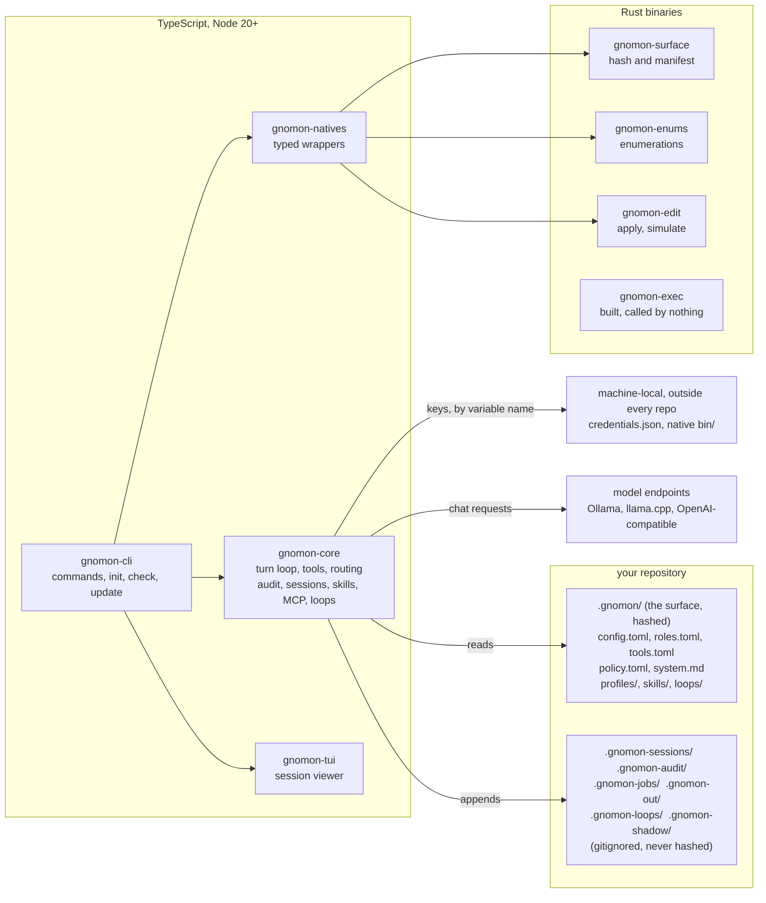
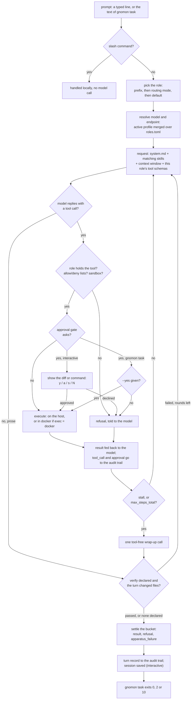
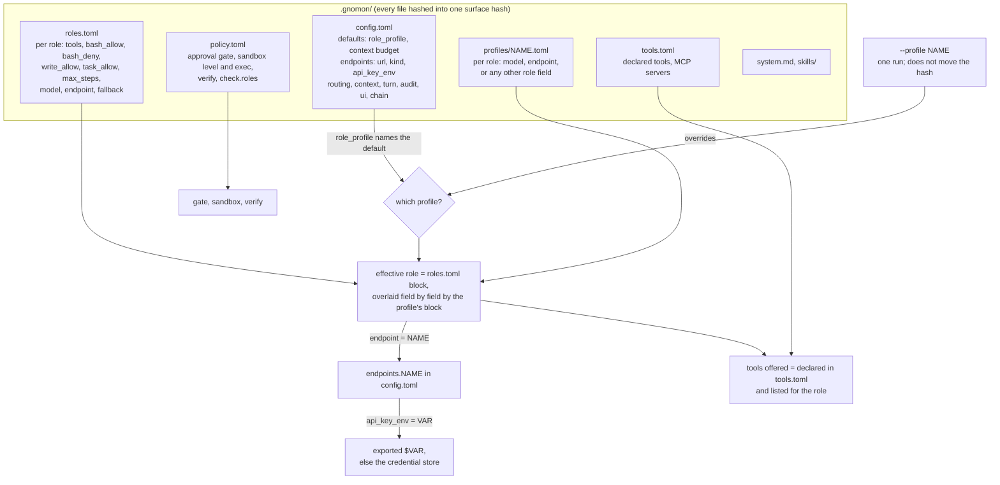
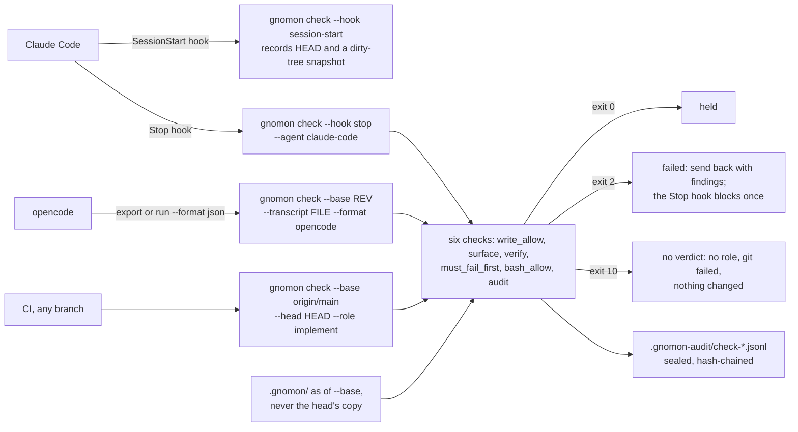
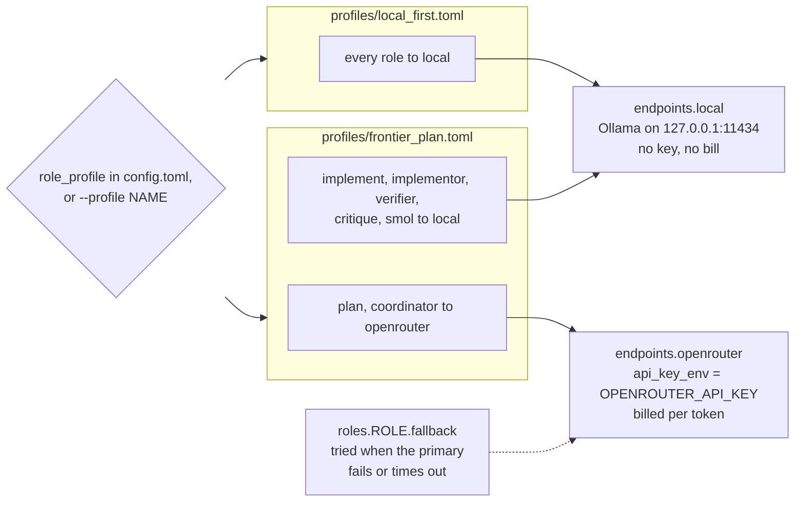

# The gnomon guide

A white paper and a how-to, for two readers:

- **People** deciding whether to adopt gnomon, and then adopting it.
- **AI agents** asked to install, configure or troubleshoot gnomon for someone.
  [Section 11](#11-for-agents-configuring-gnomon) is your procedure. Read
  [The Six Rules](../README.md#the-six-rules) first, because the procedure
  preserves them.

[README.md](../README.md) is the reference; this guide is the path through it.
Its commands were run against gnomon 0.3.1 (`master` at `bc8f27a`) and every
TOML snippet was loaded by that build;
[Appendix A](#appendix-a-how-this-guide-was-verified) says how, and what was
not exercised.

**Contents**

1. [What gnomon is, in one page](#1-what-gnomon-is-in-one-page)
2. [Architecture](#2-architecture)
3. [Install](#3-install)
4. [Quick start: five minutes to a first useful result](#4-quick-start-five-minutes-to-a-first-useful-result)
5. [Model setup recipes](#5-model-setup-recipes)
6. [The commands that matter](#6-the-commands-that-matter)
7. [Use-case patterns](#7-use-case-patterns)
8. [Configuration essentials](#8-configuration-essentials)
9. [Troubleshooting](#9-troubleshooting)
10. [FAQ](#10-faq)
11. [For agents configuring gnomon](#11-for-agents-configuring-gnomon)

---

## 1. What gnomon is, in one page

**The problem.** Ask most coding agents *why did you do that?* and there is
nothing to point at. What they may do is spread across global dotfiles,
environment variables and per-machine state. Two people get different behaviour
from the same repository, and nobody can say which difference mattered.

**The idea.** In gnomon, behaviour is a property of the repository. One
directory, `.gnomon/`, declares the models, the roles, which tools each role may
call, when it must ask permission, and how context is kept. That directory is
content-hashed, and the hash is stamped on every session and audit record. If
the behaviour changed, the hash changed, and `git diff .gnomon/` shows which
file moved. Clone the repository on another machine and you get the same agent.

**What you get, and the mechanism behind each:**

| Property | Mechanism |
|---|---|
| Same agent on every machine | Everything lives in `.gnomon/` and is hashed. There is no global config file. |
| Roles separated by capability, not by asking nicely | A role is offered only the tools it holds. The `verifier` has no `write` tool to call. |
| Nothing changes your repo unseen (default gate) | Writes, edits and shell commands show a diff or the command, then wait for you. |
| The agent cannot rewrite its own rules | `write` and `edit` refuse paths in `.gnomon/`. `bash` can't be blocked honestly, so the hash is re-read after each command and any change is reported. |
| A record you can check | A hash-chained JSONL audit trail, switched on in every surface `gnomon init` writes. It holds decisions and outcomes, not prompt text. |
| Outcomes a script can branch on | Every step lands in one of three buckets (`result`, `refusal`, `apparatus_failure`), and the exit codes are a published contract. |
| Governance for other harnesses | `gnomon check` judges a change that Claude Code, opencode or a CI branch made, using this repository's rules. |
| Local, cloud, or both | Each role picks its own endpoint and model: Ollama, llama.cpp or any OpenAI-compatible API. |

**What it is not.** gnomon does not make a model complete more tasks. It was
measured against opencode on 34 paired Terminal-Bench tasks with the same model:
50.0% against 47.1%, p = 1.0 ([POSITIONING.md](POSITIONING.md)). That is no
measurable difference. What gnomon adds is determinism, capability separation
and a record of what happened.

**A good fit if** you want an agent whose configuration you commit and review
like code; you run local or self-hosted models, or mix them with cloud ones; you
must be able to say afterwards what an agent was allowed to do; or you want a
governance layer over the agents you already use.

**A poor fit if** you need cloud or background execution (there is no queue
and no daemon), HTTP/SSE MCP servers (only stdio is wired), the widest provider
support (there are two request shapes: `openai` and `ollama`), or an editor
that does not speak the Agent Client Protocol: gnomon runs in the agent panel
of ACP editors such as Zed and JetBrains IDEs ([7.8](#78-in-your-editor-gnomon-acp)),
and has no extension of its own for any other.
Status is **pre-1.0**: interfaces can still move, and the README's
[Known Limits](../README.md#known-limits) is specific on purpose.

---

## 2. Architecture

### 2.1 Components



Rust owns the surface hash (`conformance/manifest_golden.json` pins it), and
the TypeScript loop computes the same hash independently, with a test keeping
them in agreement. No Rust runs inside a turn. Only `surface`, `enumerations`,
`session`, `apply` and `simulate` need the native binaries.

### 2.2 One turn, end to end



- **The model is only offered the tools its role holds.** A tool it invents is
  refused by name.
- **Policy refuses before the gate asks.** `bash_allow`, `bash_deny`,
  `write_allow`, `task_allow` and the sandbox say no without asking you.
- **No composite verdict.** Each step keeps its own bucket; the exit code is
  settled from the *terminal* step ([CONTRACTS.md](CONTRACTS.md) §1).
  `max_steps` is a checkpoint (compact, continue in a new leg);
  `max_steps_total` is the wall.

### 2.3 The surface, and how its files combine



The rule to remember: **a profile is merged over `roles.toml` field by field,
and the profile wins.** A fresh scaffold's `profiles/local_first.toml` routes
`plan`, `implement`, `critique` and `smol`, so editing their `model` in
`roles.toml` changes nothing (gnomon warns at startup).
[Section 5.0](#50-where-routing-lives-and-a-one-time-step) avoids the trap.

### 2.4 gnomon as a governance layer over other harnesses



gnomon's own loop refuses a call *before* it runs; `gnomon check` judges a
change *after* another harness made it, before you accept it. The rules come
from the base revision, so a change that widens its own `write_allow` is still
judged by the old list.

### 2.5 Hybrid routing: local and cloud



The enumerations publish three profile names: `local_first`, `frontier_plan`
and `all_remote`. `gnomon init` ships only `local_first.toml`;
[section 5.3](#53-hybrid-plan-in-the-cloud-implement-locally) has the other
two. A profile with no file is reported at startup and ignored.

---

## 3. Install

**Requirements**

| Need | For |
|---|---|
| Node 20 or newer, with npm | everything |
| A model endpoint: local Ollama, llama.cpp or any OpenAI-compatible server, or a cloud key | any turn |
| git | `gnomon check`; also what makes `.gnomon/` worth committing |
| Git for Windows (Windows only) | the POSIX shell the `bash` tool uses on every platform |
| pnpm 9 and a Rust toolchain | building from source only |
| docker (optional) | `[sandbox] exec = "docker"` |

### 3.1 The installer (recommended)

```bash
# Linux / macOS
curl -fsSL https://raw.githubusercontent.com/eljaplacido/gnomonharness/master/scripts/install.sh | sh
```

```powershell
# Windows, PowerShell 5.1 or 7
irm https://raw.githubusercontent.com/eljaplacido/gnomonharness/master/scripts/install.ps1 | iex
```

It checks for Node 20+ and npm (if missing, it prints the command for your OS
and stops; it never installs Node as root), resolves the latest release,
installs the npm package (from the npm registry, where `gnomon-harness` is
published from 0.3.2 on; from the release's own tarballs for a version that is
not there), and puts the native binaries in
`~/.local/share/gnomon/bin` (`%LOCALAPPDATA%\gnomon\bin` on Windows). No sudo:
if npm's global prefix is not writable it installs under `~/.local`. Every
download is checked against the release's `SHA256SUMS`.

| Variable | Effect |
|---|---|
| `GNOMON_VERSION=0.3.3` | Pin a release (`curl … \| GNOMON_VERSION=0.3.3 sh`) |
| `GNOMON_NPM_PREFIX` | Where npm installs |
| `GNOMON_NO_NATIVE=1` | Skip the native binaries |
| `GITHUB_TOKEN` | Lift GitHub's anonymous API rate limit |

Native binaries exist for **linux-x64, linux-arm64, darwin-arm64 and
windows-x64**. On an Intel Mac, `surface`, `enumerations`, `session`, `apply`
and `simulate` will not work unless you build from source; everything else does.

### 3.2 Release tarballs, by hand

The four packages are one program split up, so npm needs all four URLs:

```bash
V=0.3.3
B=https://github.com/eljaplacido/gnomonharness/releases/download/v$V
npm i -g $B/gnomon-core-$V.tgz $B/gnomon-natives-$V.tgz \
         $B/gnomon-tui-$V.tgz  $B/gnomon-harness-$V.tgz
```

```powershell
$V="0.3.3"
$B="https://github.com/eljaplacido/gnomonharness/releases/download/v$V"
npm i -g "$B/gnomon-core-$V.tgz" "$B/gnomon-natives-$V.tgz" "$B/gnomon-tui-$V.tgz" "$B/gnomon-harness-$V.tgz"
```

This route skips the native binaries: unpack the release's
`gnomon-<version>-<platform>.tar.gz` and point `GNOMON_BIN_OVERRIDE` at it
([GETTING_STARTED.md](../GETTING_STARTED.md#prebuilt-binaries--if-you-would-rather-not-install-rust)
has the commands, with checksum verification).

### 3.3 From source

```bash
corepack enable pnpm
pnpm setup && exec $SHELL         # once: pnpm's own step, sets PNPM_HOME
git clone https://github.com/eljaplacido/gnomonharness.git ~/gnomon
cd ~/gnomon && pnpm run setup     # deps, Rust binaries, tsc, gnomon on PATH
```

`pnpm setup` and `pnpm run setup` are different commands; you need both, in
that order. Without Rust, `setup` skips the binaries and says so. To skip the
global link, run `~/gnomon/gnomon <command>` from any project. Windows steps:
[GETTING_STARTED.md](../GETTING_STARTED.md).

### 3.4 Verify the install

```bash
gnomon --version        # gnomon/0.3.3+npm for a release install; +<commit> from a checkout
gnomon enumerations     # prints the enumerations JSON: proves the native binaries are found
```

### 3.5 Update and uninstall

| Want | Command |
|---|---|
| See whether a newer release exists | `gnomon update --check` |
| Update the way this copy was installed | `gnomon update` (alias `upgrade`). From a checkout it prints the git commands instead. |
| Silence the once-a-day "newer version" line | `gnomon update --notice off`, or `GNOMON_NO_UPDATE_CHECK=1` |
| Remove it | `gnomon uninstall` prints the exact commands for how this copy was installed, including any loops it scheduled. It runs nothing. |

Updating gnomon **never rewrites a project's `.gnomon/`**. To adopt newer
scaffold defaults, run `gnomon migrate --check` in the project, then
`gnomon migrate`, then review `git diff .gnomon/`.

---

## 4. Quick start: five minutes to a first useful result

### 4.1 On a local model (Ollama)

```bash
ollama pull qwen3:8b       # any chat model with tool support; skip if Ollama already serves one
cd my-project
gnomon launch
```

`launch` runs `init`, which asks Ollama on `127.0.0.1:11434` what it serves and
writes real tags (the largest model under about 70B for the reasoning roles,
the smallest one able to summarise for `smol`). If the project declares a check
(a `verify`, `check` or `test` script in `package.json`, or `Cargo.toml`,
`go.mod`, Python test config, a Makefile `test:` target), `init` switches it on
as `[verify]`. It also turns the audit trail on and gitignores the run
directories. Then the session opens; the banner names the project, role, model,
and the tools the role does **not** hold. If Ollama is not running, `launch`
offers a picker first: Ollama, OpenRouter, OpenCode Go, OpenCode Zen, Custom or
Skip.

### 4.2 On a cloud model

```bash
cd my-project
gnomon launch
```

With no local model answering, `launch` offers the picker. Choose OpenRouter,
OpenCode Go or OpenCode Zen. It asks for the key (input hidden, stored outside
the repository), lists the models the endpoint serves, and runs one token
through your choice. Only then does it write the endpoint into `.gnomon/`,
point every role at the model, and open the session.

If a local model already answers, there is no picker. Add the cloud endpoint
explicitly:

```bash
gnomon endpoint add --preset openrouter      # or opencode-go | opencode-zen
```

> Whenever the picker or `gnomon endpoint add` chose the model (rather than
> `init`'s detection), later startups print `⚠ … model = "…" is ignored:
> role_profile "local_first" sets …` for `plan`, `implement`, `critique` and
> `smol`. The warning is accurate and harmless: those roles are routed by
> `profiles/local_first.toml`.
> [Section 5.0](#50-where-routing-lives-and-a-one-time-step) clears it for good.

### 4.3 The first useful result

Start read-only. Reads and searches never ask for approval under the default
`on_write` gate:

```
implement ▸ Where is this project's entry point, and how are its tests run? Answer from the files.
```

Then ask for a small, reversible change, with a clean git tree. Nothing is
written until you have seen the diff:

```
  ┌ approve: edit src/lib.ts (+1 −1)
  │ - return a - b;
  │ + return a + b;
  └ [y]es · [a]ll this turn · [s]ession · [N]o
```

`a` approves the rest of this turn and `s` the rest of the session; both are
recorded as standing approvals. When anything is unclear, ask the harness, not
the model: `/explain endpoints`, `/explain approval` read your live surface and
make no model call.

Prefer one shot from a script? The exit code carries the outcome:

```bash
gnomon task "add a unit test for add()" --yes      # 0 result, 2 refusal, 10 apparatus_failure
```

---

## 5. Model setup recipes

Two request shapes exist: `kind = "ollama"` (Ollama's `/api/chat`) and
`kind = "openai"` (any `/v1/chat/completions` server). **Always write `kind`.**
It defaults to `ollama`, even for a URL that ends in `/chat/completions`.

**Checking that a recipe works**, cheapest first:

| Command | Model call? | What it proves |
|---|---|---|
| `echo /quit \| gnomon prompt` (PowerShell: `"/quit" \| gnomon prompt`) | none; only declared MCP servers are started | The surface loads. It prints the role, the model, the profile, and every problem (`⚠` warning, `✗` fatal). Exit 1 on a fatal problem. |
| `gnomon endpoint list` | none; it asks each endpoint for its model list | Which roles use which endpoint, whether each key is set, and each role's model id checked against what the endpoint serves |
| `gnomon endpoint test NAME` | one token | The key and the model id work for inference |
| `gnomon task "Reply with OK"` | one short turn | The whole path. Exit 0 means a model answered. |

### 5.0 Where routing lives, and a one-time step

In a fresh scaffold, routing lives in **two** files:

| Roles | Routed by |
|---|---|
| `plan`, `implement`, `critique`, `smol` | `.gnomon/profiles/local_first.toml`, because `role_profile = "local_first"` |
| `coordinator`, `implementor`, `verifier` | `.gnomon/roles.toml` |

`roles.toml` also lists `model` and `endpoint` for the first four, overridden
by the profile. `/models` and `gnomon endpoint add --role` write the file a run
reads but leave the `roles.toml` copy, hence the startup `⚠ … is ignored`
lines. The recipes below use one layout: **the active profile holds all
routing; `roles.toml` holds only capability.** Set it up once per project:

```bash
# 1. Remove model/endpoint lines from roles.toml (any OS; it only touches
#    lines starting "model = " or "endpoint = ", so on a fresh scaffold the
#    commented-out fallback example is left alone)
node -e "const fs=require('fs'),f='.gnomon/roles.toml';fs.writeFileSync(f,fs.readFileSync(f,'utf8').replace(/^(model|endpoint) = .*\r?\n/gm,''))"
# 2. Replace .gnomon/profiles/local_first.toml with the file in 5.1
```

After that, `/models`, `gnomon endpoint add --role`, `role_profile` and
`--profile` all work on one file and nothing warns. Each profile must then name
all seven roles: a role with no `model` anywhere runs as `local:default` and
fails.

### 5.1 Local: Ollama on this machine

The scaffold already declares this endpoint:

```toml
# .gnomon/config.toml (already in a fresh scaffold)
[endpoints.local]
url = "http://127.0.0.1:11434/api/chat"
kind = "ollama"
```

```toml
# .gnomon/profiles/local_first.toml — every role on this machine's Ollama
name = "local_first"
description = "All roles local. Nothing is billed."

[roles.coordinator]
model = "qwen3:14b"
endpoint = "local"
[roles.implementor]
model = "qwen3:14b"
endpoint = "local"
[roles.verifier]
model = "qwen3:14b"
endpoint = "local"
[roles.plan]
model = "qwen3:14b"
endpoint = "local"
[roles.implement]
model = "qwen3:14b"
endpoint = "local"
[roles.critique]
model = "qwen3:14b"
endpoint = "local"
[roles.smol]
model = "qwen3:4b"
endpoint = "local"
```

Use tags that `ollama list` shows. Check it: `gnomon endpoint list`, then
`gnomon task "Reply with OK"`.

**One command instead.** It runs one token through the model, then writes the
endpoint block and each role's routing. After the one-time step in 5.0, all
seven roles go to the profile. Leave out `--model` on a terminal to pick from
what Ollama serves.

```bash
gnomon endpoint add --preset ollama --model qwen3:14b --role coordinator,implementor,verifier,plan,implement,critique,smol
```

### 5.2 Local: Ollama on another machine, llama.cpp, any OpenAI-compatible server

Add the endpoint block to `.gnomon/config.toml`. Then, in
`profiles/local_first.toml`, set `endpoint` to its name and `model` to an id it
serves, for every role.

```toml
# Ollama on another machine (LAN or Tailscale). Start it there with
# OLLAMA_HOST=0.0.0.0 ollama serve
[endpoints.gpu-box]
url = "http://192.168.1.50:11434/api/chat"
kind = "ollama"
```

```toml
# llama.cpp: llama-server -m model.gguf --jinja --alias qwen3-coder --port 8080
[endpoints.llamacpp]
url = "http://127.0.0.1:8080/v1/chat/completions"
kind = "openai"
```

```toml
# Any OpenAI-compatible server on your own hardware (vLLM, LM Studio, ...)
[endpoints.vllm]
url = "http://127.0.0.1:8000/v1/chat/completions"
kind = "openai"
# api_key_env = "VLLM_API_KEY"   # only if the server was started with a key
```

**llama.cpp needs `--jinja`** for tool calling; the model id is what
`/v1/models` reports, and `--alias` sets it. Loopback, private-range,
Tailscale (`100.64–127.x`) and `*.local` addresses are listed as **LOCAL**: no
key, no bill. The one-command form writes the block and the routing after a
one-token probe:

```bash
gnomon endpoint add --name llamacpp --url http://127.0.0.1:8080/v1/chat/completions --kind openai --model qwen3-coder --role coordinator,implementor,verifier,plan,implement,critique,smol
```

### 5.3 Hybrid: plan in the cloud, implement locally

Declare the cloud endpoint, write a second profile, and choose between the two
profiles.

```toml
# .gnomon/config.toml
[endpoints.openrouter]
url = "https://openrouter.ai/api/v1/chat/completions"
kind = "openai"
api_key_env = "OPENROUTER_API_KEY"
```

```toml
# .gnomon/profiles/frontier_plan.toml — plan on a cloud model, do the work locally
name = "frontier_plan"
description = "plan and coordinator on OpenRouter; everything else on local Ollama."

[roles.plan]
model = "<openrouter-model-id>"
endpoint = "openrouter"
[roles.coordinator]
model = "<openrouter-model-id>"
endpoint = "openrouter"
[roles.implementor]
model = "qwen3:14b"
endpoint = "local"
[roles.verifier]
model = "qwen3:14b"
endpoint = "local"
[roles.implement]
model = "qwen3:14b"
endpoint = "local"
[roles.critique]
model = "qwen3:14b"
endpoint = "local"
[roles.smol]
model = "qwen3:4b"
endpoint = "local"
```

Replace `<openrouter-model-id>` with an id the endpoint serves; never guess.
`gnomon endpoint list` flags an id it does not serve, and `/models --list`
prints every id. Then:

```bash
gnomon key set openrouter                       # the key, input hidden, stored outside the repo
gnomon prompt --profile frontier_plan           # this run only: the surface hash does not move
gnomon task "plan the cache layer" --role plan --profile frontier_plan
```

With `--profile`, the banner says `--profile frontier_plan overrides the
surface's role_profile — behaviour changed, surface hash did NOT`. To make it
the project default, set `role_profile = "frontier_plan"` under `[defaults]` in
`config.toml`; that moves the hash, which is the point. **All-cloud** is the
same file with every role on the cloud endpoint, saved as
`profiles/all_remote.toml`. **Cloud only as a fallback**, tried when the local
primary fails or times out:

```toml
# .gnomon/roles.toml, under the role it backs up
[roles.implement.fallback]
model = "<openrouter-model-id>"
endpoint = "openrouter"
```

### 5.4 Cloud providers

| Provider | Endpoint block | Key |
|---|---|---|
| OpenRouter | as in 5.3, or `gnomon endpoint add --preset openrouter` | `gnomon key set openrouter` |
| OpenCode Go | `[endpoints.go]`, already in the scaffold | `gnomon key set go` (shares `OPENCODE_API_KEY` with zen) |
| OpenCode Zen | `[endpoints.zen]`, already in the scaffold | `gnomon key set zen` |
| OpenAI, or any OpenAI-compatible API | below | `gnomon key set openai` |
| Gemini, Azure OpenAI, GitHub Copilot | commented templates at the end of `[endpoints]` in a scaffolded `config.toml` | as named there |
| Anthropic (Claude) | No native kind. Use OpenRouter (`anthropic/…` ids), or an OpenAI-compatible gateway such as LiteLLM. | the gateway's key |
| AWS Bedrock | Needs an OpenAI-compatible gateway in front (SigV4 is not supported) | the gateway's key |

```toml
# Any OpenAI-compatible cloud provider. This one is OpenAI itself.
[endpoints.openai]
url = "https://api.openai.com/v1/chat/completions"
kind = "openai"
api_key_env = "OPENAI_API_KEY"   # the NAME of the variable, never the key
```

- **OpenCode Go:** model ids are bare (`glm-5.3`, not `opencode-go/glm-5.3`).
  Go rejects a request with no `x-opencode-session` header
  (`400 MissingSessionID`) and asks clients for a User-Agent that names the
  agent. gnomon sends both on **every** request: a stable `x-opencode-session`
  per conversation and `User-Agent: gnomon/<version>`. Other providers ignore
  them.
- A declared but unset key is caught **before** any request: the turn ends with
  `No API key: … Set it with: gnomon key set <endpoint>` and
  `No request was sent, so nothing was billed.`

### 5.5 Credentials

| Do | Command |
|---|---|
| Store a key (prompted, hidden) | `gnomon key set <endpoint>` (or a variable name: `gnomon key set OPENAI_API_KEY`) |
| Store a key from a script | `printf '%s' "$KEY" \| gnomon key set openai` (stdin is read when it is not a terminal) |
| See which are stored | `gnomon key list` (names only; values are never printed) |
| Remove one | `gnomon key unset openai` |

- **Where keys live:** `$XDG_DATA_HOME/gnomon/credentials.json` if set, else
  `~/.local/share/gnomon/credentials.json` (Linux, macOS; mode `0600`) or
  `%APPDATA%\gnomon\credentials.json` (Windows; ACL). Never in a repository.
- **An exported variable always wins** over the store (that is how CI secrets
  work). Only variables the surface declares as `api_key_env` are loaded.
- **Never put a key in `.gnomon/`.** `api_key`, `token`, `secret` or
  `password` in an endpoint block is a fatal startup error. The surface names
  the variable; the value stays on the machine.

---

## 6. The commands that matter

### 6.1 CLI

| Command | What it does | When to use it |
|---|---|---|
| `gnomon launch [--dir P]` | Creates `.gnomon/` if missing, offers model setup if nothing answers, opens the loop | Daily start. The one to remember. |
| `gnomon prompt [ROLE] [--continue \| --resume ID] [--profile N] [--trust]` | The interactive loop (alias `run`). A surface looser than the defaults that this machine has not trusted is shown and asked about first. | Resume a session; start in a role |
| `gnomon task "TEXT" [--role R] [--yes] [--json] [--profile N] [--trust]` | One task, no terminal. Gated calls are refused unless `--yes`. An untrusted loosening surface runs clamped to the defaults unless `--trust`. | Scripts, CI, cron |
| `gnomon init [--from P] [--force] [--no-verify]` | Writes a surface. `--from` copies another project's `.gnomon/`. | New project; team template |
| `gnomon migrate [--check]` | Brings a surface up to current scaffold defaults. `--check` writes nothing and exits 1 if anything is pending. | After `gnomon update` |
| `gnomon endpoint [list \| test NAME \| add …]` | Lists endpoints and keys and cross-checks model ids; runs one token; declares an endpoint end to end | Model setup, diagnosis |
| `gnomon key [set \| list \| unset] NAME` | The machine-local credential store | Keys |
| `gnomon check --base REV [--head REV] [--role R \| --agent N] [--transcript F --format FMT] [--json]` | Judges a change by this surface's rules as they stood at `REV`. Exit 0 held, 2 failed, 10 no verdict. `FMT`: `claude-code`, `opencode`, `goose`, `qwen-code` or `mini-swe-agent`. | CI, hooks, other harnesses |
| `gnomon check --install-hook claude-code` | Prints the Claude Code hooks JSON and writes nothing | Governing Claude Code |
| `gnomon guard --tool T --input JSON [--role R \| --agent N]`, or `--from claude-code\|opencode\|cursor\|generic` with the call on stdin | Decides one tool call another harness is about to make, by the committed rules: exit 0 allow, 2 deny, 3 ask, 10 no decision (answered as ask) | Governing another agent at run time |
| `gnomon guard install claude-code\|opencode\|cursor [--write]` | Prints the hook or plugin for that harness; `--write` adds it to this project's config | Setting up `guard` |
| `gnomon acp [--role R] [--profile N]` | Serves the Agent Client Protocol on stdin/stdout for an editor. Same surface, roles, approvals and audit as `prompt`. | Zed, JetBrains IDEs |
| `gnomon trust [list \| grant \| revoke]` | What this project's `.gnomon/` grants beyond the defaults, and whether this machine trusts it | A repository you did not write |
| `gnomon audit [show \| verify]` | Lists trails; checks every chain, seal and signature anchor. `verify` exits 1 on a break or when there is nothing to verify. | Review, release gates |
| `gnomon sessions` | Saved interactive sessions, newest last | Find one to resume |
| `gnomon skill [list \| accept ID \| reject ID]` | Active skills and the proposals the agent made | Reviewing what it learned |
| `gnomon loop [list \| status \| dry-run N \| run N \| install N \| uninstall N \| reset N \| kill]` | Cron-scheduled guard/act loops declared in `.gnomon/loops/` (alias `loops`) | Unattended supervision |
| `gnomon surface [hash \| manifest \| paths]` | The surface hash, the manifest, the hashed paths | Pinning, drift, bug reports |
| `gnomon enumerations` | The published legal values (alias `enums`) | Contract checks |
| `gnomon session "CMD" ["CMD" …]` | Runs shell commands as recorded steps with buckets | Recording a manual procedure |
| `gnomon apply \| simulate PATCHSET.json` | Applies or dry-runs a patch set through `gnomon-edit` | Structured edits from a script |
| `gnomon tui` | Reads a saved session back: turns, tools, buckets | Review |
| `gnomon update [--check] [--force] [--notice on\|off]` | Updates the way this copy was installed | Upgrades |
| `gnomon uninstall` | Prints the removal commands | Removal |
| `gnomon --version`, `gnomon --help` | Build string, full help | Bug reports |

`--dir PATH` acts on another project. Otherwise `.gnomon/` is found by walking
up from the current directory, the way git finds `.git`, and the banner names
the project it resolved.

A patch set for `apply`/`simulate` looks like this; paths are relative to the
project:

```json
{ "patches": [ { "path": "src/lib.js", "pattern": "a - b", "replacement": "a + b" } ] }
```

### 6.2 Inside the loop

Press **Tab** after `/` to list everything. These matter most:

| Command | What it does |
|---|---|
| `/explain [topic]` | What a feature is, how this repo has it set, and what to do next. No model call. Topics include `endpoints`, `approval`, `roles`, `tools`, `audit`. |
| `/models` | Lists what each endpoint serves; arrows and type-to-filter, Enter assigns a model to a role. `/models --list` only prints. |
| `/role NAME` · `/roles` | Switch the session's role · list roles and models |
| `/plan …` (any role name) | Route this one turn to that role |
| `/mode manual\|suggest\|auto` | Who picks the role: you, the routing rules with your confirmation, or the rules |
| `/tools` · `/endpoints` · `/profiles` | What this role may call · endpoints and keys · available profiles |
| `/allow strict\|custom\|all` | May the agent edit `.gnomon/` this session (default `strict`: no) |
| `/network on\|off` · `/sandbox off\|confined\|strict` | Session-only consent dials. The surface default is untouched. |
| `/session [id]` · `/new` | Switch sessions · start a fresh one (the old one stays resumable) |
| `/context` · `/todo` · `/manifest` | The window · the agent's checklist · the surface hash and what it covers |
| `/cot MODE` · `/think MODE` · `/expand` | How much of the live trace and reasoning to show · list the steps in the last folded run |
| `/quit` | Leave. See the note on sealing in [section 9](#9-troubleshooting). |

**Esc** cancels the turn in progress. Anything you type during a turn is queued.

---

## 7. Use-case patterns

### 7.1 Daily interactive coding

```bash
cd my-project && gnomon launch
```

- Start with `/mode suggest`: the routing rules propose a role ("spec …" →
  `coordinator`, "run the tests" → `verifier`) and wait for `y`, `a` or `N`.
  Move to `auto` once they stop surprising you.
- Survey from a role that cannot change anything (`/role verifier`), plan in
  `coordinator` (it may create `docs/**`, `specs/**`, `*.md`, never edit code),
  implement in `implement` or `implementor`.
- Trust the approval diff, the tool log and the buckets, not the model's prose.
- `gnomon prompt --continue` resumes the newest session. It replays the
  conversation, not the rules, and says so if the surface moved since.

### 7.2 Headless `task` in scripts and CI

```bash
gnomon task "update CHANGELOG for the last commit" --role implement --yes --json > record.json
case $? in
  0)  echo "result" ;;
  2)  echo "refusal: something said no (a gate, a policy, the model)" ;;
  10) echo "apparatus_failure: the harness or endpoint failed; retry or page someone" ;;
esac
```

- Nobody can be asked, so **every gated call is refused** unless `--yes`. The
  trail records it as `by: "default:no-operator"` or `by: "flag:--yes"`.
- `--json` emits the task record (`surface_hash`, `harness`, `role`, `model`,
  `output`, `bucket`, `tool_log`, `stop_reason`, …). Only `volatile` (duration,
  tokens) differs run to run. Warnings go to stderr, so stdout stays clean.
- Switch on the **bucket** (0, 2, 10); that part of the
  [exit contract](CONTRACTS.md) is stable.

### 7.3 Governing Claude Code, opencode and other harnesses

**In CI, on every pull request:**

```bash
gnomon check --base origin/main --head HEAD --role implement --json
```

The diff is taken from `merge-base(origin/main, HEAD)`, so check out with full
history (for example `fetch-depth: 0`).

**In every Claude Code session:** run `gnomon check --install-hook claude-code`
and merge the printed JSON into `.claude/settings.json`. Then map the agent to
a role in `.gnomon/policy.toml`:

```toml
[check.roles]
claude-code = "implement"
```

SessionStart records `HEAD` and a snapshot of a dirty tree, so your own
uncommitted work is not charged to the agent. Stop runs the six checks on what
changed since, with the transcript for the shell check; a failure blocks the
stop **once** and hands Claude the findings.

**opencode, or any transcript after the fact:**

```bash
opencode export <session-id> > session.json
gnomon check --base "$START_REV" --role implement --transcript session.json --format opencode
```

| Check | Fails when |
|---|---|
| `write_allow` | a changed path is outside the role's `write_allow` |
| `surface` | the change edits `.gnomon/` |
| `verify` | the `[verify]` command fails on head |
| `must_fail_first` | a new or changed test still passes against the old sources, so it pins nothing |
| `bash_allow` | a command in the transcript breaks the role's `bash_allow` or `bash_deny` |
| `audit` | the verdict could not be appended to the hash-chained trail |

A check that does not apply says `skipped` and gives the reason; it never
counts as a pass. Every verdict is written to `.gnomon-audit/check-*.jsonl`,
even with `[audit] enabled = false`.

**At run time, before each call: `gnomon guard`.** `check` judges a change
after it is made. `guard` decides one tool call at a time, from inside the
other harness's own pre-tool hook, with the same code gnomon's own loop uses:

```bash
gnomon guard --role implement --tool bash --input '{"command":"git push --force origin main"}'
# {"schema":"gnomon.guard/1","decision":"deny","rule":"bash_deny","reason":"Refused: …", …}   exit 2
```

| Exit | Decision |
|---|---|
| 0 | allow |
| 2 | deny, with the rule and the reason |
| 3 | ask: the harness's own prompt decides. Under the default `on_write` gate, any shell command asks. |
| 10 | no decision could be made; the document says `ask`, never a silent allow |

The rules are the committed ones (the session's starting HEAD, else HEAD),
never the working tree, so an agent cannot loosen them by editing `.gnomon/`.
Install the adapter for a harness with `gnomon guard install <harness>`, which
prints it, or `--write` to add it to this project's config:

| Harness | What is installed |
|---|---|
| Claude Code | a `PreToolUse` hook, beside the `check` hooks, in `.claude/settings.json` |
| opencode 2.2 | a plugin, `.opencode/plugins/gnomon-guard.js` |
| Cursor | `.cursor/hooks.json` for shell commands and file reads; writes are left to `check` |
| anything with a pre-tool hook | `gnomon guard --from generic`, with `{"tool": "bash", "input": {"command": "…"}, "cwd": "…", "session_id": "…"}` on stdin |

`guard` stops only what a hook shows it; a harness without one is judged after
the fact by `check`. The README section
[Before the call: `gnomon guard`](../README.md#before-the-call-gnomon-guard)
has each harness's answer format and the measured latency.

### 7.4 Scheduled loops

A loop is a deterministic shell guard plus an action, run by cron. There is no
daemon, and a guard that does not trip costs nothing.

```toml
# .gnomon/loops/todo-guard.toml
[loop]
name        = "todo-guard"
every       = "30m"              # Nm (< 60), Nh (< 24) or Nd
description = "Fail loudly when TODOs pile up in src/"

[guard]
run         = "grep -r TODO src | wc -l"
act_when    = "gt 5"             # gt ge lt le eq ne, or exit_nonzero
timeout_sec = 30

[act]
run         = "echo too many TODOs in src/ >&2; exit 1"

[limits]
max_consecutive_failures = 3     # then the breaker opens until `gnomon loop reset`
max_runs_per_hour        = 2
```

```bash
gnomon loop dry-run todo-guard   # runs the guard, not the action
gnomon loop run todo-guard       # one tick: 0 fine, 2 act failed or breaker open, 10 guard failed
gnomon loop install todo-guard   # writes this machine's crontab entry (not on Windows)
gnomon loop status               # declared vs installed; exit 1 on drift
gnomon loop kill                 # unschedule every loop of this project
```

`[act] task` (handing a tripped guard to a model) is **not implemented**; the
tick reports `act_failed`. To reach a model, have `[act] run` call
`gnomon task … --json` with absolute paths (cron's `PATH` is minimal). On
Windows `install` does not work; schedule `gnomon loop run NAME` in Task
Scheduler.

### 7.5 Audit and compliance trails

```toml
# .gnomon/config.toml (gnomon init writes this, switched on)
[audit]
enabled = true
dir = ".gnomon-audit"        # outside .gnomon/, so logging never moves the hash
record = "metadata"          # metadata: decisions and outcomes, no prompt or response text
                             # full: text as well, after redact is applied
redact = ['(api[_-]?key|token|secret|password)\s*[:=]\s*\S+']
chain = true
```

- Session start, turns, tool calls, approvals, verify runs and chain stages are
  JSONL records, each carrying the `surface_hash` and a SHA-256 link to the
  previous record. `gnomon audit verify` reports, per trail, the chain, the
  **seal** (ends with `session_end`) and the signature anchor.
- Chaining proves a file is internally consistent, not that it is the file
  that was written. `[audit.attest]` anchors it with a signer command; gnomon
  never holds the key
  ([README → `[audit.attest]`](../README.md#auditattest--an-anchor-outside-the-file)).
- A redaction pattern that does not compile fails **open** (gnomon warns).
  Do not write `(?i)`; matching is already case-insensitive.
- This is an evidence layer, not a compliance claim.

### 7.6 Containment: what it is, and what it is not

| Control | Governs | Does not govern |
|---|---|---|
| A role's `tools` | which tools the model is offered | what `bash` can do |
| `bash_allow` / `bash_deny` (regex) | which shell commands a role may run; deny wins, and a deny pattern that fails to compile refuses | effects of an allowed command |
| `write_allow` (globs) | paths `write` and `edit` may touch | files written through `bash` |
| `[sandbox] level` (`off`, `confined`, `strict`) | **tool paths**: `read`, `write`, `edit`, `glob` and `grep` must resolve inside the repo, symlinks included | `bash`. Even under `strict`, `cat /etc/passwd` runs. |
| `[sandbox] network = false` | the `webfetch` tool | network use by `bash` (`curl`, package managers) |
| `[sandbox] exec = "docker"` | **where `bash` runs**: a `docker run --rm` per command, repo bind-mounted, `--user` mapped, no network unless `network = true` | anything else. And any value other than `docker` (`bwrap`, a typo) silently runs on the host, with a warning that `gnomon task` does not show. |

```toml
# .gnomon/policy.toml
[sandbox]
level = "confined"
network = false
exec  = "docker"
image = "debian:stable-slim"
```

`exec` can be set per role, and is refused on native Windows. Nothing checks
for a docker daemon before a turn. Docker raises the cost of an accident or an
injected instruction; it is not a jail for hostile code
([SANDBOX-DESIGN.md](SANDBOX-DESIGN.md)). The control that binds everyone is
branch protection on the remote.

### 7.7 Team use

1. **Commit `.gnomon/` and `.gitattributes`.** `init` adds
   `.gnomon/** text eol=lf` (a Windows clone hashes the same surface) and
   gitignores the six `.gnomon-*` run directories.
2. **Review surface changes like code**; `gnomon surface hash` names the rules.
3. **Same agent everywhere.** Machines that differ only in where inference runs
   use `--profile`, and the banner says so.
4. **CI parity:** `gnomon check` on every PR, and `gnomon migrate --check` to
   flag a surface that lags the shipped defaults.
5. **Start from a known-good surface:** `gnomon init --from ../reference-repo`.
6. **Skills are proposals.** The `coordinator` proposes into
   `.gnomon/skills/proposed/` (not loaded, not hashed);
   `gnomon skill accept ID` is the human act that makes one count.

A minimal GitHub Actions job:

```yaml
jobs:
  gnomon-check:
    runs-on: ubuntu-latest
    steps:
      - uses: actions/checkout@v4
        with: { fetch-depth: 0 }
      - uses: actions/setup-node@v4
        with: { node-version: 22 }
      - run: curl -fsSL https://raw.githubusercontent.com/eljaplacido/gnomonharness/master/scripts/install.sh | sh
        env: { GITHUB_TOKEN: "${{ github.token }}" }
      - run: echo "$HOME/.local/bin" >> "$GITHUB_PATH"   # in case npm's prefix was not writable
      - run: gnomon check --base origin/main --head HEAD --role implement --json
```

### 7.8 In your editor: `gnomon acp`

`gnomon acp` speaks the [Agent Client Protocol](https://agentclientprotocol.com)
on stdin and stdout, so an editor that hosts ACP agents runs gnomon in its
agent panel. A prompt from the editor runs the same turn as the terminal, under
the same `.gnomon/`, roles, approval gate, sandbox and audit trail. Approvals
become the editor's permission prompts, and roles become its modes.

**Zed:** open Agent Settings, go to External Agents, choose Add Agent, then
Add Custom Agent. Or add this to `settings.json` directly:

```json
{
  "agent_servers": {
    "gnomon": {
      "type": "custom",
      "command": "gnomon",
      "args": ["acp"],
      "env": {}
    }
  }
}
```

**JetBrains IDEs** (AI Assistant): AI Chat, then ⋯, then Add Custom Agent,
which opens `~/.jetbrains/acp.json`:

```json
{
  "agent_servers": {
    "gnomon": {
      "command": "gnomon",
      "args": ["acp"]
    }
  }
}
```

- If the editor cannot find `gnomon`, give the full path (`which gnomon`).
  `"args": ["acp", "--role", "plan"]` starts sessions in another role.
- **The project needs a `.gnomon/` first.** Run `gnomon launch` or
  `gnomon init` there once from a terminal. The editor gets an error, not a
  surface written for it: writing a surface is a human act.
- Files are read and written on disk by gnomon's own tools, not through the
  editor's buffers, so the sandbox, `write_allow` and drift detection still
  apply. MCP servers the editor offers are not connected; declare them in
  `.gnomon/tools.toml`.

### 7.9 A repository you did not write: workspace trust

A cloned repository's `.gnomon/` could ship `approval = "never"`,
`network = true` or a role allowed any command. gnomon measures what a surface
grants beyond the scaffold `gnomon init` writes. A surface that grants nothing
more, which includes every scaffolded project, is never asked about.

```bash
gnomon trust            # this project's grants, and what this machine trusts
gnomon trust grant      # trust the current surface here
gnomon trust revoke     # forget every trust for this project; the next launch asks again
```

- **On a terminal** (`launch`, `prompt`), an untrusted surface that grants more
  is shown against the defaults before anything runs. `y` trusts it and runs it
  as declared. Enter runs this session **clamped** to the defaults. `q` exits 3.
- **Headless** (`task`, CI, no terminal), it runs clamped and prints one line
  on stderr naming what was withheld, for example:
  `untrusted surface 17b7b90a14f5 grants more than the defaults (approval: never …) — running clamped to the defaults`.
  `--trust`, or `GNOMON_TRUST=<surface hash or a 12+ character prefix>`, runs
  it as declared for that invocation only.
- Trust is kept outside the repository, beside the key store, keyed by project
  and surface hash. A changed surface that grants something new is asked about
  again; a tightening is not.

---

## 8. Configuration essentials

| File | Holds | Most important keys |
|---|---|---|
| `config.toml` | Defaults, endpoints, routing rules, context, turn limits, audit, UI, chain | `[defaults] role_profile`, `[endpoints.NAME]`, `[routing] mode`, `[audit] enabled/record`, `[defaults] max_context_tokens/compaction` |
| `roles.toml` | What each role may do | `tools`, `bash_allow`, `bash_deny`, `write_allow`, `task_allow`, `max_steps`, `max_steps_total`, `fallback` |
| `profiles/NAME.toml` | Per-machine or per-billing routing | `[roles.NAME] model`, `endpoint` |
| `policy.toml` | Autonomy and checks | `[approval] gate`, `[sandbox] level/network/exec`, `[verify]`, `[check.roles]` |
| `tools.toml` | Declared tools and MCP servers | `[[tools]] enabled`, `timeout_seconds`, `[mcp_servers.NAME]` |
| `system.md` | The system prompt | — |
| `skills/*.md` | Durable notes, loaded when their `match` regex fits the input | front matter `match`, `roles` |
| `loops/*.toml` | Scheduled guard/act loops | see 7.4 |

**Traps to know:**

- `approval` and `sandbox` appear twice: `[defaults]` in `config.toml` and
  `policy.toml`. **`policy.toml` wins** (`[approval] gate`, `[sandbox] level`),
  silently. Change them there.
- `compaction` and `max_context_tokens` are read from `[defaults]`, not
  `[context]`. `[verify]` belongs in `policy.toml` (fatal in `config.toml`).
- An unknown key in a role block is fatal: a typo such as `tool =` would
  otherwise hand the role every tool.
- gnomon reads a **subset of TOML**: no comment after a `[table]` header, no
  dotted keys, no multi-line strings, and inline tables are read as strings.
  Use single-quoted strings for regexes
  ([CONTRACTS.md §5](CONTRACTS.md#5-toml--the-subset-gnomontoml-may-use)).
- `.gnomon/` is read at startup. Restart the session after editing it.

**Minimal surface:** what `gnomon init` writes, untouched: approval
`on_write`, sandbox `confined`, routing `manual` (default role `implement`),
audit on (`metadata`), `[verify]` if the project declares a check, Ollama on
`127.0.0.1:11434`.

**Governed surface** for unattended or team use. Edit the existing blocks; do
not append duplicates:

```toml
# policy.toml
[approval]
gate = "on_write"                 # never only where nobody needs to see a change first

[sandbox]
level = "strict"
network = false

[verify]
command = "npm test"              # the project's own check
after = "change"                  # any turn that moved the tree, by write/edit or the shell
max_rounds = 1
test_must_fail_first = true       # a new test must fail on the code as it was

[check.roles]
claude-code = "implement"
```

```toml
# config.toml
[routing]
mode = "suggest"

[chain]
stages = ["plan", "implement", "critique"]
gate = "on_check"                 # stop the chain when a stage's [verify] check fails

[audit]
enabled = true
record = "metadata"
chain = true
```

```toml
# roles.toml: confine where implement may write
[roles.implement]
write_allow = ["src/**", "tests/**", "docs/**", "*.md"]
```

A declared chain is sequencing with a gate, not proof of quality: an ungated
chain measured 48.7% against 56.6% without one, within noise
([README → Known Limits](../README.md#known-limits)). Full contract:
[CONTRACTS.md](CONTRACTS.md). Every key, with its rationale:
[README → The Surface](../README.md#the-surface--gnomon).

---

## 9. Troubleshooting

| You see | Cause | Fix |
|---|---|---|
| `gnomon: command not found` after installing | npm installed under a prefix that is not on `PATH` | The installer printed the line to add, typically `export PATH="$HOME/.local/bin:$PATH"`. Open a new terminal. |
| Installer: `gnomon needs Node.js 20 or newer` | Node missing or old (Ubuntu 22.04 ships 12, 24.04 ships 18) | Run one of the commands it prints (NodeSource, Homebrew, nvm, winget), then re-run the installer |
| `gnomon native binary not found: "gnomon-surface"` | No native binaries found | Re-run the installer, set `GNOMON_BIN_OVERRIDE` to an unpacked release archive, or `cargo build --release` in a checkout. Only `surface`, `enumerations`, `session`, `apply` and `simulate` need them. |
| `WARN … has no binaries`, or `FAILED: gnomon is NOT on PATH after pnpm link --global` (from source) | `PNPM_HOME` unset, so no shim was written | `pnpm setup`, open a new terminal, `pnpm run link:global`. Or run `./gnomon` from the checkout. |
| `Nothing is listening on 127.0.0.1:11434 — the connection was refused` (exit 10) | The local server is not running, or runs on another port | `ollama serve`, or fix `url` under `[endpoints]`. `gnomon endpoint list` shows what answers. |
| `No model answers for this project yet: …` (from `launch`) | The default role's endpoint, key or model is not usable | Pick a provider in the picker, or Skip and run `gnomon endpoint add` later |
| `No API key: endpoint "X" declares api_key_env = "VAR", and $VAR is not set` | Key not stored or exported | `gnomon key set X`. No request was sent. |
| `Model API error: 401 …` / `The key came from $VAR … the provider rejected it` | Wrong or expired key, or an exported variable shadowing the stored one | `gnomon key set X` with a fresh key; `unset VAR` if an old one is exported |
| `Model API error: 400`/`404` naming a model | The model id is not one the endpoint serves | `gnomon endpoint list` (it suggests the nearest id), or `/models` |
| `⚠ .gnomon/roles.toml [roles.R] model … is ignored: role_profile "P" sets …` | The profile routes that role and wins | Edit `profiles/P.toml`, or remove the line from `roles.toml` ([5.0](#50-where-routing-lives-and-a-one-time-step)) |
| Banner shows `Model: local:default` | No `model` for the role anywhere: a missing profile, or `roles.toml` stripped without a profile | Fix `role_profile` or the profile file. `✗ profile "X" is not in .gnomon/profiles/` names the problem. |
| `✗ … api_key holds a secret in the surface` (session will not start) | A key was written into `.gnomon/` | Delete the line, **rotate the key**, `gnomon key set NAME`, and declare `api_key_env` |
| `✗ … endpoint = "X" is not declared` | A role names an endpoint with no block | Add `[endpoints.X]` or fix the name |
| `.gnomon/<file> line N: cannot parse "…"` | TOML outside gnomon's subset (for example a comment after `[table]`) | Rewrite per [CONTRACTS.md §5](CONTRACTS.md#5-toml--the-subset-gnomontoml-may-use) |
| `unknown field "tool" — … Did you mean "tools"?` | A typo in a role block (fatal, on purpose) | Fix the key |
| `[verify] is declared here but read from policy.toml` | `[verify]` in the wrong file | Move it to `policy.toml` |
| `No .gnomon/ surface found in … or any parent directory` | Wrong directory, or no surface yet | `cd` to the project, `gnomon init`, or pass `--dir` |
| `.gnomon/ already exists … Refusing to overwrite` | `init` on an existing surface | Keep it, or `gnomon init --force` |
| `gnomon task` exits 2 and the trail says `by: "default:no-operator"` | A gated call with nobody to approve it | Intended. Add `--yes` deliberately, or lower `[approval] gate`. |
| `[tools] MODEL cannot accept tools — retrying without them.` | The model or its template rejects a tools array (common with reasoning distills) | Use a tool-capable model for that role, or set `tools = []` for it |
| `Refused: no POSIX shell found, so bash cannot run.` (Windows) | Git for Windows missing | `winget install --id Git.Git`, or set `GNOMON_SHELL` to a bash you have |
| `exec = "bwrap" is not one of off \| docker, so this silently falls back to "off"` | Only `docker` is a backend | Use `docker` or `off` |
| `audit verify`: `NOT SEALED (truncated, or the run was killed)` after a normal session | `/quit` exits without writing `session_end` | End interactive sessions with **Ctrl-D**, which seals the trail. `gnomon task` trails are always sealed. |
| An edit to `.gnomon/` did not take effect | The surface is read at session start | Restart the session |
| `gnomon endpoint test go`: `NOT TESTED — no role routes here` (exit 10) | No role gives it a model to try | `gnomon endpoint test go --model ID` |

---

## 10. FAQ

**How is it different from Claude Code, opencode or aider?**
Those are agents you configure per machine or per user. gnomon's configuration
is a hashed, committed artefact that the agent cannot edit, and every record
carries its hash. Roles differ by the tools they are *offered*, not by
instructions. It can also judge their work: `gnomon check` applies the
repository's rules to a change Claude Code or opencode made. They have things
gnomon lacks: an IDE surface, cloud execution, HTTP/SSE MCP, a large ecosystem
([POSITIONING.md](POSITIONING.md)).

**Will it complete more tasks than my current agent?**
Not demonstrably (50.0% vs 47.1% against opencode, not significant). Choose it
for reproducibility, separation and auditability.

**Does it work offline?**
Yes, with a local endpoint (Ollama, llama.cpp, vLLM, …). Installing needs
GitHub. An interactive `launch`/`prompt` checks GitHub for a newer release at
most once a day; turn that off with `GNOMON_NO_UPDATE_CHECK=1` or
`gnomon update --notice off`.

**What does it cost?**
gnomon is MIT-licensed and free. Local models cost your hardware. Cloud
endpoints bill per token at the provider's prices. `gnomon endpoint test` costs
one token, and an unset key is caught before any request is sent.

**Is my code sent anywhere?**
Only to the model endpoints your roles route to: the system prompt, matching
skills, the conversation, and tool results (file contents it reads, command
output). With local endpoints, that stays on your machine or network. The
other outbound traffic: model-list requests to those endpoints, the update
check above, MCP servers you declare, a `[shadow]` URL if you enable it,
`webfetch` (off by default), and whatever commands `bash` runs. There is no
telemetry.

**Which models work?**
Any chat model behind `kind = "ollama"` or `kind = "openai"` that supports tool
calling. Bigger models follow the loop better. Small ones narrate loosely, so
trust the diffs, not the prose.

**Can I use Claude, GPT or Gemini models?**
GPT and Gemini: yes, through OpenAI-compatible endpoints ([5.4](#54-cloud-providers)).
Claude: through OpenRouter or an OpenAI-compatible gateway. There is no native
Anthropic request shape.

**Can I use it in CI?**
Yes, two ways. `gnomon task "…" --json` with exit codes 0/2/10 runs work
headless (gated calls need `--yes`). `gnomon check --base origin/main --head HEAD --role implement`
judges a branch, whoever wrote it ([7.2](#72-headless-task-in-scripts-and-ci),
[7.7](#77-team-use)).

**How do I trust what it did?**
Read four things: the approval diffs you saw; the audit trail (`gnomon audit verify`
proves the chain is intact, and `[audit.attest]` anchors it outside the file);
the `surface_hash` on every record, which names the exact rules; and the
`[verify]` result, which is a command that ran, not the model's claim. For
someone else's agent, `gnomon check` gives a verdict, and that verdict is
itself an audit record.

**Can the agent change its own rules?**
Not by `write` or `edit`: both refuse `.gnomon/` unless you grant `/allow` for
the session, and a delegated sub-turn never can. Through `bash` it could, so the
hash is re-read after every command and a change is reported
(`surface changed`). `gnomon check` fails any change that edits `.gnomon/`.

**Is the `bash` tool sandboxed?**
Not by default. `sandbox.level` confines the file tools, not the shell.
`bash_allow`/`bash_deny` filter commands, and `exec = "docker"` runs them in a
container ([7.6](#76-containment-what-it-is-and-what-it-is-not)).

**Does it run on Windows?**
Yes, natively (CI runs the full TypeScript suite there), with Git for Windows
for the POSIX shell. `gnomon loop install` and `exec = "docker"` do not work
there.

**Can I commit `.gnomon/`? Where are my keys?**
Commit it; that is the design. Keys live in a machine-local store
([5.5](#55-credentials)); the surface holds only the variable *name*.

**My teammate uses a cloud model and I use a local one. Same surface?**
Yes: commit both profiles and pick one per run with `--profile`.

**Why did the surface hash change?**
A file under `.gnomon/` changed: you edited it, `/models` or
`gnomon endpoint add` wrote it, `gnomon skill accept` moved a skill in, or
`gnomon migrate` applied a default. `git diff .gnomon/` says which.
`skills/proposed/` and `extensions/` are excluded, because nothing loads them.

**What do the exit codes mean?**
`gnomon task`, `gnomon check` and `gnomon loop run` exit **0** (result or
held), **2** (refusal or failed check), or **10** (apparatus failure or no
verdict). Most other commands exit 0 or 1 ([CONTRACTS.md](CONTRACTS.md)).

**Does it support MCP?**
Yes, stdio servers declared under `[mcp_servers]` in `tools.toml`. Their tools
appear as `mcp__<server>__<tool>`, gated per role. HTTP and SSE are not wired.
Pin the server version, because its behaviour is outside the hash.

**Can I use it in my editor?**
In editors that host Agent Client Protocol agents, such as Zed and JetBrains
IDEs: `gnomon acp` ([7.8](#78-in-your-editor-gnomon-acp)). There is no
extension for other editors, and no background mode: the unattended paths are
`gnomon task` and cron-scheduled `gnomon loop`s.

**Can gnomon stop another agent before it acts, not only judge it after?**
Yes, where that agent has a pre-tool hook: `gnomon guard` decides each call
by this repository's committed rules ([7.3](#73-governing-claude-code-opencode-and-other-harnesses)).
Adapters exist for Claude Code, opencode 2.2 and Cursor (shell and reads).

**I cloned a repository and gnomon says it is running clamped. Why?**
Its `.gnomon/` grants more than gnomon's defaults, and this machine has not
trusted it. `gnomon trust` shows what it grants. Trust it with
`gnomon trust grant` if you accept that, or keep running clamped
([7.9](#79-a-repository-you-did-not-write-workspace-trust)).

**How do I make it ask less, or more?**
`[approval] gate` in `policy.toml`: `always` (every call), `on_write`
(default: anything that can change something), `never`.

**I edited `roles.toml` and nothing changed. Why?**
The active profile wins per field, and the surface is read at startup. Edit
the profile and restart ([5.0](#50-where-routing-lives-and-a-one-time-step)).

**Does it learn from my sessions?**
Only through skills you accept: the coordinator proposes, and
`gnomon skill accept` makes one active.

**Is it production-ready?**
It is pre-1.0 and maintained by one person. The contracts in `conformance/` are
versioned and tested, the README is tested against the code, and the
[Known Limits](../README.md#known-limits) are specific. Pin a version
(`GNOMON_VERSION`) for anything you depend on.

---

## 11. For agents configuring gnomon

You are an AI agent setting gnomon up for a user. Follow these steps in order,
and stop and report at any failure. Do not improvise around a failed step.

### 11.1 Invariants: the Six Rules, as constraints on you

| Rule | What it forbids you to do |
|---|---|
| 1. No machine-scoped configuration | Configuring behaviour anywhere but `.gnomon/`: no `~/.gnomon/`, no shell profile settings, no `GNOMON_MODEL_URL` as a fix. (Keys are not behaviour; they go in the credential store by variable name.) |
| 2. Every session emits a manifest | Writing logs, notes or state into `.gnomon/`. Run output belongs in `.gnomon-*` siblings, which are never hashed. |
| 3. Tool schemas are declared data | Hiding a tool from a role any way other than its `tools` list in the surface |
| 4. Three outcome buckets, no composite verdict | Summarising a run as "passed" when a step was a refusal or an apparatus failure. Report the buckets. |
| 5. Published exit contract | Treating exit 2 as success, or parsing text instead of the exit code |
| 6. Published enumerations | Using a value outside `gnomon enumerations` for `edit_format`, `sandbox`, `approval` or `role_profile` |

### 11.2 Procedure

1. **Detect the environment.**
   ```bash
   node --version          # need v20+
   git --version
   gnomon --version        # already installed?
   ```
   Note OS and architecture; on Windows, confirm Git for Windows. Is Ollama
   answering (`curl -s http://127.0.0.1:11434/api/tags`), another local server,
   or a cloud provider? **Ask the user** if the route is not obvious.
2. **Install** with the installer ([3.1](#31-the-installer-recommended)). If
   Node is missing, show the user the command it printed; do not install Node
   as root yourself. Verify: `gnomon --version`, `gnomon enumerations`.
3. **Initialise** in the project root: `gnomon init`. Read its output (models
   detected or placeholders, the `[verify]` command). Never `--force` over an
   existing surface without the user's say-so. If the project already has a
   `.gnomon/`, run `gnomon trust` and show the user anything it lists as
   granted beyond the defaults. Whether to trust it is their decision
   ([7.9](#79-a-repository-you-did-not-write-workspace-trust)).
4. **Choose a model route** with the user: local ([5.1](#51-local-ollama-on-this-machine),
   [5.2](#52-local-ollama-on-another-machine-llamacpp-any-openai-compatible-server)),
   cloud ([5.4](#54-cloud-providers)) or hybrid ([5.3](#53-hybrid-plan-in-the-cloud-implement-locally)).
   Apply the one-time layout in [5.0](#50-where-routing-lives-and-a-one-time-step)
   if you will hand-edit routing. **Never guess a model id**: take it from
   `ollama list`, from `gnomon endpoint list`, or from `/models --list`
   (non-interactively: `printf '/models --list\n/quit\n' | gnomon prompt`).
5. **Set keys safely.** Have the user run `gnomon key set <endpoint>` and type
   the key. If you must pass one, pipe it from the user's own secret store
   (`printf '%s' "$KEY" | gnomon key set <endpoint>`). Never echo it, write it
   to a file, or put it in a logged command line. A key pasted into the
   conversation is exposed: tell the user to rotate it.
6. **Verify at no cost.**
   ```bash
   echo /quit | gnomon prompt     # no model call: must exit 0 with no ✗ lines; read every ⚠
   gnomon endpoint list           # roles → endpoints, keys set, model ids cross-checked
   ```
   Only with the user's consent, since a cloud call is billed:
   `gnomon endpoint test <name>` (one token) or `gnomon task "Reply with OK"`.
7. **Report:** the surface hash (`gnomon surface hash`), each role's model and
   endpoint, which keys are stored, the `[verify]` command, any trust grants
   still pending, and every warning you did not resolve. Suggest committing
   `.gnomon/` and `.gitattributes`. If the user asked for editor use or for
   governing another agent, point them to `gnomon acp` (7.8) or
   `gnomon guard install` (7.3); installing either into their config is a
   change for them to approve.

### 11.3 Never

- **Never put a key, token or password in `.gnomon/`** or anywhere else in the
  repository: not in `.env`, not in a comment, not in a test fixture.
- **Never hand-edit hashed state without understanding the surface hash.**
  Every edit under `.gnomon/` changes the hash that identifies later records.
  Make the smallest change, say which file and why, show `git diff .gnomon/`.
- **Never accept a skill on the user's behalf.** `gnomon skill accept` is the
  human act.
- **Never grant workspace trust on the user's behalf**: no `gnomon trust grant`,
  `--trust` or `GNOMON_TRUST=…` unless the user has seen what
  `gnomon trust` lists and asked for exactly that.
- **Never disable or weaken audit silently**: no `[audit] enabled = false`,
  `chain = false` or `record = "full"`, and no deleting `.gnomon-audit/`,
  unless the user asks for exactly that.
- **Never widen a role silently**: removing `bash_allow`/`bash_deny`, adding
  tools, `[approval] gate = "never"`, `[sandbox] level = "off"`, `/allow all`,
  or `task --yes` in a script.
- **Never use `GNOMON_MODEL_URL` or `GNOMON_BIN_OVERRIDE` as configuration.**
  They are machine-local escape hatches. Fix the surface.
- **Never report a run as successful from its prose.** Use the bucket, the exit
  code, the `[verify]` result and the audit trail.

---

## Appendix A: how this guide was verified

- **Build:** `pnpm install --frozen-lockfile`, `pnpm -r run build` and
  `cargo build --release` on `master` at `bc8f27a` (Linux, aarch64).
- **Commands** in sections 3.4 to 9 were run through
  `packages/gnomon-cli/gnomon.js` in scratch projects with an isolated `HOME`
  and `XDG_DATA_HOME`; quoted messages are what that build printed. Not run:
  `update` without `--check`, `loop install`/`kill` (they act on the machine),
  `tui`, and the terminal-only pickers in `launch` and `/models`. Slash
  commands were checked against the registry.
- **Snippets:** every TOML block was applied to a fresh scaffold and loaded
  with `echo /quit | gnomon prompt`, with no `⚠` or `✗`. The local recipes, at
  their own ports, plus the `--profile` switch and the stored-key path, were
  driven to a `result` against fake OpenAI- and Ollama-shaped servers.
  `packages/gnomon-cli/src/docs.test.ts` keeps the commands, slash commands and
  TOML blocks here parseable and real.
- **Not exercised:** no cloud provider was called for inference (cloud recipes
  are checked for configuration validity and request path only); the
  installers, Windows, macOS, docker exec and the Actions job were not run.
  `docs/reconciliation.json` flags this guide for a re-read when the CLI or
  installers change.
- **0.3.3 additions** (`guard`, `acp`, `trust`, `--trust`, sections 6.1, 7.3,
  7.8, 7.9, the FAQ and 11) were run on `master` at `414d420`, the same way:
  `guard` deny, ask and stdin decisions with their exit codes,
  `guard install claude-code`, the `trust` list, grant and revoke cycle on a
  surface set to `approval = "never"`, the clamp line from a headless run and
  its absence under `GNOMON_TRUST`, and the ACP `initialize` handshake plus the
  `session/new` error in a directory without `.gnomon/`. The Zed configuration
  was checked against Zed's External Agents documentation on 2026-11-01. The
  JetBrains configuration is the README's and was not run here, and no editor
  was driven end to end.
